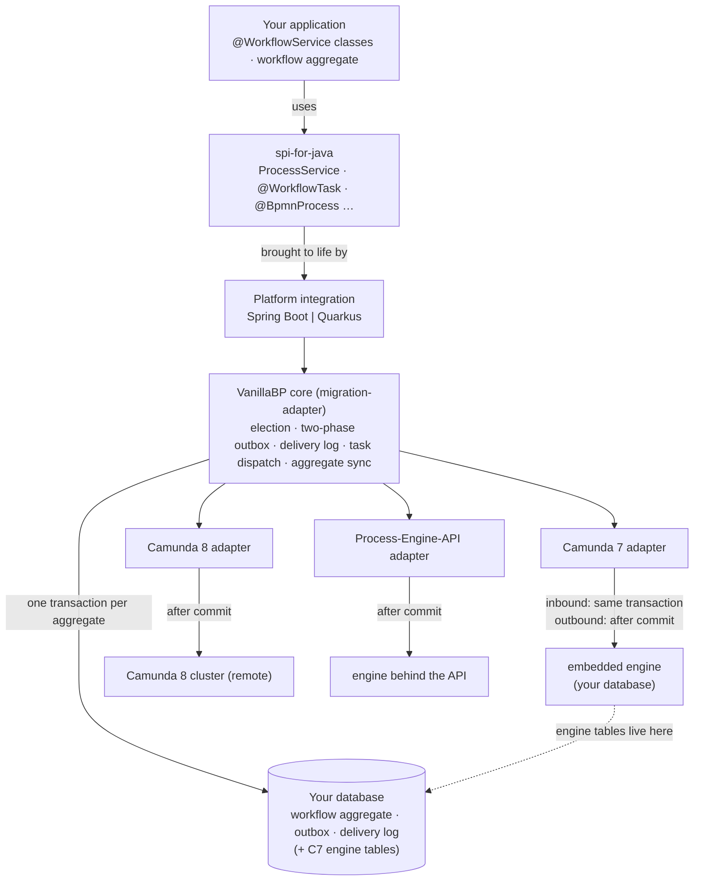

# Diagrams

One VanillaBP picture is a drawing, and it lives here. All the others are Mermaid blocks. Each one
sits inside the document which explains its subject. GitHub renders Mermaid without an export step,
and a reviewer can read in a diff what changed.

## The architecture overview

`overview.excalidraw` is the source, and `overview.png` is the export. The Home page of the wiki
shows the PNG and links back to the source. So export the PNG again whenever you change the
drawing. Otherwise the wiki keeps showing the old picture while the source says something else.

This one is not Mermaid because the place of each box is the content. Layers go from top to bottom.
Each engine sits under its adapter. The database stands next to everything which writes to it.
Mermaid's automatic layout put the database anywhere it liked. That does not help a reader who wants
to see who writes where.

Here is the same overview as Mermaid, for a page which cannot show an image:

## Where the other pictures are

All of them are in `migration-adapter/README.md`, each in the section which describes what it shows.
Change a picture in the same place where you change the text around it. There is no second copy of
the diagram source anywhere, and that is on purpose. Two copies drift apart, and the reader cannot
tell which one is current.

|                                              Picture                                              |                                              Section of `migration-adapter/README.md`                                               |
|---------------------------------------------------------------------------------------------------|-------------------------------------------------------------------------------------------------------------------------------------|
| Moving a workflow module from one BPMS to the next                                                | [BPMS election by prioritized adapters](../migration-adapter/README.md#bpms-election-by-prioritized-adapters)                       |
| The walk which asks each adapter whether it holds a workflow, and the second walk at the dispatch | [Awareness contract](../migration-adapter/README.md#awareness-contract-workflowawareness)                                           |
| Correlating a message, and what each adapter checks before the commit                             | [Waiting for a workflow to become visible](../migration-adapter/README.md#waiting-for-a-workflow-to-become-visible)                 |
| The order the core calls an adapter in while a workflow module deploys                            | [Deployment pipeline](../migration-adapter/README.md#deployment-pipeline)                                                           |
| One task delivered, and the same task delivered twice                                             | [Workflow-task processing](../migration-adapter/README.md#workflow-task-processing)                                                 |
| The contexts an adapter builds and hands to the core                                              | [Workflow-task processing](../migration-adapter/README.md#workflow-task-processing)                                                 |
| Camunda 7 on an engine datasource of its own, where the two commits are separate                  | [Deliveries VanillaBP already processed](../migration-adapter/README.md#deliveries-vanillabp-already-processed-taskdeliverylog-spi) |
| `startWorkflow` from the application, across the commit into phase two                            | [Phase one and phase two](../migration-adapter/README.md#phase-one-and-phase-two-phasetwooutbox-spi)                                |
| The same start on a time line which crosses a crash                                               | [Phase one and phase two](../migration-adapter/README.md#phase-one-and-phase-two-phasetwooutbox-spi)                                |
| What is left on `MigratableProcessService` once the handlers carry the operations                 | [An operation is defined once](../migration-adapter/README.md#an-operation-is-defined-once)                                         |
| Which points write the aggregate's shared values, and what reads them                             | [Pushing a changed aggregate](../migration-adapter/README.md#pushing-a-changed-aggregate-aggregatechanged)                          |
| A timer, signal or conditional start event firing in the BPMS                                     | [Workflows the BPMS starts itself](../migration-adapter/README.md#workflows-the-bpms-starts-itself-bpmsinitiatedstartinvoker)       |
| What an adapter registers per platform, and what it never implements                              | [What the platform hands an adapter](../migration-adapter/README.md#what-the-platform-hands-an-adapter-adaptercollaborators)        |
| The three transaction boundaries and which work belongs to which                                  | [The transaction the work runs in](../migration-adapter/README.md#the-transaction-the-work-runs-in)                                 |

## Two traps worth knowing before you edit one

In Mermaid, a semicolon separates statements. So a semicolon inside a message, a note or a
`participant … as …` alias ends the statement too early. Then the diagram does not parse at all.
You get no picture in IntelliJ and none on GitHub, only an error message. Six of the pictures above
could not be read for this reason, until somebody found it. Write a comma, a `·` or a second
sentence instead.

Angle brackets and round brackets are safe. Mermaid escapes `<` and `>` itself. So
`AdapterDeploymentService<BPMN,PC>` renders as written, and a `participant P as Platform (Spring /
Quarkus)` needs no quotes. A semicolon belongs in one place only: at the end of a `classDef` or
`class` statement. There it ends a statement instead of cutting one off.

Before you commit a changed diagram, render it once. `../bin/render-diagrams.sh` draws every
Mermaid block of every Markdown file in the repository. For a single file, run
`../bin/render-diagrams.sh migration-adapter/README.md`. It runs `npx -p @mermaid-js/mermaid-cli
mmdc`, the same renderer which GitHub and the IntelliJ plugin use. Where they fail quietly, it fails
with a clear error. Every pull request which changes a Markdown file runs it too.
