# Migration adapter

The migration adapter is the implementation of VanillaBP's adapter mechanism which runs under the
hood. The platform integrations do only the platform-specific work: they load the configuration
and analyze the business code. This module, which the platform integrations use as a dependency,
connects to the adapters of the supported BPMSs (business process management systems). So
VanillaBP behaves the same on every platform.

This file explains the core to the people who change it. If you BUILD an adapter and do not change
the core, read [`ADAPTER-AUTHORS.md`](./ADAPTER-AUTHORS.md) instead. It collects the duties from
the sections below into one document. A team without access to this workspace can read it from top
to bottom. If you build an EXTENSION, the same document for that side is
[`EXTENSION-AUTHORS.md`](./EXTENSION-AUTHORS.md).

## Two kinds of plug-ins: adapters and extensions

Everything which takes part in deploying a workflow module implements
`ExtensionWiringService<BPMN, PC>`. There are two kinds of implementations. The first thing to
understand about this module is how they differ:

|                     |                                                                 **BPMS adapter**                                                                 |                                                                           **Extension**                                                                           |
|---------------------|--------------------------------------------------------------------------------------------------------------------------------------------------|-------------------------------------------------------------------------------------------------------------------------------------------------------------------|
| Interface           | `AdapterDeploymentService<BPMN, PC>`, which *extends* `ExtensionWiringService`                                                                   | `ExtensionWiringService<BPMN, PC>`                                                                                                                                |
| What it is for      | It connects VanillaBP to ONE BPMS. It owns the BPMN model type, reads and deploys the models and runs every workflow operation against its BPMS. | It adds something ADDITIONAL to the deployment. It sees the models the adapter sees and wires its own concerns to them. It never talks to the BPMS for VanillaBP. |
| Owns the model?     | Yes. It reads, prepares and deploys it.                                                                                                          | No. It only looks at what the adapter read, and may add to it.                                                                                                    |
| How many per module | One per configured adapter id. Several BPMSs side by side are the migration scenario.                                                            | Any number                                                                                                                                                        |
| Examples            | `camunda7`, `camunda8`, `process-engine-api`                                                                                                     | the [VanillaBP Business Cockpit](https://github.com/vanillabp/business-cockpit)                                                                                   |

So an adapter is "the wiring service which owns the model". That is why the sections below
describe the pipeline once and note where extensions join it.

## Features

The migration adapter is "an adapter which knows about other adapters". It is the one place where
BPMS adapters plug in, and it decides for each workflow which BPMS it uses. This makes migration
possible without changes to the business code:

1. Migrating within the same BPMS (on-premises to SaaS, or between versions).
2. Migrating from one BPMS to another (e.g. Camunda 7 to Camunda 8).

### BPMS election by prioritized adapters

You configure the BPMS to use as a *prioritized list of adapters*
(`vanillabp.prioritized-adapters`). A workflow module can override the list
(`vanillabp.workflow-modules.<id>.prioritized-adapters`), and so can a workflow
(`...workflows.<bpmnProcessId>.prioritized-adapters`). The most specific value which is not empty
wins (see `MigrationAdapterProperties`).

- **New workflows** always start in the first adapter, the one with the highest priority.
- **Existing workflows** may still live in a BPMS used before. For operations on existing
  workflows (message correlation, completing tasks) the core asks the adapters in priority order
  whether they own the instance (`MigratableProcessService.awarenessOfTask` and
  `awarenessOfWorkflow`, which return a `WorkflowAwareness`). This is why eventual consistency has
  to be handled *here* and not in each adapter. A remote BPMS (like Camunda 8) may not know an
  instance *yet*, and only the migration adapter can decide to fall back to the next adapter in the
  list.

A migration has three states of one configured list, and the picture below shows them. First the
old BPMS is alone. Then both run side by side, while the workflows which already run finish where
they are. At the end the new one is alone, once the old one holds nothing any more.

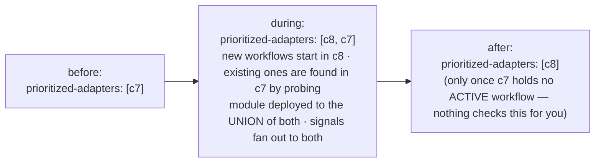

### Awareness contract (`WorkflowAwareness`)

When the core asks a BPMS whether it knows a workflow or a task, there are four possible answers
(`MigratableProcessService.awarenessOfTask(workflowAggregateId, taskId)` /
`awarenessOfWorkflow(aggregatePersistence, workflowAggregateId)`):

|       Value        |                            Meaning                            |        Migration adapter's reaction         |
|--------------------|---------------------------------------------------------------|---------------------------------------------|
| `ACTIVE`           | The BPMS knows the workflow/task and it is active             | Use this adapter                            |
| `COMPLETED`        | The BPMS knows the workflow/task but it was already completed | Use this adapter (operation comes too late) |
| `UNKNOWN_TO_BPMS`  | The BPMS definitely does not know the workflow/task           | Fall back to the next adapter of the list   |
| `BPMS_UNAVAILABLE` | The BPMS could not be asked (unreachable, timeout)            | Do **not** fall back. Retry later.          |

The difference between `UNKNOWN_TO_BPMS` and `BPMS_UNAVAILABLE` matters most. Only a sure "not
known" allows a fall-back to the next adapter. A failure which only lasts a while must not quietly
elect the wrong BPMS. There is a method for the instance (`awarenessOfWorkflow`) next to the one
for the task, because message correlation has no task ID, and task IDs are not unique across
BPMSs. `WorkflowLocatorTest` goes through the four answers one at a time (`activeStopsTheWalk`,
`unknownFallsThrough`, `completedIsReported`, `unavailableNeverFallsBack`). So if somebody slips a
fall-back into the unavailable branch, the build turns red.

The election runs in `WorkflowLocator` (one instance per process service). Every operation on an
EXISTING workflow walks the prioritized adapters with a probe made for that operation
(`awarenessOfTask`, `awarenessOfUserTask`, `awarenessOfWorkflow`). Such operations are complete
or cancel task, user task and message correlation, in phase one and again at the phase-two
dispatch. `ACTIVE` runs the operation there. `UNKNOWN_TO_BPMS` falls through to the next adapter.
`COMPLETED` does nothing and logs a warning. `BPMS_UNAVAILABLE` fails and names the adapter. It
NEVER falls back. New workflows always start in the adapter with the first priority, without a
probe.

The picture below shows the walk. The core probes a cached hint first, and then the other adapters
in list order. Each of the four answers ends the walk in its own way. For an operation on a
workflow without a hint in the cache, the row written when the workflow started is the hint (see
"Waiting for a workflow to become visible").

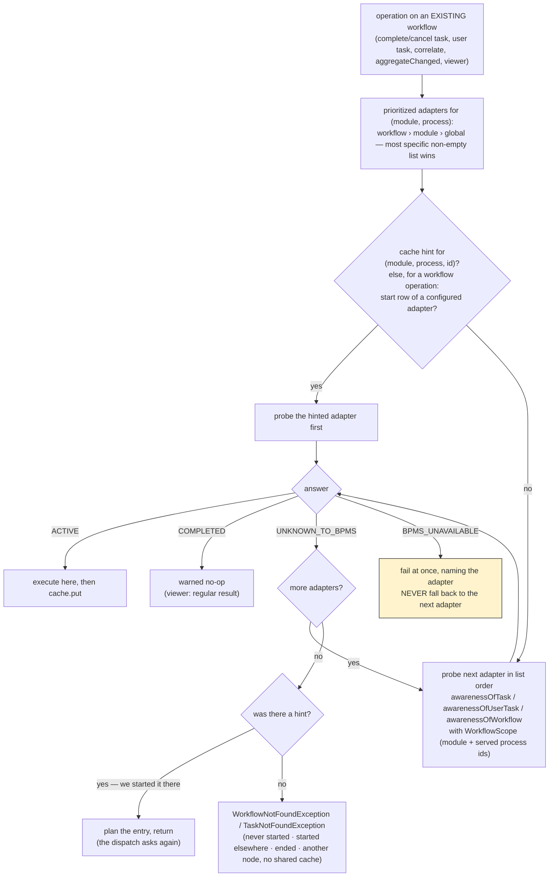

The CALLER decides how long the walk may take (`WorkflowLocator.Patience`), because the same walk
runs in places with very different costs. In **phase one** it runs inside the application's
transaction. It holds a database connection and the locks on the workflow aggregate. So it asks
every adapter once and never sleeps. At **dispatch** time no transaction of the application is
open. So a BPMS which cannot be reached is worth two more questions (500&nbsp;ms apart, fixed, by
the rule "optimize late"). And a read model which has not caught up is worth its window. A **read**
of the viewer/history API waits for the same window, for the opposite reason. No outbox entry
stands behind it which could ask again later, so whatever it does not wait for becomes an error in
the application. The **election an extension asks for** waits for that reason too. It is the one
caller which may wait inside a transaction of the application, and the cost of that is measured
below. Decision 5 says why the line is drawn there. Three tests hold the three patiences:
`WorkflowLocatorTest#withoutPatienceAHintedAdapterIsAskedOnce`,
`#withoutPatienceAnUnavailableBpmsFailsAtOnce` and
`#retryingPatienceDoesNotWaitForVisibility`.

At the dispatch, the same walk gets a loop for a BPMS which cannot be reached. The walk in phase
one must not have this loop. A workflow which is not visible yet gets no loop at all. The entry
goes back to the store and is due again in the window, because the lane it would wait on also
carries the entries of other workflows. The first picture ends in an exception. This one ends in an
entry which is repeated and, in the end, blocked.

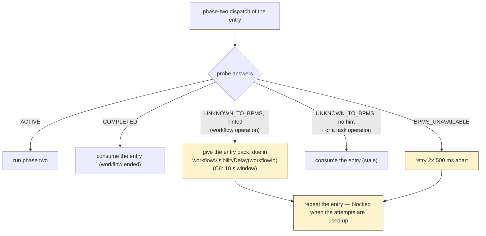

An adapter which cannot ask its BPMS at all says so (`canLocateWorkflows()`, `default true`). The
core then refuses to boot a workflow module which lists that adapter next to another one. Such an
adapter answers optimistically. The walk stops at the first `ACTIVE`, so the operations of every
adapter behind it in the list would end up in the wrong BPMS. The check runs after the adapters
deployed and before anything touches a workflow. (Camunda 8 learns from its first failed query
whether the cluster has secondary storage.) An application which wants that routing anyway sets
`vanillabp.election.guessing-adapters: ACCEPTED` (per module:
`vanillabp.workflow-modules.<id>.election.guessing-adapters`). The message then stays as a WARN.
`GuessingAdapterStartupTest` boots such a pair and expects the refusal on both platforms.
`AcceptedGuessingAdapterStartupTest` covers the accepted variant.

The walk cannot check the answers, so the SPI (service provider interface) writes down that duty.
An adapter answers ONLY for the workflows and tasks of the scope it is asked about. Everything else
is `UNKNOWN_TO_BPMS`. Every probe gets that scope as a `WorkflowScope`: the workflow module and the
BPMN processes which the calling process service serves, secondary ones included. The platform
integrations collect them when they register the process services
(`MigrationProcessService.setServedBpmnProcessIds`). Before that, a probe knew only the ID of the
workflow aggregate. Neither that ID nor a task ID says whose workflow it is. Two adapter ids may
address one backend (the migration from one scoping to another). And two workflow modules of one
backend may carry the same aggregate ID. Only the adapter can compare the scope, so the contract
sits in `MigratableProcessService`. `ElectionScopeContractTest` holds three parts of it. The walk
reaches the holder where the answers are scoped. It stops at the wrong adapter where one claims
more than it holds. And an adapter does not claim a workflow of another workflow module of the same
adapter. The shared-cluster setups of Camunda 8 and Camunda 7 show what happens without the
contract.

Successful elections fill a `WorkflowAdapterCache` (an integration SPI; the key is workflow
module, BPMN process and serialized aggregate ID, the value is the adapter ID). The next election
probes the cached adapter first. Entries are HINTS, not truth. A stale hit (the adapter answers
`UNKNOWN_TO_BPMS`) falls through to the full walk and repairs the entry. `BPMS_UNAVAILABLE` on a
cached adapter follows the rule "retry, never fall back". The platform integrations provide a
default in memory which is bounded and expires (`InMemoryWorkflowAdapterCache`, 10&nbsp;000 entries
and 1&nbsp;h TTL by default, both configurable, see below). An application bean which implements
`WorkflowAdapterCache` replaces it. That is how a cluster shares its elections. For Hazelcast that
bean is shipped, in
[hazelcast-shared-election-cache](https://github.com/vanillabp/hazelcast-shared-election-cache).
There the nodes of the application form the cluster themselves. On any other cache infrastructure
the application writes the bean, and this SPI was written for that case. Tests hold these rules.
`WorkflowLocatorTest#staleCacheHitIsRepaired` and `#unavailableCachedAdapterNeverFallsThrough`
hold what a hint is worth. `InMemoryWorkflowAdapterCacheTest` holds the bounded default.
`MigrationElectionTest#applicationProvidedCacheReplacesTheDefault` holds the replacement by an
application bean.

The BPMN process of that key is the one which was running when VanillaBP learned the answer. A task
of a secondary process is delivered to the instance of THAT process, while the application calls
its operations on the primary one. So the write stays where it is, and the READ asks for every id
the workflow service serves (`WorkflowLocator.setBpmnProcessIdsToReadUnder`, fed from
`servedBpmnProcessIds`). The reading instance's own id comes first. A hint found under another id
is dropped or marked where it sits, not under the own id. A second entry would leave the one which
is read next time with the old answer.
`WorkflowLocatorTest#aHintOfACalledProcessIsReadAndItsWindowIsWaitedOut` and
`#aStaleHintOfACalledProcessIsRepairedWhereItLives` hold both parts.

### An ended workflow lets go of its hint

The end of a workflow used to be an inbound delivery like any other. So it REFRESHED the hint of a
workflow which had just become uninteresting. The entry then stayed for a full time-to-live in a
cache a cluster pays for. Now the end MARKS the hint instead (`WorkflowAdapterCache.putEnded`,
`WorkflowLocator.rememberWorkflowEnded`). A probe which answers `COMPLETED` does the same.

A mark is not a deletion, and that is the point. Some calls still arrive after a workflow ended: a
`completeTask` which lost its race with a timeout, a message from an endpoint which did not learn
about the end, an outbox entry dispatched after the end, and a read of the viewer API. With the
hint, each of them asks the adapter which held the workflow. It hears `COMPLETED` and does nothing
but log a warning. Without the hint the full walk runs. It ends in a `WorkflowNotFoundException` as
soon as the BPMS has forgotten the instance. When that happens depends on Camunda 7's
`history-time-to-live`, or on how long Camunda 8's secondary storage keeps a finished process. The
mark changes the lifetime: `vanillabp.workflow-adapter-cache.ended-time-to-live` (five minutes)
against `.time-to-live` (one hour). The two are checked against each other at startup
(`WorkflowAdapterCachePropertiesTest#endedTimeToLiveHasToBeShorter`).

The key is workflow module, BPMN process and aggregate ID. It does not name the instance, so a
second workflow on the same aggregate writes the same entry. So order matters, and the place where
the entry is written handles it. A mark leaves an entry which names ANOTHER adapter alone, because
only the election of that second workflow can have written it. The key cannot tell apart two
workflows on the same aggregate in the SAME adapter. So a late mark shortens the fresh hint. That
costs one walk, never a wrong route.

`vanillabp.workflow-adapter-cache.release-on-workflow-end` (default `false`) is what makes the
notification arrive at all. VanillaBP lets a BPMS report the end of a workflow only where somebody
asked for it. This is the third user of that one signal, next to a `@WorkflowEnded` method and
`vanillabp.delivery.release-on-workflow-end`. Switching it on attaches a listener or a worker to
every deployed process of the module. If one of the other two asked already, the cache gets the
signal at no extra cost. It is still best effort. The Process-Engine-API reports no end at all, and
Camunda 8 reports a `CANCELED` workflow only from its 8.10 line on. So the lifetime stays the
backstop and not the exception.

An application's own cache decides for itself. `putEnded` is a `default` method which falls back
to `put`. So a cache written before this method existed compiles and behaves exactly as it did. A
cache which wants the saving implements the method and gives such an entry a lifetime of its own
(Redis: its own `EX`; Hazelcast: a `ttl` per entry).

These tests hold all of this. `WorkflowLocatorTest#theEndMarksTheHint` and its two
`completed*MarksTheEntry` siblings hold the marking. `#aCacheWithoutTheMarkKeepsWorking` holds the
`default` method. `InMemoryWorkflowAdapterCacheTest#endedEntriesExpireEarlier` and
`#aSecondWorkflowOnTheSameAggregateWins` hold the two lifetimes and the shared key.
`WorkflowEndedTest#theCacheReleaseAsksForTheEndNotification` holds the switch which makes the
notification arrive at all.

### Sizing the election cache, and knowing when to

Both bounds are properties of the platform, not of an adapter:
`vanillabp.workflow-adapter-cache.max-entries` and `.time-to-live`
(`WorkflowAdapterCacheProperties`). They are checked at startup like everything else, and today's
values are the defaults. An application which runs several thousand workflows of one process at
the same time does not run out of memory. The map is bounded, and a full cache costs about
3&nbsp;MB. Instead it runs into EVICTION PRESSURE: there are more hot workflows than places, so
entries are dropped before anybody reads them.

**Why the bound is a number and not a soft reference.** We looked at soft references and said no.
The JVM clears them only when it is nearly out of heap. So the cache would grow into the old
generation and be reclaimed exactly when the application is under pressure anyway. Full GCs visit
every soft reference, and that makes the pauses longer, which this kind of application cares about
most. A soft reference would also swap a fixed bound for one which depends on GC tuning
(`-XX:SoftRefLRUPolicyMSPerMB`), and the loss of this cache is cheap by design. And the numbers do
not call for it: 100.000 entries are about 30&nbsp;MB, and raising the bound is the cheaper answer.
Both memory figures are estimates from the size of one entry, not measurements. A heap dump of an
application with a full cache would correct them. An application which really wants soft or
off-heap behaviour has the SPI bean for it.

**What is measured, and who owns which number.** There are two sets of numbers, and the split is on
purpose.

`WorkflowAdapterCacheStatistics` (one per application) counts what the ELECTION asked: hits,
misses, and how often the end of a workflow was marked. The process services wrap WHATEVER cache is
in use into an `InstrumentedWorkflowAdapterCache` which reports there. So these three numbers exist
for the default in memory, for the shared cache VanillaBP ships for Hazelcast, and for a cache an
application wrote itself. A number which disappears once somebody plugs in their own cache would
surprise exactly the operator who needs it. `WorkflowAdapterCacheMeters` publishes them under
`vanillabp.workflow.adapter.cache.*`.

What an implementation knows about ITSELF belongs to that implementation. It is published under a
prefix which names the implementation. The default in memory owns an
`InMemoryWorkflowAdapterCacheStatistics`. Its constructor creates it, and nobody else writes it. It
holds the size, the number of marks, the evictions, the evictions of entries never read, and the
LOST HINTS. `InMemoryWorkflowAdapterCacheMeters` publishes them under
`vanillabp.inmemory.election.cache.*`. It registers NOTHING where another cache is in use. That is
the point. If a size cannot be read, its meter is absent; it does not report NaN forever. And an
eviction counter which can never leave zero is not published either (the Hazelcast cache has no
size bound at all). A cache which lives somewhere else reports what it knows the same way, under a
prefix of its own.

The number of marks tells an operator whether the release works. It rises while workflows end, and
it falls again as the shorter lifetime takes those entries away. Micrometer is OPTIONAL for all of
it. Both platforms apply `MeterBinder` beans to their registries by themselves. So an application
without Micrometer boots unchanged and reports nothing.

**The warning is about lost hints, not about a full cache.** A cache which is only full is
healthy. An entry evicted before anybody read it is not a defect by itself: a workflow which starts
and then never gets an operation leaves exactly such an entry behind. It becomes a defect when
somebody DOES look up that workflow later. Then the bound decided the outcome, not the workflow. So
the cache remembers the keys of unused evictions (as hash codes, bounded like the cache). A later
miss on such a key is a lost hint. Ten of them within an hour produce ONE WARN with guidance. It
names the number seen, the period of observation and the property to raise. Heap pressure is on
purpose not the trigger, because the cache cannot see the old generation and the JVM does not tell
it. `InMemoryWorkflowAdapterCacheStatisticsTest` holds the counting and the rule for the warning:
`lookupOfAnEvictedEntryIsALostHint`, `onlyUnusedEvictionsCountTowardsThePressure` and
`evictionPressureIsWarnedAboutOncePerHour`.
`WorkflowAdapterCacheStatisticsTest#theElectionsNumbersHoldForEveryCache` holds that the numbers of
the election exist for every cache.
`WorkflowAdapterCacheMetersTest#aForeignCachePublishesNothingItCannotKnow` holds that no meter of
the cache in memory exists while another cache is in use.

The cache detects the lost hint, not the decorator around it, because only the cache knows that it
dropped this key. The miss itself is still counted where every miss is counted.

The workflow probe takes the aggregate's persistence. A BPMS without a business key finds the
workflow by the process variable which carries the aggregate's ID. That variable is named after
the aggregate's ID attribute (`AggregatePersistenceAware.getAggregateIdName()`). The election runs
BEFORE every other SPI method of an operation. So an adapter must never take the name from an
earlier call. Camunda 8 did exactly that once and searched under a placeholder name. On a cluster
with secondary storage that found nothing, and every workflow was reported as unknown.

To migrate, you put the new BPMS first in the priority list and keep the old one in the list. New
instances start in the new BPMS, and existing instances finish in the old one.

### Waiting for a workflow to become visible

Some BPMSs answer from a read model which is eventually consistent. Camunda 8, for example,
searches its query API, and an exporter fills it. An election which asks such a BPMS about a
workflow started a moment ago gets an honest "unknown". If the core turned that into
`WorkflowNotFoundException`, the exception would name causes which are all wrong. And it would hit
the most ordinary sequence there is: start a workflow, then correlate the message which lets it go
on.

Four pieces solve it, and the split matters:

1. **The adapter gives the window, the core does the waiting.**
   `MigratableProcessService.workflowVisibilityDelay()` is a `default` which returns
   `WorkflowVisibilityDelay.none()`, so no adapter breaks. It answers how long an
   `UNKNOWN_TO_BPMS` may still turn into `ACTIVE`, and how often to ask. Camunda 7 answers from
   the same transaction which created the instance and reports none. Camunda 8 reports
   `vanillabp.adapters.<id>.workflow-visibility-timeout` (default 10 seconds, zero switches it
   off). Eventual consistency is the core's business. The timing is the adapter's. What the core
   actually asks is `workflowVisibilityDelay(workflowId)`: the same window for one workflow. So an
   adapter which knows that workflow can name a shorter one. Its default answers the window above,
   and that is what every adapter written before this does.
2. **A hint limits the waiting. It is never a general wait.** VanillaBP waits only for an adapter
   which the `WorkflowAdapterCache` names for that workflow. For an operation on the workflow
   itself, it also waits for the adapter which the row written at the start of the workflow names.
   A workflow nobody ever heard of has no hint and fails at once. A wrong ID has to fail that way.
   Waiting the full window on every typo would turn a programming error into a timeout.

   The start row is the hint which survives. The cache lives in the memory of one node and forgets
   after its time-to-live. So a restart, a second node which takes over an outbox entry, or an hour
   without an operation used to leave an operation on a running workflow without a hint. While the
   BPMS' read model was behind, phase one then threw `WorkflowNotFoundException`, and the dispatch
   consumed the entry as stale. That work was lost for good. We measured it against Camunda 8.10.0
   with a stopped exporter on 2026-10-04. A restart after six minutes consumed all 480 waiting
   `aggregateChanged` entries that way. The row is in the application's database, so it counts as
   a hint wherever the cache has none. A row which names an adapter the workflow is no longer
   elected among does not count. `AnOperationReadsTheStartRowTest` holds the core, and
   `WorkflowVisibilityDelayTest#anOperationAfterARestartWaitsForTheWorkflow` holds both platforms.

3. **The cache is filled where VanillaBP knows the answer without asking**
   (`MigrationProcessService.rememberWorkflowAdapter`). That is when a start is SCHEDULED (the
   elected adapter is decided then), again after its phase two, and on every inbound delivery: a
   task, a user task, a start initiated by the BPMS. The end of a workflow is the one delivery
   which marks the hint instead of refreshing it (see above). For the deliveries, the inbound
   contexts carry the adapter's id (`TaskInvocationContext.getAdapterId()` and its siblings,
   `default null`, implemented by all three adapters). A delivery PROVES which BPMS holds the
   workflow.

   The record at SCHEDULING time is what makes the sequence work at all. On a remote BPMS the
   instance is created after the commit. So a correlation in the very next transaction runs its
   election before phase two ever ran. Without the early hint it would find nothing to expect. The
   price is the usual price of a hint. A start which is rolled back leaves an entry behind. The
   next operation on that aggregate ID is then planned and dispatched until the outbox blocks it,
   instead of failing at the call.

4. **The waiting happens at the dispatch and in a read. Phase one never waits.** Phase one asks
   once. If the answer is "unknown" but a hint says the workflow exists, the operation is PLANNED:
   the aggregate is saved, the outbox entry is written, and the caller returns. The dispatch asks
   again. While the BPMS still says nothing, it gives the entry back, due again in the window. In
   everyday operation (Camunda 8 lags one to three seconds) that costs one attempt and nobody gets
   an error. While an exporter is broken, it costs attempts until the entry is blocked, and that is
   where it becomes visible. Some work hangs on a JOB: a `@WorkflowTask`, or an asynchronous task
   whose completion does not arrive. There the cluster runs out of job retries and Camunda raises
   an incident of its own. Where no job is behind it (a correlation from a REST endpoint), the
   blocked entry and its counter are the place where it shows. Decision 5 covers this, and what
   it costs.

   A read of the viewer/history API (`getProcessDefinitions`, `getWorkflowHistory`) is the first
   of two callers which wait for themselves. It has no phase two to plan, and nothing repeats it
   later. So it waits where a hint says which adapter holds the workflow. A viewer asks all day for
   the history of a workflow the application started seconds ago. The few seconds by which Camunda
   8's exporter lags must not answer that with `WorkflowNotFoundException`. The row written when
   the workflow started counts as a hint, as it does for an operation (decision 5). So a second
   node, or a node after a restart, waits for a young workflow too, although its cache never saw it.
   `TheViewerReadsTheStartRowTest` holds this. Without a hint the read still fails at once. A hint
   which never comes true costs the window. Then the failure names the adapter which was expected
   to answer.

   The election an extension asks for (`WorkflowElection#adapterIdOfWorkflow`) waits the same way,
   for the same reason: nobody repeats an extension's question either. Unlike a read it is not
   free. An extension which REPORTS something calls it while the transaction which wrote what it
   reports is still open. The Business Cockpit does exactly that on every `aggregateChanged`. That
   is how a report from a service task ends up holding a connection for ten seconds. The cost is
   measured below.

**What we did NOT build, on purpose: an outbox query.** A `START_WORKFLOW` entry which is still
`OPEN` would prove "too early, not unknown". One which became `DONE` a moment ago would prove
"exactly the window we are waiting for". We left it out:

- The outbox can only ever give the POSITIVE half. This VanillaBP need not have started the
  workflow. Think of a version-1 application which migrated, a start by another system, a start
  initiated by the BPMS (which writes no entry at all), or a `DONE` entry which was cleaned up. In
  all these cases the outbox says nothing while the workflow runs perfectly well.
- It would need a new query method in EVERY store implementation: the JDBC store both platforms
  run, the two MongoDB stores, the gruelbox store in its own artifact, and any store an
  application wrote itself.
- Compared to the cache, it would help in one case only: the start ran on ANOTHER node of a
  cluster, and the correlating node does not share that node's cache in memory. The
  `WorkflowAdapterCache` bean exists for exactly that case. An application which runs as a cluster
  plugs in its shared cache. That is cheaper than teaching every outbox store a query.

So one gap remains, and it is honest and documented. Take a cluster WITHOUT a shared cache, and an
operation on a TASK which reaches a node that neither started the workflow nor received a delivery
for it. That operation has no hint, so it fails at the call while the BPMS catches up. The start
row covers an operation on the workflow itself. It does not cover a workflow started before the row
existed, or one started by an adapter which reports no workflow id. A retry of the business
operation works, and so does a shared cache. The `WorkflowNotFoundException` says so when an
eventually consistent adapter is configured.

The other gap is the mirror image. An operation with a hint, whose workflow really is gone (ended
long ago and cleaned out of the read model), is planned instead of refused. Its entry is repeated
and in the end blocked, and the counter of blocked entries is where it shows. That is the price of
never refusing an operation on a workflow which only is not searchable yet. The start row makes
this window longer. It is kept for `vanillabp.delivery.workflow-start-retention` (thirty days)
instead of the cache's hour. So a workflow which ended and was cleaned out of the read model within
that period ends as a blocked entry, not as a refused or consumed call.

### What an election costs a caller which holds a transaction

Sometimes the row written at the start of the workflow names an adapter which is still configured
for the workflow. Then `adapterIdOfWorkflow` and `locationOfWorkflow` answer from that row, and
none of the costs below are paid: no BPMS is asked and nothing is waited for. The adapter of that
row started the workflow. A workflow does not change its BPMS, so that adapter holds it until its
end. The same row is also why the two methods do not throw after a workflow ended, as long as the
row lives. Without such a row, or where it names an adapter the configuration dropped, the election
runs as measured here. `TheElectionReadsTheStartRowFirstTest` holds both ways.

We measured on 2026-09-14 against the BPMS double, with Spring Boot, H2 and a HikariCP pool of four
connections. The double reported the window and the probe interval which the Camunda 8 adapter
reports out of the box (ten seconds, 250 ms). The caller opens a transaction, reads the workflow
aggregate through it and then asks the election. A `@WorkflowTask` which reports a change runs in
this shape.

|          what the caller meets          | the transaction is open for | the adapter is asked |
|-----------------------------------------|----------------------------:|---------------------:|
| the read model has caught up            |                      3.9 ms |               1 time |
| the read model is behind, a hint exists |                   10 076 ms |             41 times |
| no hint, so nothing is waited for       |                       <1 ms |               1 time |

The wait is about the window. The 41 questions are the first one plus one every 250 ms, and they
add 76 ms to the ten seconds. Once the window is used up, the walk asks the other adapters. It
skips the one it already asked, so it never pays a second window.

What a few such callers do to the rest of the application, measured in the same run with four of
them at once:

|            four reports at once             |                              what was measured                               |
|---------------------------------------------|------------------------------------------------------------------------------|
| each transaction was open for               | 10 046 to 10 072 ms                                                          |
| the pool while they waited                  | 4 active, 0 idle                                                             |
| an unrelated caller asking for a connection | refused after 1 003 ms with `Connection is not available, request timed out` |

The last row is the point. The four reports have nothing to do with each other, or with the caller
they lock out. Four threads which sleep on a BPMS emptied the pool of the whole application, and
everything else it does stopped with them. Four is the pool size here, so read it as a ratio and
not as a number. A pool of twenty needs twenty reports at the same time. One lagging exporter and a
handful of busy service tasks produce that, and none of it is unusual.

`WhatAnElectionCostsATransactionTest` in
`spring-boot-integration/integration-tests/election-cost-integration-test` holds both shapes. It
runs with a window of 1.5 seconds, because a build should not pay ten seconds twice for a number
which is already written down here.

An adapter can make the middle row of the first table smaller. The core asks
`workflowVisibilityDelay(workflowId)` for the workflow it waits for. So an adapter which already
knows something about that workflow may answer a shorter window than a freshly started one needs,
and today's window for everything else. It may only shorten the wait. The answer after the shorter
window is still the honest one, and a workflow which ended is `COMPLETED` and never
`UNKNOWN_TO_BPMS`.

Correlating a message is the operation where both patiences show up in one call. The picture
follows such a call from the caller's transaction to the BPMS. Phase one asks the adapters once and
lets the caller commit. The dispatch asks again and publishes the message as soon as the BPMS
reports the workflow. That may take an entry or two.

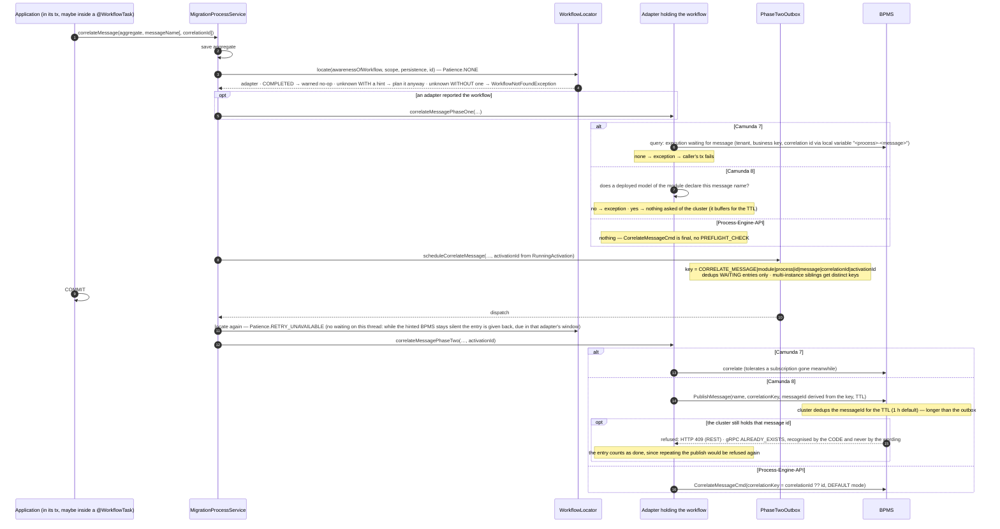

Starting a workflow by a message has the same shape. It derives the idempotency key of the plain
start. So a workflow starts at most once per aggregate, no matter which of the two calls started
it.

`WorkflowVisibilityDelayTest` runs the ordinary sequence on both platforms
(`correlationIsPlannedAndDispatchedWhenTheWorkflowShowsUp`, `unknownWorkflowStillFailsFast`).
`WorkflowLocatorTest#withoutAHintAnUnknownWorkflowIsNotExpected` and
`#hintedAdapterIsAskedAgainWithinItsVisibilityWindow` hold the two halves of the hint rule.
`ViewerApiTest#readWaitsForAnEventuallyConsistentAdapterToCatchUp` and
`#readFailsAfterTheVisibilityWindowPassed` hold the read path.

### The election may carry the BPMS' own id of the workflow

`MigratableProcessService.awarenessOfWorkflow` has a fourth argument, and every election about a
workflow passes it: both phases of an operation on the workflow, the election an extension asks
for, and the read of the viewer API. It is the BPMS' own id of the workflow, or `null` where
VanillaBP holds none.

Why it is worth passing: we measured on three Camunda 8 clusters in September 2026. The engine knows
a new instance 16 to 19 ms after the create was sent. The search which `awarenessOfWorkflow` uses
finds it after 167 to 1324 ms. After a cancellation the engine says "gone" after 21 ms, and the
search needs 176 to 2068 ms to agree. So the engine answers far earlier than its index, and every
command which asks the engine addresses a key.

- An adapter may use it to SHORTEN A YES. It asks the engine by the key and answers `ACTIVE`
  without waiting for the read model.
- It may NOT use it to turn a negative answer into `UNKNOWN_TO_BPMS`. An engine forgets a workflow
  the moment it ends. So an unknown key does not tell `COMPLETED` from `UNKNOWN_TO_BPMS`, and only
  the second one lets the election move on to the next BPMS. In a migration setup that would send
  the next operation to the wrong BPMS.
- The default drops the id and calls the question with three arguments. So every adapter written
  before this still compiles and behaves the same (`ElectionWithAWorkflowIdDefaultTest`).
- Where the core takes the id from: first the row written at the start of the workflow, then the
  open delivery records of that aggregate, then the election cache. The cache keeps the id next to
  the adapter id, since it learns both from every delivery. No BPMS is asked anything new for it.
- Phase two of an operation on a workflow carries the id too, as `PhaseTwoRequest#workflowId()`.
  It does so only where the start row names the adapter which runs that phase two. Some adapters
  would otherwise search for the key of the workflow, as Camunda 8 does to push a changed
  aggregate. Such an adapter can use the id instead and needs no read model for that operation.

`WorkflowAdapterCache.hintOf` reads both in one call, because a shared cache charges a round trip
per read. `put(..., adapterId, workflowId)` writes them. Both are `default` methods. So a cache an
application wrote stays valid and simply keeps no id.

The window the core waits out carries the same id. The core asks
`workflowVisibilityDelay(workflowId)` and not the adapter's one window. So an adapter may be patient
with a workflow which started a moment ago, and quick with one it already knows is gone. The rules
are the ones above, and the default answers `workflowVisibilityDelay()`.

### Deployment pipeline

`DeploymentService` runs the deployment per workflow module:

1. Resolve the adapters the module has to be deployed to, and find the matching
   `AdapterDeploymentService` by adapter ID. This is the **union** of the module's effective list
   of prioritized adapters and every adapter named in a `prioritized-adapters` override of a
   workflow of that module. BPMS election works per process, but deployment works per file. So an
   adapter prioritized for one workflow only still has to receive the module's resources.
   Otherwise the start of that workflow would fail at runtime. Every adapter of the union receives
   the module's *full* resources. We looked at filtering per process and said no. BPMN files may
   contain several processes, and adapters deploy whole files. Extra processes deployed to an
   adapter do nothing, because the election routes the workflow starts. And during a BPMS
   migration it is even good to have the module's complete model in both BPMSs.
2. Load the BPMN resources, either from an adapter-specific `resources-location` or from the
   generic VanillaBP BPMN files. The loader is asked per file extension, so the same location
   answers for `.bpmn` and for `.dmn`.
3. For each file run the pipeline `readBpmn` → `prepareBpmn` (per process) → `wireBpmn`
   (adapter) → `wireBpmn` of all matching `ExtensionWiringService`s. The adapter-specific
   *processing context* (generic parameter `PC`) collects across all executable processes of a
   file and across all files of a module. Extensions receive the same processing context as the
   adapter's `wireBpmn`. Extensions are matched by assignability, so they may declare interfaces as
   model or processing-context type.
4. Read the module's `.dmn` files into the same processing context (`readDmn`), after its
   processes. A decision which a business rule task calls belongs to the module and is deployed
   with it. The context it is added to is what reading a process produced. A module without an
   executable process is skipped as before. The warning then says that its decision tables are not
   deployed either, because a decision travels with the processes which call it and never on its
   own. The SPI method is a `default` which takes no file and says so once per file. So an adapter
   written before this existed keeps working. And the application is told, instead of being left
   with a business rule task for which nobody deployed anything.
5. `deployResources` pushes the result to the BPMS. A failing deployment stops the boot. The
   exception is an adapter whose `deployment-failure` policy is `warn` *and* which is first
   priority neither for the module nor for any of its workflows. After all adapters are processed,
   a WARN reports configured workflow IDs (`vanillabp.workflow-modules.<module>.workflows.<id>`)
   which match no executable BPMN process found. It names the known process IDs. This is not a
   failure, since the BPMN may arrive later, e.g. during a BPMS migration. The process IDs are
   known only after `readBpmn`. That is why this check lives in the pipeline and not in the early
   validation of the properties.
6. Once the application is ready, `startWorkflowProcessing` is called for adapters and extensions.
   Only then are workflows actually processed. It is called for *every* adapter which received
   resources, not only the one with the highest priority. During a BPMS migration all configured
   BPMSs have to keep processing workflows.
7. On graceful shutdown of the application, `stopWorkflowProcessing` is the counterpart of step 6,
   in reverse order. Extensions stop first (in reverse wiring order), then the adapters. The
   platform integrations wire it (Spring Boot: `SmartLifecycle.stop()`; Quarkus: a
   `ShutdownEvent` observer). So no new workflow jobs are processed while the web and messaging
   infrastructure shuts down.

The pipeline is a protocol and not just a set of calls, and the picture shows that. It shows the
order in which the core calls an adapter, and the points where the adapter calls back into the core
while it reads a file.

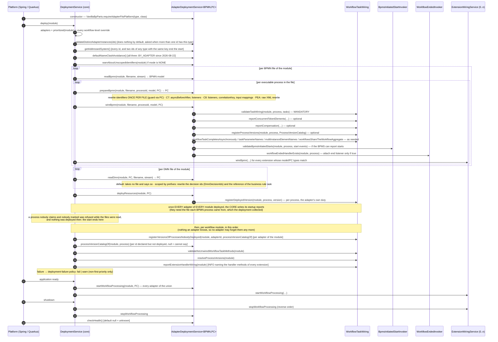

`DeploymentServiceTest` holds the pipeline itself. That includes the deployment union with an
override on a workflow (`workflowLevelAdapterIsIncludedInDeploymentUnion`), the WARN about a
configured workflow id which no BPMN process matches (`unknownConfiguredWorkflowIdIsWarned`) and
the reverse shutdown order (`extensionWiringServicesAreStoppedBeforeAdapters`).
`DeploymentPipelineTest`, `MultiAdapterDeploymentTest` and `ShutdownReverseOrderTest` run the same
against a booted application per platform.

### Name-clash avoidance (`NameClashAvoidanceSupport`)

One property per adapter decides how the identifiers of one workflow module are kept apart from
those of another module: `name-clash-avoidance`. Its values are `BY_ADAPTER` (the behaviour of
VanillaBP 1: the BPMS' own isolation, e.g. a tenant named after the module), `USE_PREFIX` (no
tenant; VanillaBP puts a prefix in front of the identifiers, separator `__`) and `NONE`. The core
owns both the resolution and the building of the strings. For the resolution the most specific
level wins: workflow > workflow module > adapter. The class is
`NameClashAvoidanceService implements NameClashAvoidanceSupport`, and every adapter gets it as a
platform bean.

Without any configuration the ADAPTER's default applies
(`AdapterDeploymentService#defaultNameClashAvoidance`, `BY_ADAPTER` unless overridden). No shipped
adapter overrides it. All three answer `BY_ADAPTER`, because VanillaBP 1 deployed that way, and an
upgraded application has to find its workflows in their tenants. For eleven days both Camunda
adapters answered `NONE`. A Camunda 8 cluster from the stock image needs that: it has
multi-tenancy switched off and rejects a deploy command which carries a tenant id. That case now
gets a boot failure with guidance which names `use-prefix` and `none`, not a different default.
The platform integrations hand the adapters' deployment services to the service as a supplier
which is resolved lazily. (The adapters receive the service themselves, so they cannot be
injected into it.)

`BY_ADAPTER` means "the BPMS' own isolation", and the core does not know what that IS (a tenant, a
namespace, a database of its own). So it computes none of it. The adapters derive the tenant
themselves from the resolved mode (`Camunda8Scoping` and `Camunda7Scoping`). This code is
duplicated on purpose: the rule is one line, and the concept belongs to the adapters. The core
answers `modeFor` and nothing else.

The same split holds for validation. Some configuration of an adapter only makes sense under
BY_ADAPTER. Such an adapter hands the PROPERTY KEY to `validateNoneNameClashStrategy`, and the core
answers whether BY_ADAPTER applies anywhere for that adapter. If it does not, the boot fails. The
message names the property, the modes which do apply and the two ways to make them fit. Both
Camunda adapters pass their `tenant-id` this way.

And the same split holds for asking the BPMS itself. Camunda 8 looks up the tenant in the cluster
before it deploys. A cluster without multi-tenancy, or an unknown tenant, becomes a message which
names the property to change. Camunda 7 has nothing to ask: a tenant id is an attribute of the
deployment there, and the engine creates nothing.

`NONE` protects nothing. So the core has the ADAPTER report it once per workflow module and
adapter id while the mode is resolved, i.e. at startup
(`AdapterDeploymentService#warnAboutUnscopedIdentifiers`). What to use instead is BPMS knowledge.
Camunda 8 offers prefixes, a tenant per module on a cluster with multi-tenancy, or a cluster per
module. Camunda 7 offers prefixes, a tenant per module or an engine per module
(`data-source-name`, `table-prefix`). The default implementation names what every BPMS can offer.

An adapter only decides WHERE to apply the result:

- In `prepareBpmn`, on its own model type, because only the adapter knows that type. Note: the
  pipeline calls `prepareBpmn` once per PROCESS, but all processes of a file share ONE model. So a
  model must be rewritten **once per file**. The adapters guard this by checking whether the file
  is already in the processing context.
- At every runtime boundary, outbound (`scoped*`) and inbound (`plain*`). Inbound always strips a
  KNOWN prefix, never "everything up to the first separator".

Nobody else sees the result. Registries, `ProcessService` calls, BPMN files and configuration keep
the PLAIN identifiers. Only the BPMS sees scoped ones. Which identifiers really need scoping
depends on the BPMS, and each adapter's wiki documents it. Camunda 7 does not prefix task
definitions, because they are expressions local to the process. Camunda 8 must prefix job types,
because workers subscribe to them across the whole cluster.

Two guardrails belong to adapters.
`validateNativeIsolationSupported(adapterId, workflowModuleId, bpmsDescription)` is called while
DEPLOYING, by an adapter whose BPMS has no isolation of its own. It rejects `BY_ADAPTER`.
(`validateDistinctAdapterInstances` is the wrong place: the core calls it only for more than one id
of a type.) `validateNoCollidingProcessIds(adapterId, deployedProcesses)` is called once the
deployed processes are known. A change of the mode is a BPMS **migration**, not a change of a
property. So a different mode makes two adapter ids of one type distinct.

`validateNoCollidingProcessIds` is the one check of this family which REFUSES. That is because it
is the one clash which loses a model. The BPMS keeps one definition under the shared identifier and
drops the other, so a workflow module would run on a model nobody deployed. The two sides of such
a clash live in two workflow modules, and a deployment works per workflow module. So the core
remembers, per adapter id, what earlier calls of the same boot passed. It keeps that in the same
map which the two reports below fill. It is one map, because all three ask the same question:
which workflow module already reaches the BPMS under this form? So an adapter hands over the
processes of the module it deploys, and nothing more. Two adapter ids never see each other's
processes, and a migration between two ids of one BPMS type needs exactly that. The boot then ends
while the second of the two modules deploys, with the first one already in the BPMS. Decision 41
of this repository says why that is the lesser evil.

What an equal pair of strings means depends on the mode, and under `BY_ADAPTER` the core cannot
say. Nothing is prefixed there, so the scoped form is the plain form. Two workflow modules which a
tenant keeps apart arrive as two equal strings. Refusing them would end a boot which is correct
today, in the DEFAULT mode. The isolation mechanism is the adapter's knowledge. So the core asks
`AdapterDeploymentService#ownIsolationSeparatesWorkflowModules(one, another)` and refuses only
where the answer is that nothing separates the two. The default answer is `false`. It means "my
isolation separates nothing", and that is the honest answer for a BPMS without isolation. An
adapter answers about the scope it would REALLY deploy those two modules to, not about a property
it reads. `tenant-id` can be set per adapter, per workflow module and per workflow. So two modules
can land in one tenant without a single line which says so. Under `USE_PREFIX` the core built both
strings itself and asks nobody. Under `NONE` nothing is scoped, so by definition nothing separates
the two. A mixed configuration is how the prefixed form of one module meets the plain id of
another module.

`validateNoCollidingProcessIds` compares one application's deployment against itself. It does not
see what somebody else put into the same BPMS earlier: the process id of another application, or a
decision id of a module deployed years ago. Asking about those is the adapter's work, because only
the adapter can query its own BPMS. The answer arrives at
`reportIdentifiersTheBpmsAlreadyHolds(adapterId, workflowModuleId, found)`. The adapter hands over
PLAIN identifiers, a `ScopedIdentifierKind` per finding, and a sentence of its own. The sentence
names the holder and says whether the adapter can prove that the holder is not an earlier
deployment of this application. The core builds the scoped form and resolves the mode and the
property which set it. Then it writes one WARN per workflow module and adapter id which lists every
finding. It never throws and never logs an ERROR, because the deployment on the other side may
belong to an application which runs correctly. An adapter which cannot ask its BPMS calls nothing
at all.

A query answers for a BPMN process id and a DMN decision id. It does so only where the BPMS keeps a
repository to search (Camunda 7, Camunda 8). The other kinds are in no index. That does not mean
nobody can answer: those names live in a BPMN model, and both Camunda adapters already read models
which a BPMS hands back. A task definition is read from a model as well. The difference is whether
it is scoped at all: it is local to the process on Camunda 7 and valid across the cluster on
Camunda 8. What rules out the complete answer is the cost: one model read per version a BPMS holds,
and that grows with the years. So that question is asked only where a model is being read anyway.
That is the third check below.

Two more checks are about the workflow modules of THIS application.
`reportIdentifiersTheModelsDeclare(adapterId, workflowModuleId, declared)` takes what the adapter
read from the models it deploys. The adapter rewrites every message name, signal name, error code,
escalation code and task definition while it scopes that model anyway, so it has them for free.
The core warns where two workflow modules end up under one scoped form. A task definition is the
worst case of the set where a BPMS subscribes to it across the cluster. If two modules use one job
type under `none`, the worker of one fetches the jobs of the other. So a `ModelIdentifier` carries
the BPMN process for a task definition, since task definitions are scoped per process unless the
application switched that off. If two processes of ONE module share one, nothing is reported either
way. Under `use-prefix` the forms differ and nothing is reported. The check catches `none`, and a
`by-adapter` adapter with one `tenant-id` for every module. Under `by-adapter` the message says
that VanillaBP cannot see whether the BPMS separates the two, because the isolation mechanism is
the adapter's knowledge. If several processes of ONE module share a name, the scope works and
nothing is reported. Unlike the process-id check, this one warns and does not refuse. Both models
stay as they are, and two modules which share a name may be a design.

`ProcessVersionCatalog#identifiersOfVersion` reaches the name a workflow module deployed years ago.
It reads it from a model which the BPMS still holds. `reportIdentifiersOfHeldVersion` compares it
against what the other modules deploy today. `DeployedProcessVersionsCheck` asks it in the loop
which already reads those models and already knows the number of workflows per version. So it costs
no query, and no extra fetch where the engine caches parsed definitions. A held version of the
module which still deploys the name is continuity and reports nothing. Decision 40 in the
repository's `DECISIONS.md` gives the background of all three.

`NameClashAvoidanceServiceTest` covers all of it: the resolution and the building of the strings
(`mostSpecificLevelWins`, `prefixComposesIdentifiers`, `readingBackStripsKnownPrefixOnly`), the
adapter default (`defaultsToByAdapter`) and both guardrails
(`byAdapterIsRejectedWithoutNativeIsolation`, `collidingProcessIdsAreReported`).
`IdentifiersTheBpmsAlreadyHoldsTest` reads the warning about what the BPMS already held, per kind
and per mode. `CollidingIdentifiersOfWorkflowModulesTest` reads the two warnings about this
application's own modules. `OldProcessVersionsTest` holds that a held version is asked in the loop
which reads its model. `StartupQuestionCostTest` keeps each of them at one message per workflow
module, or per held version.

### Workflow-task processing

The core runs the `@WorkflowTask` methods (package `workflowtask`). The platform integration
registers every `@WorkflowService` class with the `WorkflowTaskRegistry`, under all BPMN process
IDs it declares (`bpmnProcess` + `secondaryBpmnProcesses`). The registry scans the methods and
builds the parameter binders once at startup. Adapters work with it through two adapter SPIs which
the registry implements together: `WorkflowTaskWiring` while an adapter deploys, and
`WorkflowTaskInvoker` in its worker threads.

What counts as such a class is checked before anything is registered. An interface which carries
`@WorkflowService` is refused, and so is an annotation of the application which composes it.
Spring Boot refuses it while the application starts, Quarkus while it is built.
`WorkflowServiceBelongsOnAClass` is the message both platforms use. VanillaBP reads the
`@WorkflowTask` methods from the annotated type. Java inherits a method annotation from a
superclass but not from an interface. So the platforms would not even read the same methods:
Spring Boot sees the bean's class, Quarkus the interface its index reports. A subclass of an
annotated class stays a workflow service. `@Inherited` promises that, and a declaration shared by
several classes uses it. On both platforms the class handed to the registry is that SUBCLASS. So
its methods, its BPMN process id and its workflow module are the ones which count (see decision 32
in the repository's DECISIONS.md).

Two ways of writing a handler method are reported instead of served. `HandlerMethodsNobodySees`
builds that report here, once per workflow service class, so both platforms write the same one.
First, a `@WorkflowTask`, `@WorkflowStartedByBpms` or `@WorkflowEnded` method which is not public is
not among the methods the scanners read. Second, an override which repeats none of the annotations
replaces the annotated method with one which carries nothing, because Java never inherits a method
annotation. To the developer, both look like a handler which is right there in their source. Both
used to show up as the wiring validation asking for a method which exists. It is a WARN and does
not end the boot. An application whose model carries the task ends its boot anyway, on the message
about that task, and this WARN is the sentence which says why the method was not found. We refused
to serve such a method by reflection. Once VanillaBP lifts the visibility of a handler, the person
who wrote the class no longer decides which methods it offers.

The two SPIs were one interface of thirty methods. Then it became clear that a mandatory call which
an adapter can forget will be forgotten. Camunda 7 forgot the reverse wiring check for a year, and
a typo in a task definition stayed silent until a workflow reached the task.

1. During `wireBpmn`, through `WorkflowTaskWiring`: `validateTaskWiring(module, process,
   tasks)` reports every BPMN task without a `@WorkflowTask` method. It puts all defects in ONE
   exception with guidance. Throwing from `wireBpmn` follows the deployment-failure policy. The
   other wiring calls answer what the adapter needs to know about the model: which parameters a
   delivery has to carry, whether a task may stay open, which processes share an aggregate, and
   which elements can put a second token into a workflow.

   A process which NO `@WorkflowService` class claims is not validated, and an adapter does not
   wire it at all. A BPMN file goes to the BPMS as a whole. So a process modelled next to the one
   the application asked for is deployed with it. Examples are a called process which a modeller
   drew next to the calling one, or a process which moved out of the application while its model
   stayed. The start cannot tell such a process from a forgotten workflow service, so the
   application says which one it is. `DeploymentService` asks `isClaimedByAWorkflowService` for
   every executable process right after the adapter read the file. It refuses a process nobody
   claims, unless the line
   `vanillabp.workflow-modules.<module>.workflows.<process>.implemented-externally=true`
   (or the same line for one adapter) marks it. Once one process was refused, nothing more is
   deployed to any BPMS. The start ends after the last module was read, with every such process of
   every module in one message. A marked process travels with its file, and nothing else of
   VanillaBP touches it. Where a service DOES claim the process, nothing changed: an unmatched task
   ends the boot, because that is a defect the developer can fix in their own code. Decision 120 in
   the repository's DECISIONS.md has the rule.

   That refusal is also where a platform may add a sentence of its own, through
   `UnclaimedBpmnProcessHints`. It is one question with one answer, handed to `DeploymentService`
   like `workflowTaskWiring` is. The Spring Boot integration implements it and Quarkus does not.
   The answer differs per platform, but the refusal does not. On Spring Boot, a class which
   carries `@WorkflowService` and which nobody made a bean of is invisible to the discovery
   (decision 21 of `DECISIONS.md`). Only reading class resources can name it, and that is Spring's
   work, which must not enter the core. On Quarkus the same case fails the BUILD, because the build
   knows its set of beans. The hint is asked ONLY where a process is refused, so a healthy boot
   pays nothing. Its lines go inside the refusal. An implementation which throws is ignored. The
   refusal has to name the processes and the way out, and an exception of the hint would replace
   it.

   **What the core does on its own**, once the last adapter of a workflow module finished
   deploying: three calls on `WorkflowTaskWiring`, per module.

   Their order matters. First the core asks every adapter of the module, through
   `registerVersionsOfProcessesNobodyDeployed(module, adapter, ...)` and the adapter's
   `processVersionCatalogOf`. The question is what its BPMS still holds for a BPMN process which
   the application declares without bringing a model, i.e. the id a rename left behind. Those
   versions have to be in before `validateNoUnwiredWorkflowTaskMethods(module)` runs. That is the
   other direction of the wiring check, where every method has to match a task somewhere in the
   module. Without those versions, a method kept for a renamed process looks exactly like a method
   wired to nothing. `resolveProcessVersions(module)` goes last. A method which serves no task at
   all is the more basic defect, and the developer should read about it first.

   None of them needs anything an adapter knows. So the core picks the moment, instead of asking
   every adapter author to remember it. The reverse check stays exactly as loud as it was. An
   unclaimed process is never compared against methods, so it can neither excuse nor hide one.
   `registerDeployedVersion` stays with the adapter, because only the adapter knows which version
   its BPMS ended up with.

2. At runtime: `invokeWorkflowTask(module, process, TaskInvocationContext)`. The core resolves the
   handler (see [Which method serves a delivery](#which-method-serves-a-delivery)), loads the
   aggregate by its serialized ID, calls the method with bound parameters and saves the aggregate.
   All of this happens in one transaction, run by the platform's `TransactionRunner`. That is a
   new transaction, or the caller's for an embedded BPMS
   (`TaskInvocationContext.runInCurrentTransaction`). The outcomes: a normal return means COMPLETED
   (or COMPLETION_PENDING for `@TaskId` methods, where the completion arrives via
   `ProcessService#completeTask`). A `TaskException` means BPMN_ERROR, and the changes to the
   aggregate are COMMITTED (the V1 contract, restored). Any other exception rolls back and
   propagates. The adapter then applies its BPMS' retry rules and must not complete the task.

The picture shows how one delivery of one task runs through the core. The delivery log is read
before the aggregate is loaded. The handler runs inside the one transaction, together with the
aggregate and the record. On a remote BPMS the answer to the BPMS follows that commit. Camunda 7
gives it inside the engine's own transaction.

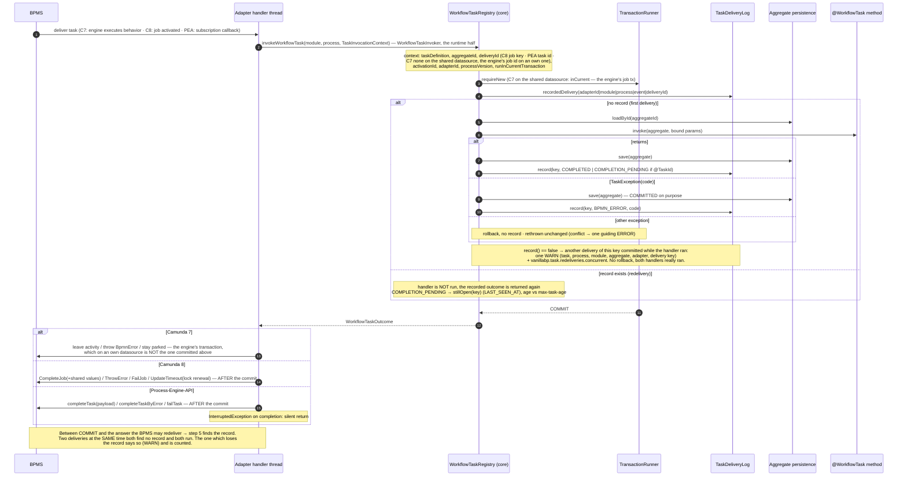

`WorkflowTaskRegistryTest` holds the wiring calls and the outcomes one by one
(`validateTaskWiring`, `validateNoUnwiredWorkflowTaskMethods`,
`taskExceptionYieldsBpmnErrorAndCommits`, `otherExceptionPropagatesWithoutSaving`).
`WorkflowTaskProcessingTest#taskProcessingCoversAllOutcomesAndBindings` runs the same outcomes
through a booted application on both platforms.

For each delivery an adapter hands the core a set of getters. The picture lists the three kinds
next to the invoker interfaces which receive them: a task delivery, a workflow which the BPMS
started by itself, and the end of a workflow.

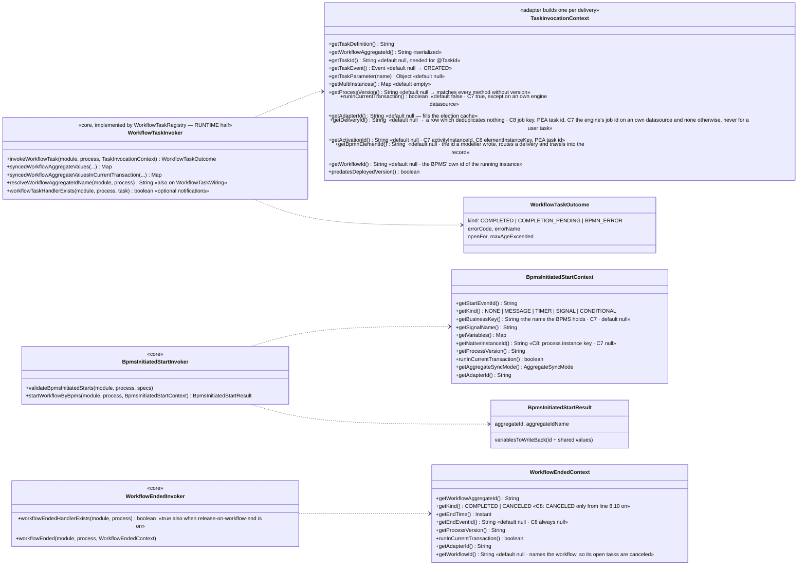

An adapter's `AdapterDeploymentService` extends `ExtensionWiringService` ("the wiring service with
deployment"). It inherits the preparing and wiring, and the starting and stopping of workflow
processing. It adds the reading and deploying of BPMS resources. A DMN file has no type parameter
for its model. `readDmn` gets its bytes and adds them to the processing context, so no adapter has
to understand a decision table. Rewriting the decision ids under prefixes is the same for every
BPMS, and `DmnDecisionIds` does it. What this means for an application is on the wiki page
[Workflow modules](https://github.com/vanillabp/adapter-platform-integration/wiki/Workflow-modules#decision-tables-travel-with-the-processes-calling-them).

#### Which method serves a delivery

A `@WorkflowTask` method is wired by one of two keys, and the method says which. `taskDefinition`
names what the BPMS subscribed to (a Camunda 8 job type, the expression of a Camunda 7 service
task). `id` names the BPMN element itself. A method which sets neither is wired by its own name and
answers to both.

A delivery reports both keys as well: `TaskInvocationContext.getTaskDefinition()` and
`getBpmnElementId()`. The routing matches a method's key against the delivery's key of the same
kind. `validateTaskWiring` matches the same pair while the application boots. That the two use the
same pair is the point: a wiring the boot accepts has to be a wiring a delivery finds. Before this
was so, one case slipped through. A service task wired by an expression, whose method named the
element id, passed the boot without a word and failed at the first delivery. The application then
learnt about it from an incident.

The element id is also compared against the reported task definition, for an adapter which names
no element of its own. There the one value it reports IS the element id, so a method wired by the
element id can be reached. An adapter which names neither the element nor a task definition shaped
like an id cannot serve such a method at all. That is why `getBpmnElementId()` is worth answering,
even though it is `default null`.

`WorkflowTaskRoutingTest` holds all of it. That includes the message for a delivery nobody serves.
It names both keys, because a reader who only sees the task definition looks for a method under a
name their model does not carry.

#### A business key which is not the aggregate's id (`BusinessKeyCheck`)

VanillaBP names a workflow by its workflow aggregate and by nothing else. Some BPMSs keep a business
key of their own. Wherever VanillaBP starts the workflow, it writes that id into the business key:
on Camunda 7 always, on Camunda 8 from cluster 8.9 on. A workflow started outside VanillaBP can
carry a key somebody else chose, while it also carries the variable with the aggregate's id. Then
two values say different things about one instance.

An adapter reports what its BPMS keeps through `getBusinessKey()`. It exists on all three contexts
with which the BPMS hands a workflow over: `TaskInvocationContext`, `WorkflowEndedContext` and
`BpmsInitiatedStartContext`. The check reads it on the first two, where the aggregate's id comes
with it. The core compares the two values and refuses what the BPMS handed over where they
disagree. Here, as everywhere, it raises no incident itself on any BPMS. The invocation ends, and
the BPMS does what it does with any failing handler. On both Camunda engines that is a retry and
then an incident.

A start which the BPMS did on its own is the third context. There the key is not compared at all.
The application names the workflow at such a start. So the key is the name by which VanillaBP looks
up the workflow, and a start is refused where no workflow aggregate carries that name. That refusal
happens inside the transaction the start opened, so it leaves no aggregate behind.

A value which says nothing does not contradict, on either side. An absent business key is the
ordinary state of every Camunda 8 workflow up to cluster 8.8, and of every workflow on a BPMS
without business keys. An absent aggregate id is the workflow which an application takes over after
an upgrade from version 1 on Camunda 7. Version 1 wrote no process variables there. So such an
instance carries its identity in the business key and nowhere else. If the core read a missing
variable as a difference, every migrated workflow would go into an incident at its first delivery.
There is no way to switch the check off. A disagreement is a defect in whatever started the
workflow, not a matter of taste. It is [decision 69](../DECISIONS.md).
`BusinessKeyIsTheAggregateIdTest` holds the two places, the empty key, the key which carries the
id, and the start which leaves nothing behind.

#### Deployment-failure policy

By default, a failing deployment of any configured adapter stops the boot of the application.
During a BPMS migration the old BPMS may not be reachable for a while. If you set
`vanillabp.adapters.<id>.deployment-failure` to `warn`, the application starts anyway when an
adapter which is NOT first priority fails to deploy. The failure is logged, and that adapter does
not process workflows. A failure of the first-priority adapter always fails the boot, whatever the
policy says, because new workflows could not start otherwise.
`DeploymentServiceTest#nonPrimaryAdapterFailureWithWarnPolicyBootsAnyway` and
`#primaryAdapterFailureFailsEvenWithWarnPolicy` hold both halves.
`DeploymentFailureWarnTest` and `DeploymentFailureFailTest` hold them per platform.

#### The variables a handler reads (`taskParameterNames`)

A `@TaskParam` takes what the BPMS GENERATED on this path through the model: the target of an input
or output mapping, the result of a script or a decision, a value the model computed and the workflow
aggregate does not hold. Most applications need none of it. But it can never be ruled out, because
a model may produce a value the application has to see.

Those names exist in exactly one place, and it is here. `WorkflowTaskScanner` reads them from the
annotations while it builds the parameter binders. `WorkflowTaskHandler` keeps them.
`WorkflowTaskRegistry#taskParameterNames(module, process, taskDefinitionOrActivityId)` reports the
union over every handler which serves that element. It is a union, because methods which serve
different process versions share one BPMN element, and whichever of them runs has to find its
variable. The list is sorted and has no duplicates. A subscription which compares itself across
restarts needs that (a Camunda 8 job stream equals another one only when the fetched variables
match).

Why the core has to say it: at runtime an adapter pulls the values one name at a time through
`TaskInvocationContext#getTaskParameter(name)`, and by then the delivery has already happened. A
BPMS which ships a payload of variables with every delivery has to know the names BEFORE it
subscribes. The only other place to look is the BPMN model, and that is a guess. The model may
declare names nobody reads, and a handler may read a name no model declares. Camunda 8 derived the
list that way for a while. The model scan is gone; we did not keep it as a second source for one
answer.

The method is a `default` which returns an empty collection. So an adapter which never heard of it
keeps the behaviour it had. Starts initiated by the BPMS have no counterpart, on purpose. The core
copies EVERY variable such a start carries into the workflow aggregate it builds
(`BpmsInitiatedStartExecution#writeVariables`). So a start worker has to ask for all of them, no
matter what any `@TaskParam` names. `WorkflowTaskRegistryTest#theUnionOfEveryMethodServingTheElement`,
`#theDeclaredNamesAreReported` and `#theDefaultAnswersNothing` hold the union and its order.

#### The iterations a handler wants the item of (`multiInstanceElementNames`)

A multi-instance element hands three things to a handler: which round it is in, how many rounds
there are, and the item of the round. Every model answers the first two. The item is the one a
model may never name. A Camunda 7 element without `camunda:elementVariable`, and a Camunda 8 one
without `inputElement`, iterate without saying what the current value is called. A handler which
asks for it then receives `null`, and nothing says why.

Both of those are fine on their own. An element which iterates a fixed number of times is a model
somebody meant to write. So is a handler which reads only the index and the total. What nobody
means is the two together, and neither side can see it alone: only the adapter reads the BPMN, and
only the core scans the handlers.

So the core answers what it sees.
`WorkflowTaskRegistry#multiInstanceElementNames(module, process, taskDefinitionOrActivityId)`
reports the element ids for which the methods serving that element ask an item. That is the value
of `@MultiInstanceElement`. Where the parameter names a resolver bean instead, it is what
`MultiInstanceElementResolver#getNames()` reports. The answer is the union over every method which
serves the element, for the same reason `taskParameterNames` builds a union. Methods which serve
different process versions share one BPMN element, and all of them read their item from the model
the adapter asks about. The answer is sorted and has no duplicates.

The resolver bean is looked up when the answer is first needed, not while the workflow service is
scanned. At that point not all beans of an application are built yet. A resolver bean which nobody
defined answers nothing here, because the parameter binder for the same parameter already says
what is missing and how to define it.

An id which is not an element of the model in question is not a finding. The multi-instance chain
crosses a call activity. So a task of a called process asks for an element of its caller, and the
model at hand is the wrong place to look for it. So an adapter refuses only what it can see: an
element of ITS model, multi-instance, with no item, and a handler which asks for that item.

The method is a `default` which returns an empty collection. So an adapter which never heard of it
keeps the behaviour it had. The other two multi-instance annotations have no counterpart and need
none. Every multi-instance element answers an index and a total, so there is nothing to check.
These tests hold it: `WorkflowTaskRegistryTest#theNamedElementIsReported`,
`#countingAsksForNoItem`, `#theResolverBeanIsAsked`, `#aMissingResolverBeanReportsNothing`,
`#theUnionOfEveryMethodServingTheElement` and `#theDefaultAnswersNothing`.

#### What a `@TaskParam` may be declared as (`ValueConversion`)

An adapter hands over the value as its BPMS deserialized it, and converts nothing. The conversion
into the declared type happens once, in the platform, in `ValueConversion`. It serves the
parameters of a `@WorkflowTask` method and those of a `@WorkflowStartedByBpms` method.

What it does:

|      the value the BPMS reported       |   the declared type    |                        what the parameter gets                         |
|----------------------------------------|------------------------|------------------------------------------------------------------------|
| anything the type already holds        | that type, or `Object` | the value itself                                                       |
| `null`                                 | a wrapper type         | `null`                                                                 |
| `null`                                 | a primitive type       | the invocation fails, naming the input mapping as the way out          |
| a number                               | another number type    | the same number, or a failure where it would not be the same number    |
| a number                               | `String`               | its `toString()`                                                       |
| the text of a number                   | a number type          | the number, or a failure where the text is no number                   |
| `"true"` or `"false"`                  | `Boolean`              | the boolean                                                            |
| the name of an enum constant           | that enum              | the constant, or a failure where the enum has no constant of that name |
| the text a value type travels as       | that type              | the value, or a failure where the text is none that type travels as    |
| the text of a `Calendar` or a `Locale` | that type              | the invocation fails, naming the type to declare instead               |
| everything else                        | anything               | the invocation fails, naming the value's class and the declared type   |

Read the row about numbers twice. A number travels through its decimal form, never through
`intValue()` or `doubleValue()`. The converted value is handed over only where it reads back as the
same number. The comparison is numeric, so a scale which the target type cannot keep is no reason to
refuse:

|      what the aggregate shared       | declared as |     what arrives     |
|--------------------------------------|-------------|----------------------|
| `new BigDecimal("120.50")`           | `Double`    | `120.5`              |
| `new BigDecimal("120.50")`           | `int`       | the invocation fails |
| a `Long` of `3000000000`             | `long`      | `3000000000`         |
| a `Long` of `3000000000`             | `int`       | the invocation fails |
| `new BigInteger("9007199254740993")` | `Double`    | the invocation fails |
| a `Float` of `0.1f`                  | `Double`    | `0.1`                |
| `"120.50"`                           | `int`       | the invocation fails |

A failure ends the invocation. So the BPMS raises the incident it raises for any other failing
task. The message names the value, the declared type and the number which would have arrived
instead. The alternative is a handler which acts on a number nobody wrote. That is why this is a
refusal and not a rounding rule. It is [decision 55](../DECISIONS.md), and `UPGRADE.md` says what
it means for an application which comes from version 1. `WorkflowTaskScannerEdgeCasesTest`, nested
class "Task-parameter conversion", holds the cases. There is no writing side any more. A workflow
the BPMS starts builds its own aggregate, so the platform writes no value of the BPMS into an
attribute ([decision 69](../DECISIONS.md)). `TextValueRoundTripTest` holds the way out and the way back against each other. It asserts
the text each of those types is shared as, and that the same text comes back as the same value.

The message names the parameter as the developer wrote it, if the application was compiled with
`-parameters`. `spring-boot-starter-parent` sets that flag. Without it javac keeps no names, and the
message says `arg1`.

Read the row about text twice, too. A workflow aggregate shares an enum as the name of its
constant. It shares a value type such as a `UUID` or a `LocalDate` as the text which
`TextValueTypes` names for it. For most of them that is the text the type writes itself. The way
back reads exactly those texts. So a handler declares the type the aggregate holds and gets the
value the aggregate held:

|             what the aggregate shared              | what the BPMS carries  | declared as |
|----------------------------------------------------|------------------------|-------------|
| `UUID.fromString("f81d4fae-7dec-...")`             | `f81d4fae-7dec-...`    | `UUID`      |
| `Decision.APPROVED`                                | `APPROVED`             | `Decision`  |
| `LocalDate.parse("2026-09-16")`                    | `2026-09-16`           | `LocalDate` |
| `Instant.parse("2026-09-16T18:15:30Z")`            | `2026-09-16T18:15:30Z` | `Instant`   |
| `Duration.ofMinutes(90)`                           | `PT1H30M`              | `Duration`  |
| `Date.from(Instant.parse("2026-09-16T19:55:30Z"))` | `2026-09-16T19:55:30Z` | `Date`      |
| `TimeZone.getTimeZone("Europe/Berlin")`            | `Europe/Berlin`        | `TimeZone`  |

The types carried both ways are `UUID`, every enum, the `java.time` values `Instant`, `LocalDate`,
`LocalTime`, `LocalDateTime`, `OffsetDateTime`, `OffsetTime`, `ZonedDateTime`, `Year`,
`YearMonth`, `MonthDay`, `Duration`, `Period`, `ZoneId` and `ZoneOffset`, plus `java.util.Date`
and `java.util.TimeZone`. `DayOfWeek` and `Month` are enums and come along with every other enum.
A text in any other form is refused, and the message shows a text the type does travel as. A
constant name which the model invented is refused too, and the message names the constants the
enum has. A handler which read such a name would act on a value nobody declared.

**That list is a selection, not a promise about the JDK.** It holds what a workflow aggregate
carries often enough to be worth carrying. A type missing from it is a type nobody has needed yet,
not a type which is ruled out. If you miss one, open an issue, and we add it with the text it
travels as. Everything else the JDK wrote still reaches the BPMS as its own text, one way only. A
parameter which declares such a type is refused.

Timers are where a model reads these texts back, so two limits belong here. Camunda accepts a
date, a duration and a cycle in a timer event. A `Duration` carries days, hours, minutes and
seconds. A `Period` carries years, months and days. Neither of them carries the combined form
`P3Y6M4DT12H30M5S`. A cycle such as `R5/PT10S` and a cron expression are not `java.time` values at
all, so share them as a `String`.

The second limit is visible in the model. `java.time` writes a duration of a day or more in hours.
So `Duration.ofDays(14)` reaches the BPMS as `PT336H` and not as `P14D`. A timer fires at the same
moment either way, because the engine reads both forms. But the text an operator reads is not the
text the application wrote. Where the wording has to survive, share the value as a `String`.

**A `Date` and a `TimeZone` travel as a text built for them**, not as the text they write
themselves. That is the one place where the way out does more than call `toString()`. A `Date` is
a count of milliseconds and carries no zone. So it travels as the instant it holds, and the
milliseconds survive. The text is the same, whichever server wrote it. An offset in the zone of the
JVM would not be: two nodes of one application would write two texts for one value, and a value
written in summer would read differently from the same value written in winter. An operator gives
up local time in the model for that. Every subclass travels the same way. So an attribute declared
`Date`, which a JPA provider fills with a `java.sql.Timestamp`, carries the same text as a plain
`Date`, down to the millisecond and no further.

A `TimeZone` travels as the id of its zone, which is what `toZoneId()` answers.
`TimeZone.getTimeZone(ZoneId)` reads it back. We measured on 2026-09-17 against Java 21. A zone
with a fixed offset survives as it was written, so `GMT+05:30` is shared and read back as
`GMT+05:30`. A three-letter id does not survive, because it is not a zone name. `IST` is shared as
`Asia/Kolkata` and `EST` as `-05:00`. It is the same zone with the same rules, under the name it
really has. An application which compares ids has to know that.

`java.util.Calendar` and `java.util.Locale` stay refused on the way back, although their text looks
readable. The message says which type to declare instead. A `Calendar` is written as its debug
form: 769 characters which name every field of the implementation. No point in time can be read
from it without guessing which of its fields to trust. A `Locale` is written as `de_DE`, which no
`Locale` method reads back, and `Locale.ROOT` is written as an empty text.

**An aggregate which shares a `Calendar` attribute does not boot.** Such a text is not a value, so
the application may not send it, and `validateSyncModel` reports the attribute as a defect. The
message names the attribute, its class, the type it is declared as and what the BPMS would get. It
says to share an `Instant` for the point in time, with a `TimeZone` or a `ZoneId` next to it where
the zone matters too. Leaving the attribute out of what is shared would be worse than refusing it.
A process variable which quietly stopped being written makes a model read null and take a branch
nobody chose. Where no model needs the attribute, `@NoSyncWithBPMS` says so, and the application
boots.

A failing boot may not rest on a guess. So the refusal asks whether the attribute really is shared,
along the same chain a sync point walks. A class states its own mode or inherits it from the
attribute which holds it, and an attribute may state its own. The walk starts out as sharing,
because `FULL` is the default of every adapter. A `Calendar` inside a nested object, or as the
element of a collection, is refused the same way, because it is the same walk.

Every other attribute whose text nothing reads back is named while the application boots, once per
attribute, with the type to share instead. Such a type works on the way out and fails on the way
in. The way in is a task handler. So without that warning the application learns about it only
when a model first maps the value into a handler. This one is a warning, and the application boots.
`validateSyncModel` is not told the adapter's default, so it cannot know whether the attribute is
shared at all, and a wrong warning costs only a log line. An attribute marked `@NoSyncWithBPMS` is
left out. [Decision 57](../DECISIONS.md) says why the list asks about the type a value IS and not
about the package its class sits in, and why a `Calendar` is refused.

**An aggregate which shares EVERYTHING does not boot either, unless its workflow says so.** An
aggregate without any `@NoSyncWithBPMS` hands every attribute it reaches to the BPMS, and nobody
decided that: it is where an application lands by doing nothing. `FullSyncCheck` asks the sync
model once per registered workflow, through `WorkflowAggregateSync.everythingSharedWithBpms`. The
answer is the attributes of the aggregate itself where nothing at all is held back, and empty
otherwise. The message names the workflow, the aggregate and those attributes. It offers the two
ways out: say what the models need, or write the permission at the workflow.

```
vanillabp.workflow-modules.<workflow-module>.workflows.<bpmn-process-id>.allow-full-sync-with-bpms: true
```

The permission is read at the workflow and at no other level. That is the one exception from the
resolution of [decision 7](../DECISIONS.md). A permission which is inherited would cover the
workflow somebody adds next week. The key is also bound at the application, at a workflow module
and in an adapter section. `MigrationAdapterProperties` refuses it there with a message which says
where it belongs, so nobody is left believing it was given. The ID attribute is not counted. It
travels whatever the sync model says, so an aggregate made of nothing but its ID starts. A
secondary BPMN process is covered by the permission of the process it belongs to. The reasoning is
in [decision 66](../DECISIONS.md).

**What to share, and as what.** A workflow aggregate carries the results a model decides on and the
values an operator reads, not every field of a business object. So a `@TaskParam` reads a decision
or a number somebody looks at. The types worth declaring are the ones such a value needs: `String`
in both directions, the integral types among each other where the value fits, a decimal to a
decimal, and a decimal to a floating type where the value survives. A decision the model acts on
travels as the name of an enum constant. A point in time travels as the text `java.time` writes.
Each of them comes back as the type the aggregate declared. A value nobody computes with travels
best as text, because every BPMS carries text, and text loses nothing on the way. A type of the
application's own is refused, and stays refused. A BPMS variable is a plain value, and only the
application knows what its own types mean.

**What the BPMS decides, and VanillaBP does not.** The engine decides as which Java type a value
comes back, and the three engines differ. Camunda 7 returns the class it stored, so a `BigDecimal`
it wrote is a `BigDecimal` again. Camunda 8 holds JSON, so a decimal comes back as a `Double` and a
whole number as a `Long`. No value the cluster returns is ever a `BigDecimal`, a `BigInteger` or a
`Float`. The Process-Engine-API answers whatever its backend stored. So `@TaskParam Object` is the
one declaration whose answer depends on the BPMS. It is the way in for a handler which wants to see
what the engine really sent. A typed parameter is served on all three, because the conversion
builds the target from the number's decimal form. This paragraph and the next one report a
measurement from 2026-09-16, against Camunda 7.24 in both of its serialization worlds, a Camunda
8.9.19 cluster and the in-memory engine of the Process-Engine-API. No test holds them.

The model also decides whether a `@TaskParam` finds anything at all without an input mapping.
Camunda 7 reads the task execution's own scope. So a task which stands directly in the process sees
a process variable, while the same task on a parallel branch or in an embedded subprocess sees
`null`. Camunda 8 resolves a job's variables up the scope hierarchy and finds the variable wherever
the task sits. Declare the input mapping and do not rely on either.

#### Deliveries VanillaBP already processed (`TaskDeliveryLog` SPI)

This is the inbound counterpart of the outbox. A remote BPMS reports the outcome AFTER the local
transaction was committed. So a crash in between makes it deliver the same task again, and that
used to run the `@WorkflowTask` method a second time. Now the core remembers a processed delivery
and answers a repeated one from the record.

Everything about those records lives in `DeliveryRecords`, one per process service. It resolves the
store, builds the key of a delivery, answers a repeated one, measures how long a task has been
open, and reads a record to tell which adapter holds a task. It takes the adapters as a parameter
where it needs them, the way `WorkflowLocator` does. Which adapters serve a BPMN process is the
business of the process service, not of the records.

- The identity of a delivery comes from the adapter: `TaskInvocationContext.getDeliveryId()`
  (Camunda 8: the job key; Process-Engine-API: the task ID; Camunda 7: none, see below).
  `TaskDeliveryKey` (package `workflowtask`) adds the adapter ID, workflow module, BPMN process
  and event to it. So an ID only has to be unique within its own BPMS. Where the result would get
  longer than a store can index, it is hashed. The limit is 512 bytes of UTF-8. That stays below
  MySQL's limit for a unique key with utf8mb4, and it fits the column on Oracle and DB2, which count
  a `VARCHAR` in bytes.
- An adapter which reports no ID still gets a key. It has `TaskDeliveryKey.NOT_DEDUPLICATED` and a
  random value where the ID would stand, and `TaskDeliveryIdentity.deduplicates()` says `false`
  for it. The row is what matters. It names the adapter which holds the task and the kind of id
  its id is, and those two answers have nothing to do with repetitions. Nothing is ever looked up
  by such a key. So no second delivery can land on it, and the race which writes one WARN cannot
  happen there. A reader of the store sees from the key itself which of the two kinds of row it
  has.
- The record is written in the handler's own transaction
  (`MigrationProcessService.executeWorkflowTask`). It is read before the aggregate is loaded and
  written after the aggregate was saved. It carries the OUTCOME (`WorkflowTaskOutcome.Kind` plus
  BPMN error code and name). So a repeated delivery reports the recorded outcome again. Skipping
  both handler and answer would leave the task open forever. A handler which threw leaves no
  record. The rollback took it, and the BPMS' retry runs the handler again.
- Two deliveries of one task which OVERLAP are the case which a record written after the work
  cannot catch. Both read no record and both run the handler. The second `record(...)` finds the
  key taken and returns `false`. Nothing is rolled back there, because both handlers really did
  their work. The core says it out loud: `DeliveryRecords#reportHandlerRanTwiceAtTheSameTime`
  writes one WARN which names the task, the workflow, the adapter and the delivery key. It counts
  the case as `vanillabp.task.redeliveries.concurrent`, the counterpart of
  `vanillabp.task.redeliveries.deduplicated`.
  `InboundIdempotencyTest#twoDeliveriesAtTheSameTimeAreNamedAndCounted` holds both halves, on
  Spring Boot and on Quarkus.
- `TaskDeliveryLog` and `TaskDeliveryLogAware` live in the integration SPI next to
  `PhaseTwoOutbox`. They are resolved per aggregate in the same way (`TaskDeliveryLogResolver`,
  implemented per platform), because a record has to ride in the aggregate's own transaction.
  `JdbcTaskDeliveryStore` and `TaskDeliveryRetentionCleanup` (package `delivery`) hold the SQL and
  the cleanup schedule which both platforms share. The connection comes from
  `JdbcConnectionAccess`, the one piece which cannot be platform-neutral.
  `jdbc.JdbcSchema#tableExists` asks the JDBC metadata whether a table is there. Every store uses
  it which either creates its table or checks that the application created it. That includes the
  gruelbox outbox of `io.vanillabp:gruelbox-phase-two-outbox`, whose table belongs to gruelbox, so
  `vanillabp-schema` does not ship it.
- The switch is the adapter-scoped `deduplicate-deliveries` (default `true`). Like every
  adapter-scoped key, it can be set per workflow module, workflow and task.
- An adapter says whether it needs this at all: `MigratableProcessService.deliversTasksAtLeastOnce()`
  (default `false`). It only decides the startup report. At runtime nothing is DEDUPLICATED where
  no delivery ID arrives, and the row is written either way. Camunda 7 answers `false` on purpose.
  It delivers tasks inside its own transaction, so a redelivery proves that nothing was committed.
- `deduplicate-deliveries` switched off is the one case which writes no row at all. It says that the
  handlers are idempotent themselves, and the BPMS behind it may repeat a delivery. A row per
  repetition would show one task as often as it was handed out, to everything which reads the
  open work of a workflow.
- Without a store there is a WARN with guidance at startup (`validateTaskDeliveryLogAtStartup`,
  once per process service), not a failed boot. Unlike the outbox, nothing is broken without a log.
  The behaviour is the one every VanillaBP had before, and the wiki's rule about idempotent
  handlers covers it.

Camunda 7 on its own engine datasource is the mode in which the core sees a redelivery at all. The
picture shows why. The engine's job transaction is one which the application's persistence cannot
join. So the record commits before the engine rolls back its job. When the engine runs the job
again, the record answers it, and the `@WorkflowTask` method is not entered.

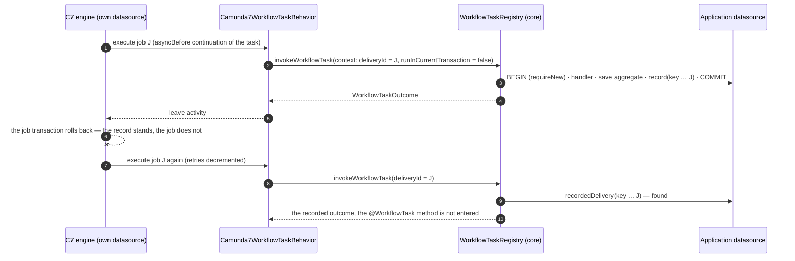

Two deliveries of that mode carry no identity at all: the notification about a user task and the
one about a cancelled task. Both travel with whatever job the engine happens to run. One such job
creates or cancels every task the token reaches, so its id would name several deliveries at once.

`InboundIdempotencyTest` holds the mechanism at both levels. In the core it has
`repeatedDeliveryIsAnsweredFromTheRecord`, `aRolledBackDeliveryIsProcessedAgain`,
`deliveriesWithoutAnIdentityAreNotDeduplicated` and `aMissingDeliveryLogIsReportedAtStartup`. It
also runs once per platform against a booted application. `TaskDeliveryKeyTest` holds the
qualification and the hashing.

#### The end of a workflow releases its records

Age alone is a poor answer to "how long does a record have to be kept?". Seven days are too long
for a busy application, and too short for a task which really is open longer than that. The end of
a workflow is the exact statement which the retention only comes close to, since nothing of an
ended instance can be redelivered.

- The switch is `vanillabp.delivery.release-on-workflow-end` (`DeliveryProperties`, resolved by
  `MigrationAdapterProperties.releasesDeliveryRecordsOnWorkflowEnd`). It is global and per
  workflow module, default `false`. It does NOT depend on the adapter. The records of every BPMS
  live in the store of the aggregate, so this is a question about the application's data.
- It is off by default, because the end of a workflow is reported only where it is used. Adapters
  ask `WorkflowTaskRegistry.workflowEndedHandlerExists` while wiring. That method answers `true`
  where the release is switched on, even without a `@WorkflowEnded` method. That is the whole
  reason why no adapter had to change for this.
- The deletion runs in `WorkflowEndedHandlers.workflowEnded`, inside the transaction which that
  notification opens anyway. It runs under every BPMN process id the workflow service serves (a
  called process reports no end of its own). It is limited by workflow module, BPMN process,
  aggregate, and an `Instant` taken BEFORE the notification is processed. The time limit keeps
  the records of a SECOND workflow on the same aggregate. That is possible, since aggregates live
  longer than their workflows.
- `TaskDeliveryLog.releaseRecordsOf(...)` has a default which deletes nothing. So every store
  written before this stays valid. Reflection answers whether a store implements it, over the
  class the platform integration hands out (`TaskDeliveryLogResolver.storeClassOf`). That method
  unwraps CDI client proxies and Spring AOP proxies, because a proxy overrides the default method
  and would claim a release which does not exist. A store which cannot release, with the option
  switched on, gives one WARN at startup. With the option off nothing is logged.
- The retention stays for everything the end of a workflow does not cover: workflows which still
  run, aggregates whose workflow never ends, and stores without the release.

`DeliveryRecordReleaseTest` holds every one of those points, in the core and once per platform.

#### How old an open task is

A `@TaskId` handler leaves its task open. From then on nothing asks whether the completion is still
coming. The BPMS keeps redelivering the task. The core answers every redelivery from the record it
wrote when the handler ran. And a Camunda 8 adapter renews the job's lock on the way. So a workflow
which waits forever looks exactly like one which waits for a good reason.

- `TaskDelivery` carries `recordedAt`, the moment the delivery was processed. Every store persisted
  it from the beginning, because the retention deletes by it. What came later is the SPI component
  and the mapping in the four stores. The core sets the value when it builds the record. So the
  timestamp is the moment of processing and not whatever a store's clock says.
- `DeliveryRecords.stillOpen` measures the distance to now on every redelivery which is answered
  with `COMPLETION_PENDING`. It compares it to
  `MigrationAdapterProperties.maxTaskAge(module, process, task)`
  (`vanillabp.delivery.max-task-age`, default `P30D`, `0` switches it off). Like the rest of
  `DeliveryProperties`, the property does NOT depend on the adapter. It resolves globally, per
  workflow module, per workflow and per task, the most specific first. That is why
  `WorkflowAdapterProperties` and `TaskAdapterProperties` got a `delivery` section.
- The report is one WARN per delivery key, not per redelivery. A bounded LRU map of the process
  service remembers it. Forgetting an entry costs one repeated message, which is why nothing
  durable is involved.
- What happens beyond the report belongs to the BPMS. So `WorkflowTaskOutcome` carries `openFor`
  and `maxAgeExceeded`. An adapter which has a better place for the finding reads them. Camunda 8
  stops renewing the lock and fails the job into an incident where `async-task-max-age-action`
  says so. An adapter without a lock to renew ignores both, and the report is all that happens.
- There is no callback into the application, on purpose. An application which knows its task is
  obsolete has `ProcessService#cancelTask`. One which lost track of it could not answer a question
  about liveness truthfully anyway.
- The record itself used to expire with the retention while its task was still open. The
  retention made that risk smaller than the old horizon of fourteen days, but did not remove it. A
  second timestamp on the record closed it (see the next section). The age measured here keeps
  counting from the first one. That is why refreshing the first one was never an option.

`OpenTaskAgeTest` holds the measurement and its property, from `anOverdueTaskIsReportedOnce`
through `theMaximumAgeResolvesMostSpecificFirst` to `zeroSwitchesTheReportOff`.

#### The retention of a record is its own property

`vanillabp.delivery.retention` decides how long a record is kept. It defaults to
`vanillabp.outbox.retention`, where the number lived while one property ruled both windows. They
stopped being one kind of thing when the outbound deduplication window ended with the dispatch
(decision 22). On the outbox side the retention only decides how long a dispatched entry stays
readable for support. On this side it decides whether a late redelivery runs the business code
again. An installation which made the one shorter to keep its table small made the other shorter
with the same move. Decision 24 gives the two questions of different kinds two properties.

- The resolution is `DeliveryProperties.resolveRetention`. On Spring Boot
  `MigrationAdapterProperties.resolvedDeliveryRetention` calls it. On Quarkus the lazy
  `getDeliveryRetention` of the two logs calls it, because they cannot ask a bound properties
  object at the moment they need the number.
- It is read GLOBALLY, unlike `release-on-workflow-end` and `max-task-age` next to it. One
  `TaskDeliveryRetentionCleanup` per store deletes by age across the whole table or collection.
  So a value per workflow module would only mean something if each of the four stores had a
  different deletion for it.
- Where exactly one of the two numbers differs from the default, the startup says which window
  applies to what (`MigrationAdapterProperties.reportRetentionSplit`). The trigger is "differs
  from the default" and not "was written down", because a bound property cannot tell those apart.
- No startup check compares the retention against the time in which an adapter can redeliver. That
  was the alternative to the split, and decision 24 refuses it. What an adapter knows is the
  INTERVAL at which it hands out unacknowledged work again: the Camunda 8
  `async-task-lock-renewal`. The horizon depends on how long the application is stopped and on
  whoever resolves an incident. A check against the interval would pass in exactly the
  installations which are about to run business code twice.

Move one of the two numbers away from its default, and `DeliveryRetentionTest` says which window
applies to what: `theDeliveryHalfFollowsTheOutboxRetention`,
`theOutboxDoesNotFollowTheOtherWayRound`, `movingOnlyTheOutboxNumberIsReported`,
`agreementIsSilent`.

#### The record of a task which is still open

The record which answers the redeliveries of an open task used to be deleted once the retention
passed, seven days by default. A task open for longer lost the record, and the next redelivery
reached the `@WorkflowTask` method a second time.

So the record carries a second timestamp. `RECORDED_AT` still means the moment the handler ran, and
the age of an open task is measured from it. `LAST_SEEN_AT` carries the moment the BPMS last
redelivered that task. The retention cleanup deletes by the second one. So a task which is still
redelivered keeps the record which answers it, while the record of a task nobody hands out any more
expires as it always did.

- `DeliveryRecords.stillOpen` is the trigger, and it belongs to the core, not to any adapter. It
  runs on every redelivery whose recorded outcome is `COMPLETION_PENDING`, whichever BPMS
  redelivered. It reports the key to the store through `TaskDeliveryLog.stillOpen(deliveryKey)`.
  The default implementation of that method does nothing, so a store written by an application
  stays valid.
- Nothing is written there. The redelivery runs in the transaction of the workflow aggregate, and
  an UPDATE for each renewal of every open task does not belong in it. So the key lands in
  `OpenTaskTouches`, and the timer which already runs the retention cleanup writes what collected.
  If a crash loses that memory, it costs one interval of refreshes, because a record only expires
  when a whole retention passes without a single one. The memory is bounded for the same reason.
- Writing goes in blocks of `OpenTaskTouches.BLOCK_SIZE` keys: one
  `UPDATE ... SET LAST_SEEN_AT = ? WHERE DELIVERY_KEY = ?` run as a JDBC batch, not as an `IN`
  list. Every database caps the length of such a list differently (Oracle at 1000 expressions, SQL
  Server at about 2100 parameters). The MongoDB stores of both platforms do the same with an
  unordered bulk write per block.
- We rejected two alternatives for the same reason: a cleanup which skips `COMPLETION_PENDING`, and
  one collective `UPDATE ... WHERE OUTCOME = 'COMPLETION_PENDING'`. Either of them keeps the record
  of a task which never completes alive for good. A store which only grows is worse than the defect
  being fixed.
- The column belongs to `io.vanillabp:vanillabp-schema` (changelog plus generated SQL). The startup
  check used to look at the TABLE only, and that is exactly how a new column slips through. A table
  created by an earlier version exists, so the check passed, and the missing column would have
  shown up at the first delivery. So `validateSchemaExists` and `createSchemaIfNotExists` check the
  columns added later as well. The message names the `ALTER TABLE` which repairs it.

`OpenTaskRecordRetentionTest` holds the two timestamps and the expiry. `OpenTaskTouchesTest` holds
the bounded memory and the blocks. `OpenTaskRetentionTest` holds, on both platforms, that the
record of an open task survives. `JdbcTaskDeliverySchemaTest#aMissingColumnIsReportedAtStartup`
holds the check which now reads columns and not only the table.

#### The record answers which BPMS holds a task

A workflow is located by asking the adapters (decision 5). On Camunda 8 that question was asked
twice for a task. The election sends `newUpdateTimeoutCommand` against the job, and a moment later
the adapter's phase one sends the same command again as its check before the commit. The record of
that task's delivery knew the answer to the first one all along: it names the adapter which
delivered. So every call which names a task reads the record before it walks the adapters.
Decision 30 says why that is not the registry which decision 5 rejected.

- The record carries `TASK_ID`, the BPMS' identity of the task, and `TASK_CLOSED_AT`, the moment
  the application's completion of it reached the BPMS. `DeliveryRecords.record` writes the first
  from `TaskInvocationContext.getTaskId()`. Both columns are nullable, so a record written before
  them is not part of any answer.
- `TaskDeliveryLog.recordOfTask(module, process, aggregateId, taskId)` is the question. The answer
  is the record which reported `COMPLETION_PENDING`, the only outcome which leaves a task for the
  application to complete later. `markTaskClosed` writes the note. Both are `default` methods: one
  answers nothing, the other does nothing. So a store an application wrote stays valid, and its
  election walks as it always did.
- The record sits under the BPMN process id of the process which DELIVERED the task. For a task
  which a called process handed out, that is the secondary id, while the application completes it
  on the primary process service. So the read walks every id the workflow service serves
  (`DeliveryRecords.setBpmnProcessIdsToReadUnder`, fed from `servedBpmnProcessIds`), the reading
  instance's own id first. The note does the same and stops at the id whose row it marked. The
  write moves nowhere, so a record still says which process handed out the task.
- `DeliveryRecords.locate` turns the record into the `Location` which the walk would have produced.
  An open record elects the adapter it names. A closed one is the no-op with a warning, with the
  message it always had. Everything else answers `null` and lets `WorkflowLocator` decide. `null`
  is the answer to a missing store, to `deduplicate-deliveries` switched off, to a passed
  retention, to a task which was never delivered under that id, and to an adapter which is no
  longer prioritized for this workflow. A BPMS which reports no delivery identity is NOT among
  them. Camunda 7 delivers in the application's transaction and reports none, and its row answers
  this read like any other.
- The CALL decides whether the record is asked at all, not the operation: the arguments name a
  task, or they do not. That is why the record also routes `aggregateChanged(aggregate, taskId)`,
  although whoever holds the workflow elects `AGGREGATE_CHANGED`. While the task is open, the BPMS
  which holds it is the BPMS which holds the workflow around it. On Camunda 8 that saves a search
  against the secondary storage. A CLOSED record answers only the operations which end the task
  themselves (`endsTheTaskItNames`). The scope a push writes into lives longer than the task, and
  so may the workflow. The same predicate decides the note: a push completes nothing, so it never
  marks a record closed.
- The note is written in `addressWorkflowPhaseTwo`, after phase two succeeded, on the dispatching
  thread. It is not written when the caller asked. Until phase two ran, the task is still open for
  the BPMS, and on Camunda 8 this very record answers the redeliveries which renew the job's lock.
  The outbox' idempotency key (decision 22) refuses a second call inside that window. That key is
  free again from the dispatch on, and that is where the record takes over. A failed note is a
  WARN and nothing more. The completion reached the BPMS, and repeating it because a note failed
  would be the worse mistake.
- `TASK_ID` is indexed (`<table>_TASK`, the MongoDB stores index `taskId`). The read happens once
  per task operation, and a scan there would cost more than the round trip it saves. The index
  covers that column alone. One over the three narrowing columns would exceed the key-length limit
  of MySQL and of a DB2 database with 4K pages, since `AGGREGATE_ID` holds up to 1024 characters.
- What stays: phase two elects by probing. So a workflow which changed its BPMS between the call
  and the dispatch is still found. And the adapters keep their phase one. So a task which
  disappeared between the delivery and the call still fails synchronously.
- What is NOT routed this way, on purpose, is `correlateMessage` and an `aggregateChanged` without
  a task id. Nothing names a task there, so no record is about them. The question "did any
  delivery of this aggregate name an adapter?" is a different one. It answers where to route, not
  whether the workflow is alive. Widening the record's meaning that far is a decision of its own,
  and `vanillabp.task.elections.from.record` is the number to decide it on.
- That counter counts what the record answered, tagged by adapter, workflow module, BPMN process
  and operation. Only the answers are counted. A store which does not implement `recordOfTask`
  returns nothing. And nothing looks exactly like a task for which no record was ever written. So
  counting the fallback would report a defect where there is none. The counter is read against how
  many task operations the application makes.

##### A cancellation from the BPMS closes the record

The note above is written where the APPLICATION asked for something. Nobody asked for a task which
the BPMS takes away. So a second place writes the note: the delivery of
`TaskEvent.Event.CANCELED`.

- The mark runs on the delivery path, inside the transaction of that delivery
  (`MigrationProcessService.recordTheDelivery`). It is safe there for the same reason it is not
  safe when a caller only asks. A task which the BPMS cancelled is never handed out again. So no
  redelivery is left which would need the record to renew its lock.
- The cancelling delivery reports `COMPLETED` and never `COMPLETION_PENDING`.
  `isAsynchronousTask` is true for every method with a `@TaskId` parameter, a user-task method
  included. So an answer based on the method alone wrote a second OPEN record for a task nobody can
  complete any more. `recordOfTask` then answered with the younger of the two.
- The cancellation keeps a record of its own. The event is part of the delivery key, and a BPMS
  which repeats the cancellation must not run the method a second time. That record is written
  first and the mark follows. So every row which names the task carries the moment it was closed.
- A method which does NOT subscribe to `CANCELED` is not touched. Its delivery returns before the
  transactional work and writes nothing. So the record of that task stays open until the next
  wake-up of that workflow, or its end, closes it.
- `markTaskClosed` closes EVERY record which names the task, in all four stores. That is decision
  72 in the repository's `DECISIONS.md`. The count it returns is what it closed in that call. That
  is what lets two application instances claim one task against each other.

`CanceledTaskTest` holds it on both platforms. The two `MongoTaskDeliveryLogTest` classes hold the
store side of closing every row.

##### The open tasks of one workflow aggregate

`TaskDeliveryLog.openTasksOfAggregate(module, process, aggregateId)` answers the records of that
aggregate which reported `COMPLETION_PENDING` and which `markTaskClosed` has not stamped. Those are
the tasks the application still owes an answer for. An extension which shows what a workflow waits
for reads this, and keeps no memory of its own. The Process-Engine-API half of the Business Cockpit
used to keep such a memory and lost it on every restart.

- Oldest first, by the moment the handler ran. That is the order in which the tasks were handed
  out.
- No paging and no limit. A workflow has as many open tasks as its BPMN process has tokens waiting.
  The model limits that, not the age of the application.
- The default answers an empty list. So a store an application wrote stays valid, and its caller
  falls back the way it falls back for `recordOfTask`.
- The index: the MongoDB stores index `aggregateId`, which is the selective column and costs
  nothing there. The SQL tables cannot. `AGGREGATE_ID` holds up to 1024 characters, and an index
  over it exceeds the key-length limit of MySQL with utf8mb4 and of a DB2 database with 4K pages.
  `deleteRecordsOf` ran into the same wall. So they index what "open" means instead:
  `<table>_OPEN` over `OUTCOME` and `TASK_CLOSED_AT`. That narrows the read to the tasks the BPMS
  hands out right now, not to everything ever recorded. An application with very many open tasks
  at the same time adds an index over `AGGREGATE_ID` itself, with a prefix as its database spells
  it. What "very many" means is measured below.

What the read costs: we measured on PostgreSQL 16.15 and MongoDB 7.0.40 in September 2026, with the
table in memory. Each number is the median of a thousand driver calls, each of which answers three
open tasks:

| concurrently open tasks |  the plan PostgreSQL picks   | PostgreSQL | MongoDB |
|------------------------:|------------------------------|-----------:|--------:|
|                     501 | bitmap index scan on `_OPEN` |    0.22 ms | 0.29 ms |
|                    5001 | bitmap index scan on `_OPEN` |    0.68 ms | 0.28 ms |
|                   50001 | bitmap index scan on `_OPEN` |    5.73 ms | 0.27 ms |
|                  100002 | parallel sequential scan     |   14.70 ms | 0.27 ms |
|                  500001 | parallel sequential scan     |   34.30 ms | 0.27 ms |

PostgreSQL does take `_OPEN`. It keeps taking it until the open records are about a fifth of the
table, which happened between 50001 and 100002 open records. Which plan wins hardly changes the
cost. The index leads to the open records, and every one of them is read from the table and
dropped again, except the three the caller asked for. Both shapes are one pass over the open
records. So the curve is a straight line through the switch, about 0.11 ms per 1000 open tasks.
What the index really removed is the growth with history, and that holds: the index scan examined
501 entries in 0.17 ms, whether the table held one million records or two million.

Two findings for whoever repeats this. First, a statement with the values written into it gets a
different plan from the one the PostgreSQL JDBC driver sends. From the fifth call on, the driver
sends a prepared statement on the server. At 50001 open records the first already reads the whole
table, while the second still uses the index. Second, the case with 501 open records slows from 0.2
ms to 3.2 ms once the table passes a million rows. That is not the scan. PostgreSQL treats `OUTCOME`
and `TASK_CLOSED_AT` as independent, expects a quarter of the table to be open, and starts two
parallel workers it does not need. If you forbid them, the call is back at 0.21 ms. We tried an
extended statistics object over the two columns, and it does not repair the estimate.

MongoDB stays at a quarter of a millisecond everywhere, because `aggregateId_1` examines three keys
and three documents, however large the collection is. The same call with that index dropped became
a collection scan over 700001 documents at 159 ms. That one number is the difference between the
two store families.

The decision behind these numbers is to ship no further index. An index over `AGGREGATE_ID` makes
the SQL read flat as well, 0.14 ms at every size we measured. But no spelling of it works
everywhere. MySQL with utf8mb4 needs `AGGREGATE_ID(255)`, PostgreSQL does not parse that, and DB2
with 4K pages has no prefix syntax and no room for the column. Shipping it would put a different
index on different products in the runtime DDL and in the changelog, and decision 16 in the
repository's `DECISIONS.md` speaks against that. It would also be maintained on every insert, for a
read an extension makes once per screen. The wiki page `Workflow-tasks` has the numbers for readers
and asks anybody who reaches these sizes to open an issue.

`OpenTasksOfAggregateTest` holds the SQL. `OpenTaskRetentionTest` holds it through a booted
application on both platforms. The two `MongoTaskDeliveryLogTest` classes hold the MongoDB stores.

`TaskElectionFromDeliveryRecordTest` holds the routing
(`anOpenRecordElectsTheAdapterWithoutAnyProbe`,
`aClosedTaskIsTheWarnedNoOpWithoutAnyProbe`, `withoutARecordTheAdaptersAreProbed`,
`theRecordIsClosedAfterPhaseTwoAndNotBefore`), the push into the scope of a task
(`anAggregatePushNamingATaskIsElectedFromTheRecord`,
`anAggregatePushWithoutATaskProbesAsItAlwaysDid`,
`aClosedTaskDoesNotDecideAboutTheWorkflowAroundIt`,
`anAggregatePushLeavesTheRecordOfItsTaskOpen`), the record of a called process
(`aRecordOfACalledProcessAnswersTheOperationOnThePrimaryService`,
`theRecordOfACalledProcessIsClosedAfterPhaseTwo`) and the counter
(`anAnswerFromTheRecordIsCounted`). `TaskRecordLookupTest` holds the store side of it, and
`MicrometerVanillaBpMetricsTest#electionsAnsweredFromTheRecordAreCounted` holds the meter.

##### The open tasks of one workflow of the BPMS

`TaskDeliveryLog.openTasksOfWorkflow(module, workflowId)` answers the same records by another key:
the BPMS' own id of the running instance. An extension asks the question above. It holds an
aggregate and wants everything which waits for somebody. A delivery raises this question, because
the core may probe what else is open IN THAT WORKFLOW.

Three things follow from the different key.

- An aggregate may carry a second workflow, and that one is not in this answer.
- A task which a called process handed out carries the secondary BPMN process id, but belongs to
  the same instance. So the BPMN process is not part of the question. The read by aggregate has
  to be repeated per BPMN process the workflow service serves. This one covers them all at once.
- A record whose adapter named no workflow is invisible here, and so is a record written before
  `WORKFLOW_ID` existed. The Camunda 7, Camunda 8 and Process-Engine-API adapters all report the
  id.

`WORKFLOW_ID` has an index of its own, `<table>_WORKFLOW`. `AGGREGATE_ID` cannot have one. The
column is `VARCHAR(255)` and stays inside the key-length limit of every database this runs on, the
same way `TASK_ID` does. The MongoDB stores index `workflowId` next to `aggregateId`.

What the index buys: we measured on PostgreSQL 16.15 in September 2026. The table was built as
`JdbcTaskDeliveryStore.createTable` builds it, with 1.5 million closed records as history and three
open tasks in the target instance:

| concurrently open tasks in the installation | read by aggregate, without an index over it | read by `WORKFLOW_ID`, with one |
|--------------------------------------------:|--------------------------------------------:|--------------------------------:|
|                                         503 |                                    0.107 ms |                        0.029 ms |
|                                       5 003 |                                    0.490 ms |                        0.009 ms |
|                                      50 003 |                                    4.582 ms |                        0.010 ms |
|                                     500 003 |                                   49.975 ms |                        0.010 ms |

The read by aggregate follows what the whole installation has open, because its index only says
what "open" means. The read by workflow does not move at all.

The write side pays for the index. A bulk insert of 200000 records took 2.63 s with it and 1.03 s
without, so about 8 microseconds per record. That is the trade, and here it is worth it. A record
is written once per delivery. This read happens once per wake-up of a workflow, and only if its
BPMN process has an asynchronous task at all.

We did not measure MongoDB. Both MongoDB stores index `aggregateId` already and answer in 0.27 ms at
every size. So an index over `workflowId` is the same move there.

The index ships in the runtime DDL of all three stores which build their own storage, and in the
changeset `vanillabp-task-delivery-workflow-2.0.0` of `io.vanillabp:vanillabp-schema`. An
application which created its table before the index existed is told at startup which statement
adds it, the same way it is told about a missing column.

`OpenTasksOfWorkflowTest` holds the SQL and reads the plan the database prints. So a statement which
stops using the index fails there, and not in an installation with many open tasks. The two
`OpenTaskRetentionTest` classes hold it through a booted application on both platforms. The two
`MongoTaskDeliveryLogTest` classes hold the MongoDB stores.

##### What a record says about the element and the workflow

Two more fields travel with every record. `bpmnElementId` is the `id` attribute a modeller wrote
on the element. `workflowId` is the BPMS' own id of the running instance. `workflowId` is there for
whoever looks at the task from outside, and VanillaBP reads none of it. The routing reads
`bpmnElementId` as well, see [Which method serves a delivery](#which-method-serves-a-delivery).

- They come from `TaskInvocationContext.getBpmnElementId()` and `getWorkflowId()`. Both are
  `default null`. So an adapter which names neither keeps working, and its records carry nothing
  there. Camunda 7 knows both from the execution, Camunda 8 from the activated job. The
  Process-Engine-API reports them as task meta.
- `taskDefinition` is not the same question. A handler is registered under the task definition OR
  under the element id. So the two carry the same text only where the model names no task
  definition. Otherwise a Camunda 8 job type or a Camunda 7 topic stands there. An extension which
  wants the element of the model reads `bpmnElementId`.
- The SQL tables get `BPMN_ELEMENT_ID` and `WORKFLOW_ID`, both `VARCHAR(255)` and nullable. The
  MongoDB documents get two fields with the same names. Neither is indexed. Nothing reads a record
  by them, and an index which is maintained on every insert for a column nobody filters by costs
  something and serves no reader.
- A record written before the columns existed carries neither, the same way it carries no
  `TASK_ID`. The startup check names them, and what a reader of the log loses without them
  (`JdbcTaskDeliverySchemaTest#aTableWithoutTheElementColumnsIsReported`). The changeset
  `vanillabp-task-delivery-element-2.0.0` of `io.vanillabp:vanillabp-schema` adds them.

##### The record says which kind of task an id is

`completeTask` with the id of a user task is a mistake applications really make. The BPMS reads
that key as a job key. No job carries it, and the answer is "not found", for a task which is
perfectly alive. The caller used to read a list of three causes, and the real one was not among
them. The record of that task's delivery knows it: it says which kind of task the id is.

- The kind comes from `TaskInvocationContext.getTaskKind()`, `default null`. The values are
  `TaskKind.TASK` and `TaskKind.USER_TASK`, the two the platform tells apart anyway
  (`Election.HOLDS_THE_TASK` and `HOLDS_THE_USER_TASK`). The record keeps the name in `TASK_KIND`,
  or in the `taskKind` field of a MongoDB document. It is `VARCHAR(32)` and nullable, and the
  changeset `vanillabp-task-delivery-kind-2.0.0` adds it. It is not indexed. A record is found by
  its task, and the kind is read from the row which that lookup already returned.
- The kind is reported, not derived. A user task of a Camunda 8 cluster runs under a job type of
  VanillaBP's own. So the kind could be read from `TASK_DEFINITION`. But that reading belongs to
  one adapter and changes with every rename of that job type, while this table belongs to the
  platform. The delivery knows the kind without asking anybody, so it says it.
- `DeliveryRecords.locate` does not elect from a record whose kind contradicts the operation.
  Otherwise it would send a job command to the BPMS which really holds the user task. That command
  fails at dispatch time, in the outbox, with nobody left to tell. So the adapters are asked
  instead, and every one of them answers that it knows no such id. Then
  `MigrationProcessService.unknownToEveryBpms` reads the record again. It says which kind the id is
  and which method asks about that kind. It does not claim that the other method would succeed.
  Only that call can answer whether the task is still open.
- A record which names no kind contradicts nothing, and everything stays as it was. That covers an
  adapter which does not report the kind, a record written before the column existed, and a kind
  which a newer version of VanillaBP wrote and this one does not know.
- Where no record holds the id, the caller gets the list of causes it always got. It also gets one
  sentence which says why the sharper answer is missing: a record does not outlive
  `vanillabp.delivery.retention`. So nobody remembers a task completed longer ago than that. An
  application without a store hears nothing about a record, because there is none to miss.
- This reads the same table the deduplication of a delivery reads, but it is not that question.
  The deduplication decides whether a delivery ran before. This looks up what a caller's id is
  known as. Nothing about idempotency depends on it, and a missing record costs only the sharper
  sentence.
- `TheRecordSaysWhichKindOfTaskAnIdIsTest` holds all four methods and the counter-probe.
  `TaskRecordLookupTest#theKindOfTaskRidesAlong` holds the way through the SQL statements.

##### The log also says where a workflow runs

A row of the log was always a task delivery. Now it can also be the start of a workflow.
`RECORD_KIND` says which of the two it is (`TASK_DELIVERY` or `WORKFLOW_START`, the names of
`DeliveryRecordKind`). A start row carries the workflow aggregate and the BPMS' own id of its
workflow, and nothing about a task.

It is for the election of an operation about a WORKFLOW. That election probes every configured
adapter until one says it holds the workflow, and it writes nothing down. Its javadoc says so: "No
adapter ID is persisted - the executing adapter is elected at dispatch time by probing". The row
makes the probing unnecessary. On a BPMS which answers such a question from a read model, the row
is the only answer shortly after the start, because the read model has not caught up. An extension
which only wants the id reads it through `WorkflowElection#workflowIdOf`, which asks no BPMS at all.

- The id is the one of the workflow the AGGREGATE is. On a BPMS with call activities that is the
  top parent instance. The instances created below it belong to tasks and are stored on those tasks
  (`TaskDelivery.workflowId` of a delivery row). So nothing here walks a chain of parents.
- The row is written at the earliest moment both values are known. For a start by the application
  that is phase two. The instance is created after the caller's transaction committed, and
  `phaseTwo` returns nothing. So the adapter reports the id into
  `PhaseTwoRequest#reportStartedWorkflow(String)`, and the row is written in the transaction of
  that dispatch. A report of a changed aggregate between the two finds no id. That is right, since
  the instance does not exist yet either. For a workflow which the BPMS started on its own, it is
  the transaction which persists the aggregate. There `BpmsInitiatedStartContext#getNativeInstanceId`
  already carries the instance.
- The key is derived from the workflow module, the BPMN process and the aggregate
  (`WorkflowStartKey`). Its third part is `(workflow-start)`, where a delivery key carries its BPMN
  process id, and no BPMN process can have that name. So no delivery can land on it. The read is a
  lookup by primary key and needs no index. And a dispatch which runs twice writes nothing the
  second time, instead of a second row.
- The key does not carry the workflow. So an aggregate which carries a SECOND workflow after the
  first one ended reaches the row of that first one. `recordWorkflowStart` overwrites it there and
  does not refuse it. A store which does not implement that method answers the second workflow's
  id with the first one's, until the period removes the row. The three stores VanillaBP ships
  implement it.
- `OUTCOME` is nullable since this row exists. Its only legal values are the names of
  `WorkflowTaskOutcome.Kind`, and a start reports no outcome. So it would have to borrow one, and
  then it would look like a delivery to the code which reads that column as such a name.
- Every question about open work filters on the kind: `openTasksOfAggregate`,
  `openTasksOfWorkflow`, `adapterIdsOfOpenTasks` and `hasOpenRecords`. A row without a task would
  be a phantom task in each of those answers, and the core reads them when a workflow wakes up. The
  read by workflow is where it would have shown first, because a start row carries a workflow id,
  and that read uses exactly that key. `releaseRecordsOf` leaves the row where it is, because
  changes to an aggregate keep arriving after its workflow ended.
- The relational store filters `RECORD_KIND = 'TASK_DELIVERY'`, and the MongoDB stores filter
  `recordKind != 'WORKFLOW_START'`. That is not an inconsistency. The `ALTER` of the changeset fills
  the column of every row which is already there. MongoDB has no statement which fills a field,
  and `$ne` matches a document whose field is absent, while `$eq` does not.
- Since then the index `_OPEN` is `(RECORD_KIND, OUTCOME, TASK_CLOSED_AT)`. Two equality columns can
  stand in either order, and the database does the same with them. `TASK_CLOSED_AT` has to stand
  last, because it is read as a range. So the order is the one a reader follows.
- `AStartIsNoOpenWorkTest` holds one test per reader plus the two periods.
  `TheStartOfAWorkflowLeavesItsBpmsIdBehindTest` holds the way through the start itself.

##### How long a start row is kept

`vanillabp.delivery.workflow-start-retention` decides it, thirty days by default, counted from the
start. It is a period of its own and not `vanillabp.delivery.retention`, because the two are about
different things. A delivery row may go as soon as nobody can repeat that delivery. A start row is
read as long as somebody may ask which workflow an aggregate belongs to, and that lasts longer than
the workflow. Changes to an aggregate keep arriving after its workflow ended: from the
application's own `@WorkflowEnded` method, and from whoever maintains the business data of a
finished case.

Nothing about correctness depends on the number. Once the period passed, the id of that workflow is
no longer known. A caller which wanted to report a changed aggregate then finds no id, and the
report is dropped without a word. `0` keeps the rows for good. It is read only for the whole
application, like the retention next to it, and for the same reason.

The deletion counts by `LAST_SEEN_AT`, although in such a row that column holds the same moment as
`RECORDED_AT`. Nothing ever moves it there: only a redelivery of an open task does that, and a
start row answers no redelivery. Deleting by the column which the `_AGE` index covers keeps this an
indexed delete and not a scan. So the period needs no index of its own.

##### The aggregate as a second sieve

A period is a guess. The exact question is whether anybody can still ask about that aggregate. The
application's own persistence answers it: `AggregatePersistenceAware#loadById` returns the
aggregate or `null`. `vanillabp.delivery.keep-workflow-start-while-aggregate-exists` switches that
question on. Then a row past its period is deleted only where the aggregate is gone.

- The path from a row to a persistence goes through
  `PhaseTwoRouter#processServiceOf(module, process)`. Both platforms register every process
  service there while their beans are created. Then
  `MigrationProcessService#loadWorkflowAggregate` converts the serialized id into the aggregate's
  own type. A dispatched outbox entry walks the same path, so nothing new is asked of an
  application. The load runs in the transaction runner which serves that aggregate, because the
  cleanup has a thread and no transaction.
- Three answers KEEP the row, and that is the whole point: the process is no longer part of this
  application, the router has not been built yet, or `loadById` is not implemented. The last one
  is a custom persistence which did not override the method, and it answers with an
  `UnsupportedOperationException`. If the cleanup read that as "the aggregate is gone", it would
  delete exactly the rows nobody can write again. This is said once per store, not once per run.
- It is OFF by default, because it costs one read of the application's own database per expired
  row. One run looks at a thousand rows at most, and the next hourly run goes on. What it kept is
  kept, and what it deleted is gone.
- What the store side costs: we measured on H2 in memory in October 2026, with every row expired.
  The plain delete took 11 ms at 100 rows, 14 ms at 1000 and 67 ms at 10000. The pass with the
  sieve took 15 ms at 100, 22 ms at 1000 and 23 ms at 10000. The last one is the cap: it deleted
  1000 of the 10000 and left the rest to the next run. A pass which keeps everything is cheaper than
  either, 2 to 8 ms, because it deletes nothing. These numbers do not include the read of the
  aggregate itself. That read belongs to the application's own database and is a read by primary
  key, and the cap limits how many of them one run makes.
- `TheAggregateDecidesWhenAStartRowMayGoTest` holds the three answers which keep a row and the one
  which lets it go.

##### The rows carry the version of the process

Every row of the log carries the version of the process definition its workflow runs on, in
`PROCESS_VERSION`, wherever the adapter names one. That holds for a delivery row and for a start row
alike. An extension which shows details per version needs the version as early as it needs the id.
On a BPMS which answers from a read model, neither of them is there to ask for shortly after the
start. `WorkflowElection#workflowStartOf` reads the id and the version together, and the adapter of
the row with them. That adapter started the workflow, and it holds it until its end, because a
workflow does not change its BPMS. That read elects nothing. `adapterIdOfWorkflow` and
`locationOfWorkflow` still do.

- The value is the version as the BPMS counts it, in the form the adapter reports for a task: a
  number on Camunda 7 and Camunda 8, a version tag where the BPMS has only that.
- Where it comes from: `TaskInvocationContext#getProcessVersion` for a delivery,
  `BpmsInitiatedStartContext#getProcessVersion` for a start the BPMS fires itself, and
  `PhaseTwoRequest#reportStartedWorkflow(String, String)` for a start by the application. The first
  two needed no change in the adapters, because the adapters filled both already. The third is a
  second method next to the one with the id only. So an adapter which calls the old one compiles
  and runs as before, and writes a row without a version.
- Whether an empty version may still come is a question about the adapter, and the core already has
  the answer. An adapter which counts versions registers a `ProcessVersionCatalog` while it wires
  its BPMN. One which does not says so with `reportNoProcessVersionCatalog`.
  `ProcessVersions#reportsVersions` reads both, and `WorkflowStart#versionsAreReported` carries the
  answer to the reader. An adapter which said nothing either way counts as one which reports none.
  So nobody waits for a version which never comes.
- An adapter which keeps a catalog and still writes a row without a version has a defect. The core
  says so in a WARN, once per adapter and BPMN process, and writes the row anyway. Dropping a
  delivery or a start because one piece of information is missing would cost far more than the
  information is worth.
- The start of one workflow may be reported twice: once by the adapter which started it, and once
  by the BPMS, where the adapter opens a worker at every start event, as the Camunda 8 adapter
  does. Only one of the two may know the version. So `recordWorkflowStart` adds the version to a
  row which names the same workflow and has none yet. It never changes a version which is there,
  because that is the version the workflow started on. A SECOND workflow of the aggregate replaces
  the version together with the id, also with an empty one.
- A start row without a version is answered with the version of an OPEN delivery of the same
  workflow, where one has it. Only rows of the BPMN process in question count for that, because a
  task of a called process carries the version of the called process.
- No index. The version is read with the row it stands in, and a key or an index which is already
  there finds that row.
- `TheRowsCarryTheProcessVersionTest` holds the three ways in which a row comes about, and the
  WARN. `JdbcRowsCarryTheProcessVersionTest` holds the SQL, and `MongoTaskDeliveryLogTest` of both
  platforms holds the two MongoDB stores.

##### What the log does not hold

The records are the work which the APPLICATION was handed. A user task for which the application
has no `@WorkflowTask` method leaves none, and `openTasksOfAggregate` does not name it. That is not
because the delivery is missing. The adapters put their lifecycle listeners on every user task of
the model. So such a task reaches VanillaBP like any other, and the adapter finishes the
notification itself once `workflowTaskHandlerExists` answers no. What is missing is the outcome a
record carries, so there is nothing to write down. That makes this answer the open work of the
application. The open work of the workflow is a question for the BPMS. Decision 54 in the
repository's `DECISIONS.md` says why the log stays that way and does not grow a record without an
outcome. The two extension scenarios measure it. Their models hold one user task for which nobody
wrote a method, and the log answers nothing for it
(`ExtensionElectionAndConfigurationTest#anExtensionResolvesTheDeliveryLogOfTheAggregate`,
`ExtensionEnablementTest#anExtensionResolvesTheDeliveryLogOfTheAggregate`).

#### Two instances creating the schema at once

`createSchemaIfNotExists` asks the JDBC metadata and then runs the DDL, because
`CREATE TABLE IF NOT EXISTS` is not portable. Between the question and the statement, another
instance may have created the same table. A rolling deployment or a scale-up from zero starts two
of them at the same moment. The loser used to end its boot over a "table already exists".

So a refused DDL asks the metadata once more, through a connection of its own
(`JdbcSchema.tableExistsQuietly`). A failed statement leaves the current connection in an aborted
transaction, where the pool does not commit each statement by itself. If the table is there, the
loser has nothing left to do and says so on DEBUG. If it is still missing, the DDL really failed,
and the message is the one it always was. We use no SQL state, on purpose. Every database reports
that collision differently, and the metadata question is the portable answer. The JDBC phase-two
outbox does the same for its own table, on both platforms. The MongoDB stores need nothing. MongoDB
answers a `createIndex` for an index which is already there with its name.
`JdbcTaskDeliverySchemaTest#twoInstancesCreateTheSchemaAtOnce` is the race itself, and
`#anUnanswerableMetadataQuestionIsANo` is the failing second question.

#### Process versions (`version` attribute)

The `version` attribute of `@WorkflowTask`, `@WorkflowStartedByBpms` and `@WorkflowEnded` is
evaluated by `VersionRange` (parsed once at registration) and `ProcessVersions` (package
`workflowtask`). All three handler kinds share them:

- A boundary is a version identifier as the BPMS counts it, or a version TAG of the model. A
  specification made of numbers is compared to the version the adapter reports in its invocation
  context, so it costs nothing.
- As soon as a TAG is involved, both sides are placed in the deployment order through the adapter
  SPI `ProcessVersionCatalog` (package `spi.version`). An adapter hands it over per process during
  `wireBpmn` (`WorkflowTaskInvoker.registerProcessVersions`). `CachingProcessVersionCatalog` does
  the bookkeeping which every adapter would write otherwise: the versions its deploy command
  reported, the BPMS query for a version it has never seen (a rolling deployment where another node
  is ahead), and a floor between two such queries.
- `WorkflowTaskInvoker.resolveProcessVersions(module)` is called by adapters at the end of
  `deployResources`. It resolves the tags the application names while the application STARTS. The
  deployment has happened, so a tag deployed by this very start is included. A tag no BPMS knows is
  a WARN, never a boot failure. The tagged version may arrive later, and the other methods have to
  keep serving.
- An adapter whose BPMS counts no versions at all says so, with
  `WorkflowTaskInvoker.reportNoProcessVersionCatalog(adapterId, module, process,
  reported)`, and `ReportedProcessVersion` says what a delivery there carries instead: a version
  tag or nothing. Registering no catalog is not that statement. It is what the core sees before any
  adapter was asked. With the statement, the core names the methods whose version can never be met
  on that BPMS, once per process and naming the adapter. It also writes its messages about an
  unknown version in the words of an engine which counts none. It is a warning. So an application
  whose method is the right one on another BPMS of its prioritized list keeps booting (decision
  60).

Two methods wired to the same BPMN element are ambiguous exactly when their ranges OVERLAP
(`VersionRange.overlaps`, interval math). A range which names a tag cannot be placed before a BPMS
was asked. So the check runs twice: at registration for everything which can be decided without a
BPMS, and again during `resolveProcessVersions`. Both times it fails the boot and names both
methods. `ProcessVersionMatchingTest` holds the grammar and both checks (`numericRanges`,
`versionTagsAreResolvedByTheBpms`, `overlappingTagRangesFailAfterTheDeployment`,
`unknownVersionTagIsReported`, `recordedVersionsAvoidQueries`). Its nested `WithoutAVersionCatalog`
holds what a BPMS which counts no versions is told about its methods. It also holds that an adapter
which only stays silent is still answered with silence.

### Phase one and phase two (`PhaseTwoOutbox` SPI)

Phase one is the caller's transaction. Phase two is everything which runs after that transaction
committed. The two names say WHEN work runs, not who runs it. A call to a BPMS is one kind of
phase-two work. An operation which an extension registered for itself is another. The Business
Cockpit writes its report that way, and such an operation never reaches a process service at all
(see [Operations of your own in the outbox](./EXTENSION-AUTHORS.md#operations-of-your-own-in-the-outbox)).
Whatever was planned for that moment travels in the same outbox. It is written in the caller's
transaction and runs once that transaction committed.

A workflow start shows the split most clearly, so the rest of this section follows one.

Starting a workflow must be atomic with the local database transaction which persists the workflow
aggregate. Otherwise a crash could produce a workflow in the BPMS without an aggregate (a "ghost
workflow"), or the other way round. A remote BPMS cannot take part in the local transaction. So
every operation which reaches a BPMS is split into two phases. An adapter gives one
`PhaseOperationHandler` per operation (`MigratableProcessService#phaseOperations()`), and a handler
is exactly those two phases:

- **Phase one** runs inside the local transaction and only ASKS: is the task still parked, is a
  subscription waiting, is such a message declared? It never moves anything forward, and no switch
  lets it do so. The split is the same for every adapter and every operation, the embedded Camunda
  7 included. (See decision 2 of that adapter's `DECISIONS.md`. An engine command which loses a
  concurrency conflict cannot be repeated inside the caller's transaction, because the conflict
  leaves that transaction rollback-only.) An adapter which starts a workflow, completes a task or
  broadcasts a signal in phase one does it twice, because the core schedules phase two either way.
- **Phase two** runs after the local commit. It is scheduled via the *transaction outbox* SPI
  `PhaseTwoOutbox`. The outbox is resolved PER AGGREGATE via the platform's
  `PhaseTwoOutboxResolver`: first the `PhaseTwoOutboxAware` beans of the user, then the platform's
  default choice. This happens AT STARTUP, in
  `MigrationProcessService.validatePhaseTwoOutboxAtStartup()`. An application without an outbox
  which can be resolved cannot send anything to its BPMS. So the boot fails with a message which
  names the remedies. The same message stays as a backstop at runtime.

The start goes from the application's transaction to whichever of the three BPMSs the module is
configured for.

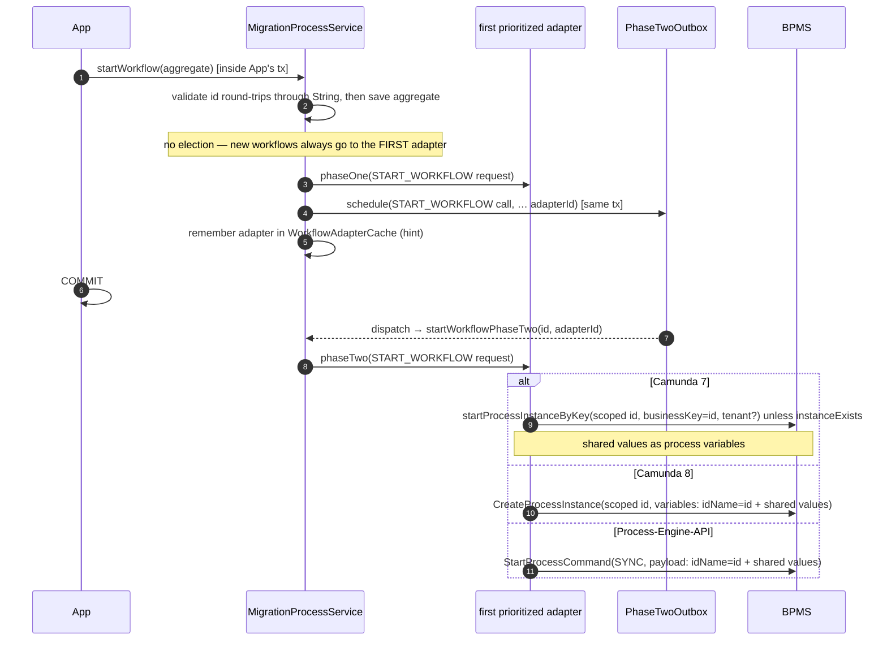

This does not touch the INBOUND direction. A BPMS which delivers a task inside its own transaction
still does so, and `TaskInvocationContext.runInCurrentTransaction()` reports it. Inbound work may
share the caller's transaction. Outbound work never does.

`AddingAnOperationTest#phaseOneRunsAndIsPlanned` and `#phaseTwoIsDispatchedThroughTheRouter` hold
the split itself. `StoreAttributionTest` and `QuarkusStoreAttributionTest` hold the resolution of
the outbox per aggregate. `OutboxStartupValidationTest` holds the boot which ends without an
outbox.

**What phase two may expect:** the dispatch calls back into the application. A remote BPMS adapter
loads the workflow aggregate to build what it sends to the BPMS. It does so on the outbox
dispatcher's own thread, where nothing the application relies on is active by itself. So VanillaBP
provides it. The `PhaseTwoRouter` runs every dispatch through
`TransactionRunner.requireTransaction`. That joins a transaction which the store already opened,
and starts one otherwise. On Quarkus that runner also activates the CDI request context, and
without it an entity manager cannot be touched at all. The guarantee sits in the router, so an
outbox which an application contributes gets it as well. Stores which dispatch inside their own
transaction (gruelbox, where an application still asks for it) keep theirs. The runner belongs to
the aggregate of the call. On both platforms the router takes it from the process service the call
routes to. Only where no process service is registered for the call's workflow module and BPMN
process does the platform's own runner step in, and Spring Boot hands none in. See the platform's
wiki page for what an application may rely on.
`PhaseTwoRouterTest#dispatchRunsInsideTheProvidedTransaction` holds the transaction around a
dispatch. `PhaseTwoJpaContextTest` and `PhaseTwoMongoContextTest` hold what an application may
touch there.

**What phase two must not do: wait.** One thread dispatches the entries of one workflow aggregate.
So whatever time an entry spends there, every other entry of that aggregate spends too. The case
which used to cost the most was a workflow which its BPMS had not made searchable yet. The election
waited out the adapter's `workflowVisibilityDelay`, ten seconds on Camunda 8, and a burst of
"start, then correlate" pairs stalled in batches. Now such an entry goes back to the store with
that window as its due time (`PhaseTwoRetryLater`), and the thread takes the next one. This answer
is not counted as an attempt, because a read model which is behind is not a failure of the entry.
Time is what ends a workflow which never becomes visible. Once
`vanillabp.outbox.wait-for-visibility-at-most` has passed since the entry was written, the next such
answer blocks the entry. If it is not set, it is the time which the attempts of
`vanillabp.outbox.block-after-attempts` take with the growing backoff, about four hours. Counting
the answers had blocked entries after fifty windows. That was eight minutes of a stopped Camunda 8
exporter, while a database which was away for hours blocked nothing (decision 49 in the
repository's DECISIONS.md). `PhaseTwoOutboxProperties#hasWaitedForVisibilityLongEnough` is the one
rule which all three stores of this repository ask. `WaitingForAReadModelUsesNoAttemptsTest` holds
it for the relational store, and `MongoWaitingForAReadModelUsesNoAttemptsTest` for the MongoDB
store of each platform. The gruelbox store lives in `io.vanillabp:gruelbox-phase-two-outbox` and
asks the same method. gruelbox counts every failed attempt and schedules it at the one distance it
knows. So the listener, which also blocks a permanent failure, fixes the row afterwards. It writes
the window, takes the counted attempt back, and blocks the entry once the wait is over. gruelbox
has no column for the moment an entry was written, so that store keeps the moment inside the stored
call. An entry written before it did so has no such moment, and there the answer still counts as
an attempt. `NotVisibleWorkflowDoesNotStallDispatchTest` holds the core's half: the entry of a
workflow which can be found is dispatched while the other one waits, and the window is the same on
every repetition. `ARejectedDispatchIsPlannedAgainTest` holds the same on Spring Boot. There a store
used to ask again on the dispatching thread instead, and decision 49 says what that cost.

**Several entries leave at the same time, and the workflow aggregate says on which thread.** Every
store VanillaBP writes itself dispatches on `vanillabp.outbox.dispatch-threads` threads, four of
them by default. `DispatchLanes` picks the thread for an entry from the workflow module, the BPMN
process and the aggregate ID. So two operations of one workflow leave in the order they were
written, while operations of different workflows leave at the same time. An entry which names no
aggregate, as a broadcast signal does, is keyed by its BPMN process instead. Handing the next entry
to whichever thread is free would be simpler, but it would lose that order. Nothing downstream
would notice until a customer did. The number of threads is bounded, because an unbounded number
only moves the limit into the connection pool, where it is harder to see. What this does NOT order
is an entry whose dispatch failed. It waits for its backoff, and the next entry of the same
aggregate passes it in the meantime, exactly as it did while one thread dispatched everything.
Decision 75 of this repository has the reasoning. `DispatchLanesTest` holds the order of one
aggregate (`oneAggregateKeepsItsOrder`), and two aggregates which really do run at the same time
(`twoAggregatesRunAtTheSameTime`).

The two MongoDB stores dispatch the same way since decision 77 of this repository. Their claim sorts
by the moment an entry was written. Without that sort the lanes would keep the order in which a
collection happened to answer. Once an attempt has moved a due time, that is not the order in which
the entries were written. The two `MongoEntriesOfOneAggregateKeepTheirOrderTest` classes hold both
halves per platform: ten operations of one workflow arrive in the order they were written, and two
operations of different workflows really are inside the adapter at the same time.

**A claimed entry which waits for its lane is still held.** The poller claims an entry and hands it
to the lane of its aggregate. That lane may be busy with an earlier entry of the same workflow. So
the renewal of the lease starts with the claim, not when the lane picks up the entry. Otherwise a
wait longer than one `attempt-frequency` would let another node claim it, and both nodes would
carry out the same operation. The wait is short, but nothing promises anybody a length, and in this
case both nodes look healthy. `AnEntryWaitingForItsLaneTest#aWaitingEntryKeepsItsLease` sees the
lease of a waiting entry move. `#anotherNodeLeavesAWaitingEntryAlone` puts a second dispatcher on
the same table and watches it walk past.

**And a node claims no more than that.** A lane takes one entry beyond the one it dispatches. So a
node holds two claims per lane, plus the one which the poller holds out to a lane which is full. The
queue used to hold sixteen, and a defect came from that. Every claimed entry is renewed once per
tick, and a tick is a third of the `attempt-frequency`. So eight lanes meant 136 writes per tick on
the one thread which renews. An application with a short `attempt-frequency` got more than eight
hundred of them a second. The thread fell behind, leases ran out under entries which were only
waiting, and the operations were carried out twice. We measured holding less against renewing on
more threads, on MongoDB and on PostgreSQL, and decision 79 of this repository has the numbers.
`AnEntryWaitingForItsLaneTest#aNodeClaimsNoBacklogBeyondItsLanes` holds the bound: forty entries are
due, one lane is busy, and three of them are claimed.

The poller borrows its connection per step, for the same reason. A lane whose queue is full makes
the poller wait. A poller which held a connection through that wait would hold the connection
which the lane needs to write down how its dispatch ended. With a pool of one that is a deadlock,
and `#aFullLaneDoesNotHoldTheConnectionItsDispatchNeeds` measures it. With a bigger pool it is a
connection missing where the work is. Every other write of this dispatcher already borrows one for
the moment it needs it, so now the poller has the same shape as the rest.

**The housekeeping left the poll.** Every poll used to end with deleting the dispatched entries
whose retention had passed, and the payloads which no entry named any more. So every application
paid for it all day long, and nobody could say what one poll cost. Now it runs in a window at
night, `vanillabp.outbox.housekeeping.start` to `.end`, and `OutboxHousekeeping` drives it. It
looks at the clock, claims the store for the window, removes the entries first and the payloads
afterwards, and publishes three numbers when the window closes. The entries go first because they
are the bulk, and the question about orphaned payloads searches the table they leave behind.
Decision 91 of this repository has the reasoning. It also says why one node per store does it, and
why the claim is not renewed while the work runs.

How much one batch takes on is measured, not configured (`HousekeepingBatchSize`). It starts with a
thousand rows. It doubles while twice the time would still fit in what is left of the window. It
halves after a batch which ran past the end. And when the next night starts, it begins with half of
the largest batch which fitted. `HousekeepingBatchSizeTest` holds every step of that.
`HousekeepingWindowTest` holds the clock, including a window which crosses midnight and the two
nights around a change of the clock.

The sweep of the payloads took three passes to get right. It used to read which payloads were old
enough, ask the entries which of them they still named, and delete the rest. Each step used a
connection which it borrowed and gave back, and each step carried a set of unknown size through
the application. Now it is one statement. The payload store deletes the payloads which are old
enough and which no entry names, and it asks the entries inside its own condition. What that
condition looks like is the store's own business and differs per store. That is why the store is
built with the table its entries lie in and the column in which they name a payload
(`JdbcPhaseTwoPayloadStore.EntriesNamingTheirPayload`). The outbox VanillaBP writes itself has a
column for it, `PAYLOAD_REFERENCE`, with an index over it, so the condition there is an equality.
gruelbox owns its table, so its reference lives inside a serialized invocation, and the condition
is a `LIKE` which scans. Decision 62 has the numbers.
`JdbcPhaseTwoPayloadStoreTest#theSweepHoldsOneConnectionAtATime` hands the store a database which
refuses a second connection. `#theSweepRemovesAtMostWhatItWasAllowedTo` holds the ceiling.
`#aFullLaneDoesNotHoldTheConnectionItsDispatchNeeds` runs the real payload store, not one with its
housekeeping taken out.

**An entry planned before the column existed gets it filled at startup.** The reference has always
travelled among the arguments, and it still does. So such an entry dispatches correctly. But it
does not answer the housekeeping, and its payload would go as an orphan. The backfill reads only
the entries which still WAIT, in rounds of a thousand. A dispatched entry gave its payload back at
the dispatch, and the dispatched entries are the part of the table which grows. On PostgreSQL
16.15 that read took 166 ms against a million rows with a hundred entries to fill.
`AnEntryPlannedBeforeTheColumnGetsItFilledTest` holds both halves: what is filled and what is left
alone.

**A lane which is stopping says that it took nothing.** A node shuts down while its poller is still
handing in claimed entries. Those entries used to be dropped without a word. The lane returned as
if it had taken the work, and the renewal of the entry's lease kept ticking until
`DispatchLease.stop()` came. Whether that happened in time depended only on the order of two calls
in `stop()`. Now `runInOrderOf` answers whether a lane took the work. Where none did, the poller
closes the renewal itself and writes one line which names the waiting operation. Nothing is lost
either way. The entry stays `OPEN` and keeps its lease. The next poll of this node or of another
one takes it once that lease runs out, so the cost is a delay of one `attempt-frequency`.
`DispatchLanesTest#aStoppingLaneSaysThatItTookNothing` holds the answer.

**A node which lost its entry writes nothing.** A lease can still be lost while its dispatch runs:
the node was away long enough for the claim to run out, and another node took over the entry. The
renewal notices it, because its write matches no row, and says so in the log. The dispatch itself
runs to its end, and its result is dropped. Every write which says how an attempt ended carries
the holder of the lease in its condition. So only the node which holds the entry writes one:
`LEASED_BY` on the JDBC store, `leasedBy` on the two MongoDB stores. Without that condition the
late node could block an entry which the other had just finished. Then somebody would be asked to
repair an operation which had succeeded. `ADispatchWhichLostItsLeaseTest` puts two dispatchers on
one database and takes the lease of the slow one away with an `UPDATE`. The second node dispatches
the entry, the first says what it lost, and afterwards the table holds what the second node wrote.
`AMongoDispatchWhichLostItsLeaseTest` does the same with two dispatchers on one MongoDB collection.
On Quarkus, `MongoADispatchWhichLostItsLeaseTest` plays the second node itself, because an
application holds one dispatcher, and a second real one would need a second application. That test
writes what another node's dispatch leaves behind, and the write which has to be refused is the
real dispatcher's.

**A write which never ran is not a write which matched no row.** The condition on the holder helps
only where the statement reached the database. A statement which did not reach it, because the pool
is empty or the connection broke, used to count as a write which took. The answer of the JDBC
dispatcher was a number, and the `-1` it gave for a failure is not zero. The entry then stayed
`OPEN` while its payload was removed, so the attempt after the lease had nothing left to send. Now
the answer says which of the three happened. A write which never ran leaves the entry as it was:
same status, same due time, same lease, and its payload next to it. The next poll of this node or
of another one reads it once the lease runs out. Nothing is counted or reported as blocked either.
The row says `OPEN`, and an operator who read a blocked entry would go and repair a row which needs
no repair. `AMarkWhichDidNotGetThroughLeavesTheEntryTest` makes both marks fail, with a second row
which holds the entry's id in the unique `DEDUP_KEY`. Afterwards it reads the payload, the row and
the meter.

What the threads bought: we measured on 2026-09-21 in the development container of this
repository. 200 entries of 40 workflow aggregates were written in one transaction against H2 in
memory. The handler takes 20 milliseconds, because that is what a call to a BPMS costs. One thread
needed 4498 ms, two 2144 ms, four 1190 ms and eight 802 ms. The measurement says what a dispatch
stage which waits for somebody else does with more threads. It says nothing about a handler which
is busy and not waiting, or about a database under load. A load test is where throughput is
defended, and a run which is faster than this one proves nothing about the order.

**What a failed dispatch costs, and why the numbers are what they are.** The distance to the next
attempt grows. `PhaseTwoOutboxProperties#attemptDelay` returns `attempt-frequency` for the first
retry and doubles it per attempt until `max-attempt-frequency` caps it. That is thirty seconds, one
minute, two, four, then five minutes for the remaining attempts, fifty of them, which is close to
four hours. The fixed distance it replaced was thirty seconds, ten times. So an outage of six
minutes (a cluster upgrade) turned every pending operation of every node into a row which somebody
had to repair by hand. The two ends of the curve answer two different questions. The cap decides
how long after a BPMS comes back the first entry reaches it. The attempt budget decides which
outage the store survives alone. Blocking then means "this entry is broken", and not "the BPMS was
away for a while". The stores VanillaBP owns compute the distance with that one method, so the
curve does not drift apart between platforms. gruelbox knows a single fixed distance and keeps it.
So an application which chose that store keeps the behaviour it always had. The table per store on
the wiki pages owns that. The distance is written where a dispatch FAILED, not when the entry is
claimed. The claim leases the entry for one `attempt-frequency`, so other pollers skip it. So a
poller which dies in the middle of a dispatch does not leave behind the long distance of an attempt
nobody made. `PhaseTwoOutboxPropertiesTest#theBackoffGrowsAndIsCapped` pins the sequence, and
`#theAttemptBudgetSpansHours` the four hours.

**What a quiet application costs, and why the poller sleeps.** A workflow application spends most
of its life waiting in a timer, and the pollers used to ask anyway: one select plus one delete per
store every ten seconds, 8640 turns a day whose answer was known. So the fixed rhythm is gone.
`DueEntryPoller` runs a store's poll, asks that store when the earliest entry it still owes
something to is due, and sleeps until exactly that moment. An entry due in four minutes is
dispatched in four minutes, not on the next tick. A store which owes nothing is left alone. The
question each store answers is its own select of due entries without the time limit. The end of
the retention of a DONE entry is not part of it. Those entries are deleted in the night window of
the housekeeping, so a wake-up only dispatches. A BLOCKED entry is not in the set either, because it
waits for a person and not for a clock.

Both stores VanillaBP owns ship one index per question, over the status and that question's
timestamp. An aggregate over a column without an index is a scan which grows with everything the
table ever held. Decision 19 forbids that for a repeated question, and decision 41 measures it.
gruelbox indexes `(processed, blocked, nextAttemptTime)` for its own flush. So that store adds
nothing and shapes its question to fit: two reads which name both flags, not one which names
`blocked` alone. Where a table was created by an earlier version, the startup names the missing
index and the statement which adds it. Creating an index on a large table is a decision with a
lock on it.

On MongoDB that check has a different shape. The first document creates a collection, so
`vanillabp.outbox.create-schema: false` leaves nothing to check but the indexes. `MongoSchema` holds
one list per collection: the outbox, its payloads and the delivery log. Both platforms create their
indexes from those lists and compare an existing collection with the same lists. An application
which looks after its own schema reads at startup which index each collection is missing. It also
gets the `createIndex` statement, which it can paste into `mongosh`. It is a warning and does not
end the boot. Every question is still answered, only it is read from the whole collection instead
of from an index. The one index which is more than speed says so in the message.
`AMissingMongoIndexIsNamedWithItsStatementTest` holds the message and the matching.
`MongoIndexesAreCreatedOrReportedTest` holds both halves against a database, and
`MongoIndexesOfAnApplicationManagingItsOwnSchemaTest` the same on Quarkus.

`vanillabp.outbox.poll-interval` caps that sleep. It is ten seconds by default, which is the rhythm
every application had before. It exists for work which a node wrote down before it went away,
because nothing tells a sleeping node about another node's row. Raising it buys the saving.
Lowering it back to seconds gives the saving away and buys nothing else. Decision 41 has the
reasoning. It also says why no notification travels between the nodes, and why we rejected a
database notification. An application which moves the cap is told at startup what else still
keeps its database awake, and `WhatStaysAwakeTest` pins that. The `OutboxSleepsWhileNothingIsDue`
tests MEASURE per store what a quiet application costs, instead of guessing it from a clock. They
count connections taken from the pool on the two JDBC stores, and commands the driver sent on the
two MongoDB ones.

The retention cleanup of the task-delivery records answers the same question differently, and
decision 43 says why. It keeps its hourly thread and runs only where a delivery was recorded since
the last run, because an application which records nothing grows nothing to delete.

**Blocking releases the deduplication key.** A blocked entry keeps everything else it has. But its
`DEDUP_KEY` (MongoDB: `dedupKey`) is replaced by the entry's own id, exactly as a dispatched entry
replaces it. Without that, a blocked entry silenced the repetition of the very operation it failed
at. The key is what refuses a second schedule. So the application asked, the store said no, and
nobody could tell that answer from a correct deduplication. One failed operation muted itself until
somebody deleted the row, and only the counter `vanillabp.outbox.discarded` made it visible at all.
The blocked row stays for whoever repairs it, so a repair now has to expect a second row for the
same operation. The gruelbox store of `io.vanillabp:gruelbox-phase-two-outbox` ends up in the same
place on another road. gruelbox has no second column to move a key into. So that store frees the
`uniqueRequestId` of a blocked row when the same key is planned again, and the row stays blocked.
Its README says so.

**A blocked entry has a written way back.** The wiki page
[Blocked outbox entries](https://github.com/vanillabp/adapter-platform-integration/wiki/Blocked-outbox-entries)
says how an operator finds such an entry, opens it again or deletes it, on the table and on the
collection. It also says what to check about a younger entry with the same key first. Every ERROR
which reports a blocked entry ends with that address. It is one constant,
`PhaseTwoOutboxProperties.BLOCKED_ENTRIES_GUIDE`. So the three dispatchers and their tests
(`PermanentPhaseTwoFailureTest` of both platforms, `MongoOutboxBlockedTest` on Quarkus and
`MongoWaitingForAReadModelUsesNoAttemptsTest` on Spring Boot) name the same page. An extension which
gave up may log an ERROR of its own next to it. Both lines stay. The extension's line says what to
check. The dispatcher's line names the row and carries the stack trace.

**A blocked entry keeps its reason.** Every write which ends an attempt also writes `LAST_FAILURE`
on the table and `lastFailure` on the MongoDB collections. It holds the reason where the attempt
failed or was answered with "not yet", and nothing where it went through. The text is built in one
place, `LastFailure`, for all three dispatchers. It has class and message of the failure and of
each cause which adds something, in one line, without the stack trace, cut to 1000 bytes of UTF-8.
Bytes and not characters, because Oracle and DB2 count a `VARCHAR` in bytes, and the write which
blocks an entry must not fail over an umlaut. An operator who opens an entry again leaves the field
alone. The next attempt overwrites or empties it. `LastFailureTest` holds the text.
`ABlockedEntryKeepsItsReasonTest` holds the writes for JDBC,
`AMongoBlockedEntryKeepsItsReasonTest` for MongoDB on Spring Boot and
`MongoBlockedEntryKeepsItsReasonTest` for MongoDB on Quarkus. The reasoning is decision 118 in the
repository's DECISIONS.md.

A scheduled call is described by the immutable value type `PhaseTwoCall`: operation, workflow
module, BPMN process, workflow-aggregate ID in serialized String form, elected adapter ID, and the
arguments of the operation. The dispatch chain is as short as possible:

```
schedule(call)                dispatch(call)         handler.phaseTwo(request)
ProcessService ──► PhaseTwoOutbox (store) ──► PhaseTwoRouter ──► MigrationProcessService ──► adapter
      within local TX             after commit        (core-owned)     (adapter election)
```

The `PhaseTwoRouter` belongs to the core. It holds a registry
`(workflowModuleId, bpmnProcessId)
→ MigrationProcessService`, which the platform integration fills when the beans are created. The
process service itself converts the serialized aggregate ID back into the aggregate's ID type
(`convertAggregateId`, backed by `AggregatePersistenceAware.getAggregateIdType()` and the core's
`AggregateIdRoundTrip`). The type is checked at startup: it must survive the round trip without
loss. A `null` type means the custom persistence layer owns the serialized form, and the String is
passed through. For `START_WORKFLOW` the adapter elected in phase one **is persisted with the
outbox entry** and used in phase two. There is no new election from the priorities which apply
then. If the adapter was removed from the configuration while the entry was still open (a stale
entry), the dispatch fails with a message which names that case. The other operations (message
correlation, completing or cancelling a task, the user-task pair, pushing a changed aggregate)
probe the prioritized adapters at dispatch time instead. So their calls carry no adapter ID. The
exception is `SEND_SIGNAL`, which names the broadcasting adapter, because a broadcast reaches every
adapter of the module. Which of the two it is, is not written anywhere in the core. It follows from
the operation's `Election`, and so do the probe the core asks and the patience it asks with.

#### An operation is defined once

An operation is a `PhaseOperation` (integration SPI) and nothing else. The record carries everything
about it which is not the business of one BPMS:

- its **name**. The store persists it, so it is a contract: never rename an operation, never change
  what an existing name means,
- its **idempotency-key derivation** (`PhaseOperation.IdempotencyKey`, a function of the
  `PhaseTwoCall`), which is just as persisted as the name,
- its **election** (`Election`), which says which BPMS serves it. For a start that is the first
  prioritized adapter. For the operations addressed to a running workflow it is whichever adapter
  holds the task, the user task or the workflow. For a broadcast it is every deployed BPMS. For an
  operation which never reaches an adapter it is "the extension dispatches it itself". The core
  reads the probe, the patience and the shape of the "nobody knows this" failure from this one
  value,
- whether **every adapter has to serve it**. That decides whether a missing handler fails the boot
  or is an honest "this BPMS has nothing like it",
- whether the **activation** in which the call was planned travels with it, and
- its **wording**: how the operation names itself in a log line or an exception ("correlating
  message 'approved'"), what to add where no BPMS knows the workflow, and what to do instead where
  an adapter cannot serve it.

What an operation DOES is in the other place, and it belongs to the adapter: a
`PhaseOperationHandler` with `phaseOne(PhaseOneRequest)` and `phaseTwo(PhaseTwoRequest)`, given per
operation in `MigratableProcessService#phaseOperations()`. That map is the only way in which an
adapter describes outbound work. There is no longer a method per operation and phase.

**So adding an operation costs one constant in `PhaseOperation` and one entry in each adapter's
map.** Nothing else. The outbox stores name, arguments and key without knowing them. The router
dispatches by name. `MigrationProcessService` runs every operation through `execute` and
`executePhaseTwo`. `AddingAnOperationTest` adds one and runs it through both phases to keep that
true.

VanillaBP's own operations (`START_WORKFLOW`, `COMPLETE_TASK`, `CANCEL_TASK`,
`COMPLETE_USER_TASK`, `CANCEL_USER_TASK`, `CORRELATE_MESSAGE`,
`START_WORKFLOW_BY_MESSAGE`, `SEND_SIGNAL`, `AGGREGATE_CHANGED`) are constants of `PhaseOperation`.
The `PhaseTwoRouter` registers them while it is built. `PhaseOperationContractTest` pins their names
and key rules, because since they stopped being enum constants, nothing else guarantees them.

An adapter which cannot serve an operation that every adapter has to serve is refused while the
application boots (`MigrationProcessService#validateAdapterOperationsAtStartup()`, held by
`AdapterOperationsAtStartupTest`). The map is the adapter's statement about what it serves. So a
forgotten operation is caught before a workflow waits for it. And the map is the whole question.
Asking the adapter's class anything would mean reflection, and reflection lies in a native image: a
method nobody registered looks like a method nobody wrote. Every adapter of a native application
would be refused.

`MigratableProcessService` is what an adapter implements, and its shape is the statement. It has a
few switches about what its BPMS can do, the probes the election walks, the map of handlers per
operation, and the read-only methods the viewer reads through.

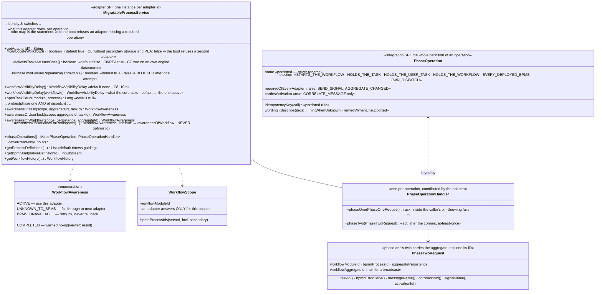

#### Operations of extensions

An **extension** contributes operations of its own, and that is why the registry
(`PhaseOperationRegistry`) exists. The extension builds them with
`PhaseOperation.extensionOperation(name)`, which enforces a namespace
(`my-extension:MY_OPERATION`). It registers them together with its own dispatch:

```java
registry.register(
    PhaseOperation
        .extensionOperation("my-extension:NOTIFY")
        .idempotencyKey(call -> Optional.of(call.workflowAggregateId() + "|" + call.args().get("event")))
        .describedAs(args -> "notifying about '%s'".formatted(args.get("event")))
        .build(),
    (call, previouslyAttempted) -> notify(call));
```

Both platform integrations offer the registry as a bean (Spring Boot:
`vanillaBpPhaseOperationRegistry`; Quarkus: a `@Singleton` producer). Scheduling works as for core
operations: build the call with `PhaseTwoCall.of(operation, ...)` and hand it to the
`PhaseTwoOutbox`, inside the business transaction. The dispatch then goes straight to the
extension's handler. The election from aggregate ID to adapter, which the core operations use,
does not apply. And no process service has to be registered for the call's BPMN process.

Some extensions have an operation which addresses a workflow the way a core operation does. Such
an extension says so through its `Election` and hands the operation to
`PhaseTwoRouter#registerOperation` instead. It is then routed to the process services like a core
operation, and every adapter which is to serve it gives a handler for it. `AddingAnOperationTest`
does exactly that.

The registry enforces rules at registration time, each with a message which guides: an operation
is registered exactly once, an extension name has a namespace, and the core's names are reserved.
At dispatch time an unregistered name is an error. It names the operation and lists the registered
ones. The entry stays in the store (like a stale adapter ID of a START entry). So an extension
which is missing from the application for a while does not quietly lose its scheduled work.

Stores never look into the registry. They persist name, arguments and key and know nothing about
the operation. `PhaseOperationRegistryTest` holds the rules the registry enforces.
`ExtensionOperationDispatchTest` runs an extension operation through both platforms.

The core defines the `PhaseTwoOutbox` contract. Since decision 75 of this repository it also writes
one store against it: the JDBC store which both platforms run. It lives here and takes only its
connection and its transaction from the platform. The contract holds for that store, for the
MongoDB ones, and for a store which an application brings itself:

- **Scheduling:** `schedule(call)` MUST be called within the local transaction which persists the
  workflow aggregate, while that transaction still runs. It MUST enlist the outbox entry in exactly
  that transaction. The entry becomes visible if and only if the transaction commits.
- **Idempotency key:** implementations MUST enforce that
  `PhaseTwoCall.idempotencyKey()` (where present) is unique, via the store's unique-constraint
  mechanism. A duplicate `schedule` does nothing and returns `false`. For
  `START_WORKFLOW` the key is
  `START_WORKFLOW|workflowModuleId|bpmnProcessId|workflowAggregateId`. That is how the storage
  enforces "a workflow is started at most once per aggregate". Every key names its operation, so
  completing and cancelling one task no longer share a key. `START_WORKFLOW_BY_MESSAGE` derives
  the key of the plain start on purpose. A key deduplicates only the entries STILL WAITING for
  their dispatch (decision 22 of this repository). A repetition after the dispatch is a new
  operation. A store which discards a schedule returns `false`.
  `MigrationProcessService#reportDiscardedSchedule` turns that into a WARN which names what was
  dropped, because a discard against a pending entry may just as well be a lost operation as a
  redelivery. The same place counts it as `vanillabp.outbox.discarded`, tagged by operation, so you
  can put an alarm on the case instead of reading logs. The core takes the count, not each store.
  That is why gruelbox and the VanillaBP stores report the same number. The key is limited to 250
  bytes of UTF-8 and hashed beyond that (`StoredKey`, shared with the inbound delivery key), because
  gruelbox refuses a unique request ID longer than 250 characters, and Oracle and DB2 count bytes.
  An aggregate ID longer than the 1024 characters of the `AGGREGATE_ID` column is refused where the
  call is built, with a message which names the column. That check counts characters. On Oracle and
  DB2 an ID with characters outside ASCII can be longer than 1024 bytes and still pass it. The
  insert fails there, see "Which databases" in the schema README. The rules for deriving the key per operation are documented on `PhaseOperation` and are a
  persisted contract.
- **The youngest call may replace the one still waiting** (decision 68 of this repository). Some
  calls carry the state their caller saw (the payload of decision 62). Such a call loses that state
  where the older entry wins, and under a backlog the report which survives is the one furthest
  behind. Such a call says `PhaseTwoCall.replacingWhatIsStillWaiting()` and goes to
  `PhaseTwoOutbox.scheduleReplacingWhatIsStillWaiting`. The store then puts it into the waiting
  entry, payload included, in the transaction in which it was planned. It removes the payload the
  replaced entry named. Without that word nothing changes, and only an operation an extension
  registered may say it. What VanillaBP plans itself reads the state it needs at dispatch time, so
  `PhaseTwoCall` refuses the word for its own operations. An entry which a dispatch has already
  taken is NOT replaced. It runs to its end, and the younger call becomes an entry of its own. That
  entry holds no key, because the key belongs to the entry on its way. The stores VanillaBP wrote
  itself read that from `ATTEMPTS` plus the lease of the entry: no attempt of it has ended, and
  nobody holds it right now. They need the pair, because the attempts are written when an attempt
  ends. gruelbox reads it from
  its `version` column plus the register of `GruelboxRedispatchAwareSubmitter`. A gruelbox entry
  submitted right after a commit was never pushed back, and the dispatch locks its row. A store
  which never learned replacing inherits the default of `scheduleReplacingWhatIsStillWaiting`. That
  default discards as before and writes a WARN which names the store.
  `AYoungerCallReplacesTheWaitingOneTest` (JDBC on Spring Boot), `ExtensionOperationDispatchTest`
  (JDBC on Quarkus) and `MongoPhaseTwoPayloadTest` on both platforms hold it.
- **The activation which planned a correlation is part of its key**, and of no other key (decision
  23 of this repository). A called process is a secondary workflow of the SAME aggregate. So three
  elements of a multi-instance call activity used to derive one key, and two of the three were
  discarded. `RunningActivation` is the scope bound to the thread which the core opens around a
  task delivery and around a workflow the BPMS started. It is filled from
  `TaskInvocationContext#getActivationId()` or
  `BpmsInitiatedStartContext#getNativeInstanceId()`.
  `CORRELATE_MESSAGE` is the one operation which says it `carriesActivation()`. So the core reads
  the scope into `ARG_ACTIVATION_ID` while it plans the call. That is the one path on which a
  correlation is planned, and the one which runs on the handler's thread.
  `PhaseOperation.CORRELATE_MESSAGE` derives from that argument. So the derivation stays a pure
  function of what a store persists. Outside any invocation there is no activation, and the key is
  what it always was. A REST endpoint, and a thread the handler started itself, get that fallback.
  `START_WORKFLOW` and the task operations must NOT carry it, because they deduplicate across
  activations on purpose.
- **The same argument reaches the adapter at dispatch time**, as
  `PhaseTwoRequest#activationId()`. Phase two runs on the dispatcher's thread, long after the
  thread which knew the activation moved on. So the value travels with the entry and is not read
  again. A BPMS which deduplicates messages in a net of its own needs the same distinction there.
  Camunda 8 derives a message id from the same values. Without the activation, three
  multi-instance siblings reach the outbox as three operations, but that cluster as one message.
- **Recovery:** every entry which is committed but not processed has to be dispatched through the
  `PhaseTwoRouter` right after the commit *and* after a restart of the application (crash
  recovery). Failed dispatches are retried with a backoff.
- **DONE instead of delete:** a successful dispatch marks the entry DONE. The physical deletion
  happens asynchronously after a retention you can configure (`vanillabp.outbox.retention`,
  default 7 days). That keeps a dispatched entry readable for support, and it does NOT extend the
  deduplication window. When the store marks the entry DONE, it takes the key out of what enforces
  uniqueness. Entries which fail again and again are blocked (an ERROR log which names
  module/process/aggregate/operation) and left as a trail you can monitor.
- **The window which remains with at-least-once:** a crash between the remote BPMS call and marking
  the entry DONE dispatches the entry again on recovery. We accept this (eventual consistency). So
  an adapter's handler MUST tolerate a repeated phase two. A second `START_WORKFLOW` for a workflow
  which already started has to return without starting another workflow instance.
- **Mitigation for a repeated START dispatch (it makes the window smaller, it does not close
  it):** stores pass "this entry was dispatched before" to
  `PhaseTwoRouter.dispatch(call, previouslyAttempted)`. The JDBC/MongoDB defaults read it from two
  places. An attempt which ENDED is counted in the attempts. An attempt whose node died in the
  middle left that node's name in the lease. So a recovered or retried entry is recognized either
  way. The gruelbox store bridges its entry state via a `Submitter` wrapper. There the counter only
  goes up on FAILED attempts, so after a hard crash the entry is still dispatched again without the
  probe. A START entry which was attempted before first reads the row written when the workflow
  started. Where it names the recorded adapter, the earlier dispatch succeeded. The entry is then
  consumed without a second start, and nobody is asked. Only without such a row is the recorded
  adapter's `awarenessOfWorkflowForRedispatch` probed, with the same result for a workflow already
  known there. The row matters on a BPMS which searches a read model. While that read model is
  behind, the probe says "unknown" for a workflow which the first attempt created, and the start
  would run twice. A second instance has jobs of its own, so the delivery log sees no repetition
  either. Neither the row nor the probe can tell an earlier, ended workflow of the same aggregate
  from the one this entry starts.
  The probe's contract is stricter than the election's. It is NEVER optimistic. A wrong "known"
  loses a workflow. A wrong "unknown" only gives the duplicate which the remaining window allows
  anyway. Adapters which cannot query reliably answer `UNKNOWN_TO_BPMS`.

The picture puts the same start on a time line which crosses a crash. It shows what the caller's
transaction commits, what the dispatcher picks up afterwards, and where the redispatch probe sits
between a repeated entry and a second workflow.

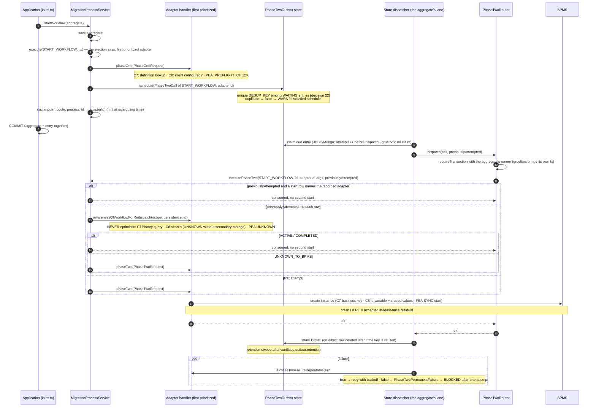

Every rule of that list has a test. Scheduling inside the transaction and dispatching after the
commit: `OutboxDispatchTest#entryWrittenInSameTransactionAndPhaseTwoDispatchedAfterCommit` and
`#rollbackLeavesNoEntryAndNoPhaseTwo`. The idempotency key:
`OutboxDispatchTest#duplicateScheduleAgainstAPendingEntryIsNoOp` next to
`RepeatedOperationTest#aSecondStartAfterTheDispatchIsPlanned`. The key released with the dispatch:
`GruelboxDeduplicationWindowTest#aDispatchedEntryIsReleased`. Recovery after a restart:
`OutboxRecoveryTest`. The redispatch probe:
`OutboxRedispatchMitigationTest#retriedStartEntryDoesNotStartASecondWorkflow`, and the start row
read before it: `AnOperationReadsTheStartRowTest#aRetriedStartWithARowStartsNothing`. The
discarded schedule: `DiscardedScheduleTest`. The activation carried by a correlation's key:
`ActivationIdentityTest` together with
`PhaseOperationContractTest#noOtherKeyCarriesAnActivation`. That a missing outbox ends the boot:
`OutboxStartupValidationTest`.

The platform integrations provide default implementations. They are configured via
`vanillabp.outbox.*`. Keys, defaults and documentation are modeled ONCE, in the core class
`PhaseTwoOutboxProperties`, which is bound as part of the `vanillabp.*` tree. Applications may
define their own `PhaseTwoOutbox` bean instead:

|  Platform   |       Persistence        |                                               Implementation                                               |
|-------------|--------------------------|------------------------------------------------------------------------------------------------------------|
| Spring Boot | JPA                      | the core's `JdbcPhaseTwoOutboxStore`, with the connection and the transaction of `spring-boot-integration` |
| Spring Boot | MongoDB                  | own implementation using `MongoTemplate` (`spring-boot-integration`)                                       |
| Quarkus     | JDBC datasource (Agroal) | the same core store, on an Agroal connection enlisted in the running JTA transaction                       |
| Spring Boot | JPA, another artifact    | based on `com.gruelbox:transactionoutbox`, in `io.vanillabp:gruelbox-phase-two-outbox`                     |

### Telling the application that a workflow ended (`WorkflowEndedInvoker`)

This is the counterpart of the start initiated by the BPMS. It is the one handler kind whose whole
point is that nothing depends on it:

- Adapters ask `workflowEndedHandlerExists(module, process)` while wiring, and attach their
  listener only where the answer is yes. A model must not pay for a notification which the
  application did not ask for. That is why the question exists at all, instead of a plain "always
  attach".
- `workflowEnded(module, process, context)` loads the aggregate, calls the method and saves the
  aggregate. It does so in the caller's transaction (embedded BPMS) or in a new one (remote BPMS).
- A missing aggregate is NOT an error. An application may delete the aggregate of a workflow which
  ended, and a redelivered notification would find nothing either. Both cases are logged and
  skipped.
- What the context reports about the KIND of end is the adapter's honest answer, not a made-up
  normal form. Camunda 7 tells a cancellation from a regular end by the execution's delete reason.
  Camunda 8 never sees the end of a cancelled instance.

`WorkflowEndedTest` holds all four points. `withoutAMethodNothingHappens` holds the question asked
while wiring, and `aDeletedAggregateIsNoError` the aggregate which is gone.

#### A called process is no workflow of its own

A process which is declared only in `secondaryBpmnProcesses`, and whose model is deployed during
this boot, is a called process (`WorkflowTaskRegistry.isACalledProcess`). It runs on the aggregate
of its caller, so its start and its end are steps of that workflow. `workflowEndedHandlerExists`
and `startsAWorkflowOfItsOwn` answer `false` for it, and an adapter leaves out its listeners. A
notification which still arrives is answered without effect on the workflow. An end only cancels
the open tasks of that instance. A start builds nothing and writes no start row. The end of the
workflow at the top releases the delivery records of every served id, because nothing else ends
the records of the called process any more.

The second half of the rule keeps renamed processes working. The id a renamed process left behind
is also declared as a secondary process, but no model arrives for it. And the workflows which the
BPMS still holds under it were started under it. `ACalledProcessIsNoWorkflowTest` on both platforms
holds both halves, see decision 124 in the repository's `DECISIONS.md`.

Whether a process is a called one must not depend on the order in which the classes are found. So a
BPMN process belongs to exactly one workflow aggregate per workflow module. If classes of different
aggregates declare the same id, the start ends, however each of them declares it. Quarkus says it
while building, Spring Boot while the first `ProcessService` is built. `registerWorkflowService`
throws as well, for a platform which did not check. `AProcessBelongsToOneAggregate` builds the text
for all three, see decision 125 in the repository's `DECISIONS.md`.

#### A workflow which is gone cancels what it was waiting for

Where the notification NAMES the workflow (`WorkflowEndedContext.getWorkflowId()`), the core reads
the tasks it still believes are open in that workflow. It reports every one of them to the
application as `TaskEvent.Event.CANCELED`. Then `@WorkflowEnded` runs. A workflow which ended has
nothing open any more, so this is knowledge and not a guess.

- The read is `TaskDeliveryLog.openTasksOfWorkflow`. It costs 0.01 ms with the index over
  `WORKFLOW_ID`.
- A record which names ANOTHER adapter is left alone. `TaskDelivery.adapterId()` says who
  delivered the task, so nothing has to be asked. During a migration one aggregate may carry work
  of two BPMSs, and this end says nothing about the other one.
- Each record is handled in a transaction of its own, in this order. First the record is CLAIMED
  with `markTaskClosed`. The delivery follows only where the claim took. That makes two application
  instances safe, and it is decision 72. A handler which throws rolls back its transaction, and the
  claim goes with it. The task is then derived again the next time somebody looks: at-least-once,
  like everything else here. The failure stays with that one record. The end of the workflow is
  reported either way.
- The KIND of the end does not decide it (decision 73). A terminate end event and an interrupting
  event subprocess end a Camunda 8 instance as COMPLETED, while they take an open task with them.
  So reading the kind first would skip exactly those.
- An adapter whose BPMS cancels each element by itself names no workflow here, and nothing is
  derived. Camunda 7 fires an END execution listener per element, process termination included.
  So a derivation on top would report the same task twice.
- A derived delivery carries no job of the element. So a `@TaskParam` and a multi-instance value
  reach the method as `null`. The boot names the methods which really declare one
  (`WorkflowTaskRegistry.reportWhatACancelationCannotCarry`) and says nothing about the rest.

The race this accepts: a task which the application completed a few milliseconds ago is gone as
well. An end which arrives between the dispatch of that completion and the mark on its record
reads a completed task as canceled. The compare and set makes that window smaller, but does not
close it.

`DerivedCancelationTest` holds it on both platforms: two open tasks reported oldest first, with the
end after them; an end which names no workflow and derives nothing; a record of another adapter
left alone; a handler which throws and leaves its record open; and the boot naming the method which
a derived cancellation cannot fill.

### The core probes what it still believes is open

An application on a remote BPMS learns nothing on its own. An adapter calls `WorkflowTaskInvoker`
`.reportTasksTheBpmsNoLongerHas(module, process, wakeUp, probe)` after it handed over a delivery.
The core looks at the other tasks it believes are open in the SAME workflow. It asks the probe
whether they still exist, and reports the ones which are gone as `TaskEvent.Event.CANCELED`. The
scope is the one workflow the wake-up belongs to, never the tree of workflows an aggregate owns.

This blindness is not a trait of one BPMS, and that is why the loop is here and not in an adapter.
The Process-Engine-API has it as well. An embedded engine does not, because it says per element
what it took away. So the core runs the loop, and the adapter answers one question.

What one call does, in the order which makes it cheap:

1. A BPMN process without an asynchronous task returns at once. The core knows that from the
   deployment. Most applications are that case, so most applications pay nothing.
2. A scope whose `vanillabp.delivery.check-open-tasks-on-delivery` is `false`, or whose
   `vanillabp.delivery.max-open-tasks-checked` is zero, returns as well. Both can be set per
   workflow module, per workflow and per task.
3. The open records of that workflow are read with `TaskDeliveryLog.openTasksOfWorkflow`. That
   takes 0.01 ms with the index over `WORKFLOW_ID`.
4. The record of the task which woke us up is dropped by its own task id, and so is every record
   which another adapter wrote.
5. The rest is probed, oldest record first, up to ten per wake-up. What is not reached this time is
   reached at the next one.
6. Every task which the probe calls gone goes through the derivation of the ended workflow: a
   transaction of its own, the claim with `markTaskClosed`, the delivery in the same transaction.
   That code is written once (`DerivedCancelations`).

The probe has three answers, and only `GONE` cancels (decision 74). A probe which cannot say is not
a probe which said no. A probe which throws is read as "cannot say" and reported once. The delivery
which led there is done and must not be lost over it.

Every question names the task definition of the record, `stillExists(workflowId, taskId,
taskDefinition)`. Some BPMSs answer about some kinds of task and not about others, and the two ids
alone do not say which kind is asked about. On Camunda 8 a user task which the engine manages lives
in a namespace of its own. So an adapter without the definition has to refuse for every record of
a process which holds one, and the plain service tasks of that process lose their derived
cancellation with it. With the definition the refusal is per record. A probe which implements
`stillExists(workflowId, taskId)` alone is asked through the default and decides as it always did.

Since `TaskInvocationContext.getTaskKind()` exists, the record states the kind of task directly.
The argument stays the definition all the same. The kind cannot say whether a single ELEMENT may be
probed. The Camunda 8 adapter reads that from the definition, for a user task which carries an
`updating` listener nobody serves. The reasoning sits in the javadoc of `stillExists`, so the
question is not asked again.

What this does not promise: a workflow which walks into a timer or a message wait after the
boundary event produces no job. So nothing wakes up the application, and the cancellation waits.
Three things catch it later: the next job of that workflow, the end of the workflow, and the next
operation which names the task.

`OtherOpenTasksOfAWakeUpTest` holds the six steps, the three answers and the probe which throws.
`DerivedCancelationTest` holds the booted path on both platforms.

### Broadcasting signals

A signal is the one BPMS operation which is not about a workflow. So it is the one place where
neither election nor aggregate applies:

- The scope is the WORKFLOW MODULE of the calling process service. Each adapter broadcasts through
  ITS own client with ITS tenant. The signal name is scoped like every other identifier of the
  module (with a prefix in `use-prefix`). Crossing module boundaries is left to the application on
  purpose. A module is a scope, and which modules a signal is meant for is a business question.
- `MigrationProcessService.sendSignal(name)` fans out over the DEPLOYMENT UNION of the workflow
  module (`getDeploymentAdaptersFor`), not over the prioritized adapters of the calling process
  service. During a migration the subscriptions are spread across the BPMSs, and a partial
  broadcast is worse than none.
- Every adapter is asked before the first failure is reported. A broadcast which stopped at the
  first BPMS it cannot reach would leave the others waiting.
- Every adapter gets one `SEND_SIGNAL` outbox entry, which carries its adapter id. The dispatch goes
  to exactly that adapter, without probing. There is no idempotency key, because nothing about a
  signal can be deduplicated.
- The call carries no aggregate ID. That is why `PhaseTwoCall` allows it to be absent. The router
  converts none where the call carries none.
- An adapter whose BPMS has no signals gives no handler for `SEND_SIGNAL`. That is allowed, because
  the operation is not required of every adapter. An application which asks for one gets a
  `PhaseOperationNotSupported`, which names the adapter and what to do instead.

`SendSignalTest` holds the fan-out over the deployment union (`everyDeployedBpmsIsReached`,
`oneFailingBpmsDoesNotStopTheOthers`), the adapter recorded per entry
(`phaseTwoUsesTheRecordedAdapter`) and the refusal (`anAdapterWithoutSignalsSaysSo`), in the core
and on both platforms.

### Pushing a changed aggregate (`aggregateChanged`)

`MigrationProcessService.aggregateChanged(aggregate, taskId)` is `correlateMessage` with another
verb. It saves the aggregate, locates the BPMS and schedules an `AGGREGATE_CHANGED` outbox entry. A
completed workflow gives a no-op with a warning. An unknown one gives a `WorkflowNotFoundException`
which says that the aggregate WAS saved. Locating means probing `awarenessOfWorkflow`. The
exception is a call which names a task whose delivery record is still open. Then the record
answers, see [the record answers which BPMS holds a task](#the-record-answers-which-bpms-holds-a-task).

Two decisions are worth knowing:

- **No idempotency key.** The values are read from the aggregate when the entry is DISPATCHED. So a
  redelivered entry writes the state of that moment. A key could only ever drop a push, never save
  one.
- **The task id decides the scope and nothing else.** Without one, the values belong to the
  workflow's global scope. With one, they belong to the scope the task RUNS in: the process, an
  embedded subprocess, or one iteration of a multi-instance embedded subprocess. Never the task's
  own scope, and never the global one in addition, or the other iterations would see what one of
  them pushed. Which execution or element instance that is, is the adapter's business. The core
  only transports the id (in `ARG_TASK_ID`).

The order of outbox entries holds only in part. The dispatchers select the due entries
(`NEXT_ATTEMPT_AT <= now`) oldest first: the relational store sorts by `CREATED_AT`, the MongoDB
stores by `createdAt`. One lane per workflow aggregate keeps that order (decisions 75 and 77). Two
gaps stay. Two entries written in the same moment, which can happen in one transaction, come in the
order the database picks. And a failed entry waits for its backoff while the next entry of the same
aggregate passes it. So a push and a task completion scheduled in the same transaction may still
reach a remote BPMS in the other order. An application which needs a strict order can keep the calls
in separate transactions.

`AggregateChangedTest` holds the shape and both decisions (`theTaskIdDecidesTheScope`,
`phaseTwoElectsByProbing`, `aCompletedWorkflowIsNoFailure`, `anUnknownWorkflowFailsGuiding`).
`EntriesOfOneAggregateKeepTheirOrderTest` and `MongoEntriesOfOneAggregateKeepTheirOrderTest` hold
the order of entries written one after the other. The two gaps have no test, because there is
nothing to hold: they are what the stores do not promise.

WHAT is pushed stays the business of the sync model. This operation adds no second way to choose
values. That keeps the aggregate the single source of truth.

Which values a BPMS gets to see is computed in one place and written in several, and the picture
shows that. The aggregate's annotations decide the map, and the core computes it. Every outbound
operation carries it to the BPMS, and nothing in VanillaBP ever reads it back.

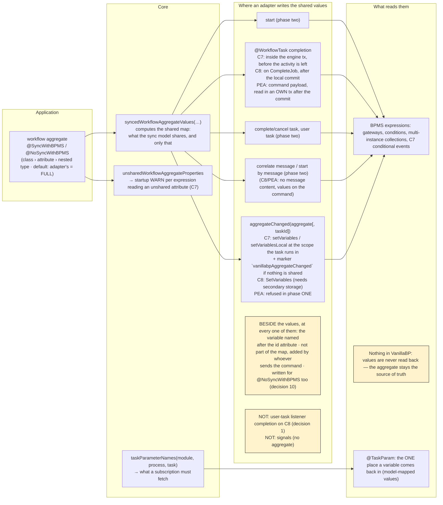

### The start of a workflow (`BpmsInitiatedStartInvoker`)

Every workflow starts somewhere, and the BPMS reports every one of those starts. What a start MEANS
is read from the state of the workflow, not from the kind of its start event. That is why an
adapter hangs its listener on every start event of a process, the plain one and the message one
included.

The rule is one sentence: the id of a workflow is the id of its workflow aggregate, and the
application assigns it. The BPMS holds that id afterwards. Camunda 7 holds it as the business key,
Camunda 8 and the Process-Engine-API as a process variable named after the aggregate's id
attribute. See [decision 69](../DECISIONS.md).

Adapters use the SPI (`io.vanillabp.integration.adapter.spi.workflowstart`) twice:

- `validateBpmsInitiatedStarts(module, process, specs)` during `wireBpmn`, with EVERY start event
  of the deployed process. The core registers them. It reports an application method which serves
  a start event that does not exist. And it refuses a process whose BPMS fires a start event by
  itself, if that process has no method for it. Signal names are reported PLAIN, because scoping
  stays invisible above the BPMS boundary. Throwing follows the `deployment-failure` policy.
- `startWorkflowByBpms(module, process, context)` for every start the BPMS reports, the
  application's own included. The context carries values only: start event id, kind, the business
  key where the BPMS keeps one, the variables the model set, and whether the aggregate has to be
  built in the CALLER's transaction (embedded BPMS) or in a new one (remote BPMS).

What the core does, in one transaction, by reading the state:

- The BPMS holds a name, and a workflow aggregate carries it. Then the workflow is already ours,
  and nothing is built. That is the application's own start. It also keeps a second delivery of
  the same notification from building a second aggregate.
- The BPMS holds no name. Then the workflow was started outside VanillaBP. The application's
  `@WorkflowStartedByBpms` method builds the aggregate and names it, and the adapter writes that
  name into the BPMS.
- The BPMS holds a name which no workflow aggregate carries. Then the start is refused.
- There is no `@WorkflowStartedByBpms` method for a start without a name. Then the start is
  refused, and the message contains the method to write.

The result carries the aggregate's ID, the name of its ID attribute, and the variables the adapter
writes back. Those are the ID variable plus the values shared per `@SyncWithBPMS`, where the adapter
asks for them (`AggregateSyncMode`).

The core builds no aggregate of its own. An object which comes into existence without the
application does not carry the application's values, and here that would be the first thing which
ever happens to the workflow (see decision 69 in the repository's DECISIONS.md). There is no
trigger time either. The moment a start event fired is a value which the application models as a
process variable, fills by an expression and reads as a `@TaskParam`.

`BpmsInitiatedStartScanner` scans the `@WorkflowStartedByBpms` methods, and `BpmsInitiatedStarts`
holds them. `WorkflowTaskRegistry` delegates the second interface for adapters to it. The scanner
builds its parameters from `CoreParameterBinders`, the one place where `@TaskParam` is bound. It is
shared with the scanners of `@WorkflowTask` and `@WorkflowEnded`, and with the
[handler contracts of an extension](#the-extensions-own-annotation-handler-contracts). The aggregate
is NOT among the parameters here, because it does not exist before this method runs. Two things stay
its own: which start event a method serves, and the check that every start event which the BPMS
fires by itself has a method. That check works per start event. So a process with a timer and a
signal cannot serve one of them and fire the other into nothing. A plain or message start event is
not checked that way. It has the shape of the application's own start, and a foreign start through
one of them says so when it happens.

An adapter whose BPMS cannot report such a start implements none of this. It fails the deployment
of such a process with a message which guides. A workflow which could never get an aggregate is
better refused than deployed.

The picture below shows the other direction: a start which nobody made through VanillaBP. The
adapter reports it. The core finds no name and lets the application build the aggregate. The
adapter writes its id back into the running instance.

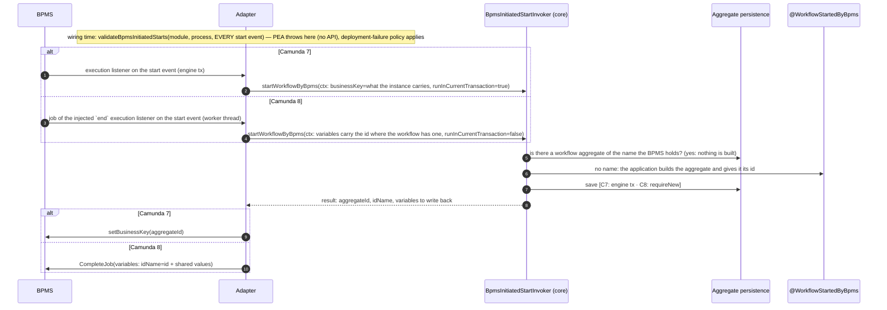

`BpmsInitiatedStartTest` holds building and validating
(`aWorkflowTheBpmsAlreadyNamesIsLeftAlone`, `aNameNoWorkflowAggregateCarriesIsRefused`,
`aSecondDeliveryBuildsNoSecondAggregate`, `aStartNobodyBuildsIsRefusedWithTheMethodToWrite`,
`methodNamingAnUnknownStartEventFailsTheBoot`).

#### A message starts only the process of its own process service

`ProcessService#startWorkflowByMessage` starts the process of its own process service and no other.
Without that rule, a message which starts ANOTHER process would start that one. The core would
then record the new workflow under the process of the caller, and `workflowIdOf` would answer an
id which belongs to a different process.

So adapters report the messages which start each process while they wire it
(`BpmsInitiatedStartInvoker#reportStartMessages`). `StartMessages` keeps them per adapter,
workflow module and process. `MigrationProcessService#startWorkflowByMessage` asks it before
anything is saved. A message which is not among the names is refused with an
`IllegalArgumentException`, which names the process and the messages which start it.

Three choices shape the check:

- The names are kept per ADAPTER, and the adapter which starts the workflow is asked. That is the
  first of the prioritized adapters. During a migration two adapters may deploy two versions of
  one process, and only the one which starts decides what a start reaches.
- The names come from the model which the adapter deploys during this start. A message always
  starts the newest version of a process, and the newest version this application knows is the one
  it deploys. A node of a rolling deployment which still runs the older code checks against its
  older model. That is what that code expects.
- The names are the plain ones. An adapter strips its name-clash prefix before it reports, and it
  scopes the name the application passes before it correlates. So the check compares the name the
  application passed with the name the model holds, both without the prefix.

An adapter which reports nothing for a process is not checked for it. That keeps an adapter working
which does not know the report yet, and one which cannot read a model at all, such as the
Process-Engine-API. `sayWhereStartMessagesAreNotCheckedAfterDeployment` says so once per process
after the deployment, at INFO. It leaves out an id which the application only declares: no model
was deployed for it, so there is nothing to report.

Decision 109 in the repository's DECISIONS.md is the decision behind it. `StartMessagesTest` holds
the cases and, per platform, `AMessageStartsOnlyItsOwnProcessTest`.

### Viewer/history API (read path)

`ProcessService#getProcessDefinitions`, `#getBpmnXml` and `#getWorkflowHistory` are read-only. No
aggregate is saved, no transaction is required, and no workflow moves forward. All three live in
`WorkflowViewer`, which the process service holds and delegates to. The reading half has an
election of its own and shares nothing with the writing half but the walk. The BPMS which answers
is elected by the same `WorkflowLocator` walk, with probing and caching, as every other operation on
an existing workflow. There is one difference: `COMPLETED` is a REGULAR result (viewers show ended
workflows). Only a workflow which EVERY adapter does not know raises the SPI's
`WorkflowNotFoundException`.

**Composite process definition ids.** `getBpmnXml(processDefinitionId)` addresses a process
DEFINITION, not a workflow. So there is no aggregate by which to elect a BPMS. That is why the core
puts a namespace in front of every adapter-native definition id it hands out (also the one inside
`WorkflowHistory#processDefinitionId()`):

```
<adapter id>#<adapter-native definition id>
```

Split at the FIRST `#`. Adapter ids are configuration keys and never contain one. Native ids may
contain one, e.g. Camunda 7's `MyProcess:1:8a9c…`. `ProcessDefinitionIds` models the scheme, and it
is a stable contract: applications may store such ids (e.g. in a viewer's URL). Adapters only ever
see their native ids. The core strips the namespace before it calls
`MigratableProcessService#getBpmnXml`, and routes to the adapter which the namespace names. An
unknown adapter, a malformed id or an unknown definition gives a
`ProcessDefinitionNotFoundException`, each with a message which guides.

Adapters answer "I do not know this workflow" with an empty list or `null`. A BPMS without an
element history reports `elementsHistory()` as `null` (the SPI's "not supported by the underlying
BPMS"). An eventually consistent BPMS reports what is visible, and raises no error.

`ViewerApiTest` holds the composite id and the read path (`compositeIdSchemeRoundTrips`,
`bpmnXmlIsRoutedByTheCompositeId`, `completedWorkflowsAreViewable`,
`malformedProcessDefinitionIdRaisesGuidingError`).

### Aggregate persistence

The core does not know any persistence technology.
`io.vanillabp.integration.spi.AggregatePersistenceAware` (module `integration-spi`) abstracts how
an aggregate is saved and how its ID is found. The platform integration provides implementations
(e.g. based on Spring Data), or the business application provides its own. The implementation with
the most specific generic type for the aggregate wins. It is the one canonical interface on all
platforms. Business code implements it, whether it runs on Spring Boot or on Quarkus.

### What the platform hands a process service (`MigrationProcessService.Builder`)

There is one process service per workflow module and BPMN process. It is built, not constructed:
`MigrationProcessService.forBpmnProcess(module, process, aggregateClass)` opens a builder, and what
follows names what it is given. Three of those are mandatory: the bound configuration, the
persistence of the workflow aggregate, and the process services of the adapters. `build()` refuses
a set without one of them and names the BPMN process and every missing name. The rest are what a
platform integration always hands over, and what a test leaves out where it does not need it:
`workflowAdapterCache` (without it every election probes), `taskDeliveryLogResolver` (without it
deliveries are not deduplicated), `transactionRunnerResolver` (without it the runner the caller
passes is used) and `phaseTwoOutboxResolver`, whose absence `validatePhaseTwoOutboxAtStartup`
reports at startup. Before this there were four constructors with seven to ten parameters. A call
site said `null, null`, and a reader had to count positions to learn what was left out.

### What the platform hands an adapter (`AdapterCollaborators`)

An adapter takes ONE object in its constructor. The platform integration it runs on builds it
(`AdapterBeanRegistrarSupport.collaborators` on Spring Boot,
`AdapterCollaboratorsSupport.collaborators` on Quarkus). Five collaborators are mandatory, because
both integrations provide them for every application:

|        collaborator         |                                               what the adapter does with it                                               |
|-----------------------------|---------------------------------------------------------------------------------------------------------------------------|
| `WorkflowTaskWiring`        | asks while it reads a BPMN file: is this task wired, what is the aggregate-ID name, which parameters does the method read |
| `WorkflowTaskInvoker`       | hands a delivered task to the application                                                                                 |
| `NameClashAvoidanceSupport` | scopes what it deploys, so two workflow modules on one BPMS do not collide                                                |
| `WorkflowAggregateSync`     | which values of a workflow aggregate the BPMS may see                                                                     |
| `PreCommitRegistrar`        | hangs work which has to run before the caller's transaction commits                                                       |

A set built without one of them throws, and names the adapter id and what is missing. Two more are
handed over as `Optional`, because an adapter has to work without them. An application which asks
for neither has nothing to report to:

|        collaborator         |                                          what the adapter does with it                                          |
|-----------------------------|-----------------------------------------------------------------------------------------------------------------|
| `WorkflowEndedInvoker`      | reports that a workflow ended, and asks whether a process even needs the listener                               |
| `BpmsInitiatedStartInvoker` | reports a workflow the BPMS started by itself, and validates the start events against the application's methods |

Both platforms do provide those two today, from the same core bean as the mandatory ones. So an
adapter built without one is nearly always a registration which left it out. The build writes a
WARN which names the adapter id and the collaborator. Decision 28 says why the object exists at
all. The collaborators used to arrive by setter. A registrar which forgot one produced an adapter
which deployed, ran tasks and never reported a workflow end, and nothing failed anywhere.
`AdapterCollaboratorsTest` holds both halves: the refusal of a missing mandatory collaborator and
the WARN about an absent optional one.

What is NOT in the object stays the adapter's own constructor argument: what it resolves from its
configuration (a job timeout, a retry backoff, the variables a worker fetches) and what its own
extension gives (its metrics).

Where the collaborators come from differs per platform, and the picture puts them side by side.
The adapter's Spring Boot module registers one bean per configured id. Its Quarkus modules produce
the same per id, through a build step and a producer. Both hand the adapter the one object. The
integration SPI at the bottom is the part which an adapter never implements itself.

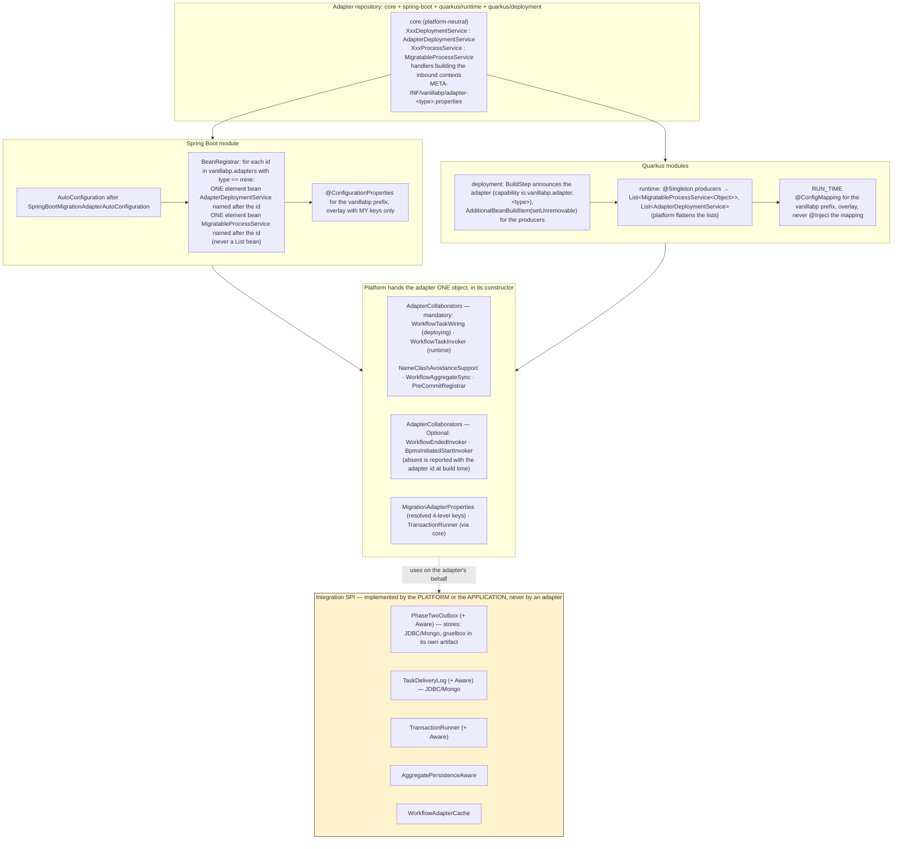

### The transaction the work runs in

VanillaBP wraps everything it does around one workflow aggregate in ONE transaction. Six steps
either all commit, or none of them do: the lookup of a processed delivery, loading the aggregate,
calling the `@WorkflowTask` method, saving the aggregate, writing the delivery record, and
scheduling a phase-two outbox entry. `TransactionRunnerResolutionTest` holds which runner is chosen
for an aggregate, plus `SpringTransactionRunnerResolverTest` and
`QuarkusTransactionRunnerResolverTest` per platform. That the six steps really share one
transaction is proved per platform by the outbox and delivery integration tests, not by a unit
test. The core's abstraction for it is `io.vanillabp.integration.spi.TransactionRunner` (module
`integration-spi`, with `requireNew`, `inCurrent` and `requireTransaction`). Every platform
provides an implementation of it.

Three transaction boundaries meet in the core. The picture shows which work belongs to which of
them: the transaction the application opened, the one in which the dispatcher runs phase two after
that commit, and the inbound one which an adapter's worker or engine thread brings along.

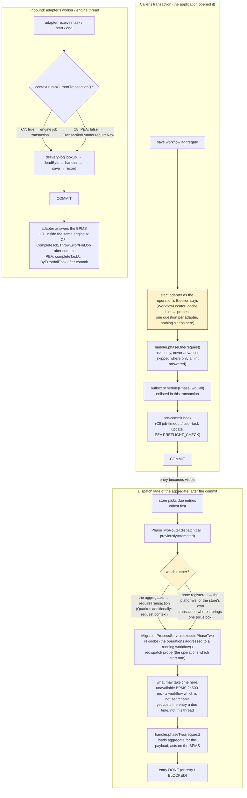

Some applications keep their aggregates in a system which the platform does not manage. Such an
application implements the runner itself. `TransactionRunnerResolver` (implemented per platform)
picks the runner in four steps:

1. The most specific `io.vanillabp.integration.spi.TransactionRunnerAware` bean which covers the
   aggregate class (`AwareSelection`). Interfaces count, and a bean which names the aggregate beats
   one which names an interface the aggregate implements. A tie ends the boot and names both beans.
2. A plain `TransactionRunner` bean of the application. It serves every aggregate which no aware
   bean covers.
3. The platform's own runner, if it can work at all. On Spring Boot that means a unique
   `PlatformTransactionManager` exists.
4. Nothing. That ends the boot with a message which guides. The aggregate and the outbox entry have
   to be written in one transaction, so such an application cannot start a single workflow.

The resolver also reports what the transaction COVERS (`TransactionCoverage`). A store which the
platform can tell is not covered gets a WARN. A combination for which it can name a fix ends the
boot, unless the application accepts it with `vanillabp.transactions.unguarded-aggregate-writes`.
A store the platform cannot judge, an `AggregatePersistenceAware` implementation which writes
wherever it wants, gets no comment. `MigrationProcessService.validateTransactionRunnerAtStartup()`
turns those verdicts into messages. It logs one line per aggregate, which names the runner that
serves it.

### Extensions

This section explains extensions to the people who change the core. What an extension AUTHOR has to
know is collected in one document, written for readers outside this repository:
[`EXTENSION-AUTHORS.md`](./EXTENSION-AUTHORS.md).

An extension takes part in two steps of the [deployment pipeline](#deployment-pipeline), through
`ExtensionWiringService<BPMN, PC>`:

|                           Method                            |                 Called                  |                                       Purpose                                        |
|-------------------------------------------------------------|-----------------------------------------|--------------------------------------------------------------------------------------|
| `getModelType()`                                            | at wiring time                          | the BPMN model type this extension understands, e.g. Camunda 7's `BpmnModelInstance` |
| `getProcessContextType()`                                   | at wiring time                          | the adapter's processing-context type this extension expects                         |
| `getOrder()`                                                | once, at startup                        | ordering among all wiring services of the same model type (default `0`)              |
| `wireBpmn(module, filename, bpmnProcessId, model, context)` | per executable BPMN process             | look at the model and wire the extension's own concerns to it                        |
| `startWorkflowProcessing(module, context)`                  | after the module was deployed           | start whatever uses that wiring (listeners, workers, …)                              |
| `stopWorkflowProcessing(module, context)`                   | on graceful shutdown (default: nothing) | stop it again                                                                        |

**Matching: an extension is either asked, or it is not.** An extension takes part in a module's
deployment only if BOTH declared types are assignable from the adapter's types: the model type AND
the processing-context type. So a Camunda 7 extension stays untouched while a Camunda 8 module is
deployed, and an extension declared against `Object`/`Object` sees every BPMS. Be aware of the
trade-off. An extension which wants to ADD to the adapter's processing context has to declare that
adapter's context type, and so it becomes specific to that BPMS. An extension which only reads the
model can stay generic.

**Ordering.** The adapter of the BPMS runs before every extension. It has wired a BPMN process
before any extension sees that process, and it processes workflows before any extension is
started. Shutdown is the mirror image: extensions first and adapters last. So nothing is stopped
while something else still feeds it. That promise lets an extension place what it adds to a model
relative to what the adapter put there, for example behind the last listener of a kind. It is
written for extension authors on the wiki page
[Extensions](https://github.com/vanillabp/adapter-platform-integration/wiki/Extensions), not only
in a javadoc.

The extensions among themselves are sorted by `getOrder()` ascending, once at startup. That order
is NOT promised. Two extensions which do not know each other cannot agree on a number, and two with
the same order run in the order in which the platform collected their beans.
`DeploymentServiceTest#theAdapterIsFirstOnTheWayUp` holds the promise for the way up, and
`#extensionWiringServicesAreStoppedBeforeAdapters` for the way down.

**An extension may define its own SPI.** `wireBpmn` is where an extension's own annotations come
alive. The Business Cockpit finds `@UserTaskDetailsProvider` methods there, just as VanillaBP finds
`@WorkflowTask` methods. Such an SPI belongs to the extension, **never to the VanillaBP core**. The
core knows nothing about user-task details, and an application which does not use that extension
must not see its annotations.

**Registration** depends on the platform. The dummy extensions in the test modules of both platform
integrations are the templates:

- *Spring Boot*: contribute a bean of type `ExtensionWiringService`, usually from an
  auto-configuration ordered after `SpringBootMigrationAdapterAutoConfiguration`. All beans of that
  type are collected. The adapters' deployment services are wiring services too, so they appear in
  the same collection, and the platform filters them out where only extensions are meant.
- *Quarkus*: the extension is a Quarkus extension. Its runtime module `@Produces` the wiring
  service (`@Singleton`, because such services usually have no no-arg constructor and so cannot
  get a client proxy). Its deployment module registers that producer via
  `AdditionalBeanBuildItem` with `setUnremovable()`. The platform looks up the beans through
  `Instance`, so ArC would otherwise remove them. Unlike adapters, extensions announce no build
  item.

**Configuration** belongs to the extension. On Quarkus it is an overlay
`@ConfigMapping(prefix = "vanillabp")`, if it wants to live under the `vanillabp.*` tree. On
Spring Boot it is a second `@ConfigurationProperties("vanillabp")` class. VanillaBP's own
configuration is available as the core object `MigrationAdapterProperties`, which can be injected
(adapter ids, workflow modules, prioritized adapters). That is usually all an extension needs to
know about the setup.

An extension which bridges to a BPMS needs one more answer from it: which adapter ids one adapter
TYPE serves. It registers one bridge per configured engine, the way an adapter registers one set of
beans per engine. `#adapterIdsOfType(adapterType)` is that answer. Filtering `adapterTypes()` is
not. An id named in `prioritized-adapters` needs no section of its own. And an application which
configures nothing at all has the id which the classpath derives. A migration setup relies on the
first rule and an application with a single dependency on the second. Decision 39 in
`DECISIONS.md` says why they live in one place.

**What holds the matching and the ordering.**
`DeploymentServiceTest#extensionWiringServicesAreFilteredAndCalled`,
`#subtypeExtensionIsNeitherWiredNorStarted` and `#wiringServicesAreSortedByOrder` in the core,
`DeploymentPipelineTest#extensionsWiredInOrder` and `#nonMatchingExtensionUntouched` against a
booted application.

#### The extension's own annotation: handler contracts

An extension brings annotations of its own. The Business Cockpit's details providers are the case
this was written for. The mechanics behind `@WorkflowTask` serve them too. The extension describes
what its annotation means and registers that description (`ExtensionHandlers#register`, a bean on
both platforms). VanillaBP finds the methods on the `@WorkflowService` classes, binds their
parameters, loads the workflow aggregate, calls the method and saves, all in one transaction.

```java
HandlerContract
    .of("business-cockpit", UserTaskDetailsProvider.class)
    .lookupKeys(annotation -> keysOf((UserTaskDetailsProvider) annotation))
    .coreParameters(WORKFLOW_AGGREGATE, TASK_PARAM, MULTI_INSTANCE)
    .parameterBinder(parameter -> parameter.getType().equals(PrefilledUserTaskDetails.class)
        ? Optional.of(HandlerContext::getPayload)
        : Optional.empty())
    .deliversReturnValue()
    .build();
```

|        Part of the contract         |                                                               What it decides                                                               |
|-------------------------------------|---------------------------------------------------------------------------------------------------------------------------------------------|
| annotation type                     | which methods belong to the extension; repeatable annotations are supported                                                                 |
| `lookupKeys(…)`                     | the keys one occurrence names; an EMPTY list means the method's own name, `EVERY_KEY` means every element of the process                    |
| `versions(…)`                       | the process versions one occurrence names, written as `@WorkflowTask(version = …)` writes them; an EMPTY list means every version           |
| `callsCarryTheProcessVersion()`     | that the calls of this contract name the version of their BPMN process wherever the BPMS reports one                                        |
| `theDeployedVersionNeedsAMethod(…)` | that the start ends if an element which the extension reports (`elementsOfTheDeployedModel`) has methods, but none for the deployed version |
| `coreParameters(…)`                 | which of the parameters VanillaBP binds itself may stand there (`@TaskId`/`@TaskEvent` are not among them, on purpose)                      |
| `parameterBinder(…)`                | the parameters of the extension's own SPI, recognized by type or by annotation                                                              |
| `deliversReturnValue()`             | whether what a method returns reaches the caller; without it a method has to be `void`                                                      |
| `validatingAnnotation(…)`           | what the extension checks about one occurrence of its annotation, while the scan holds the method which carries it                          |
| `neverSavesTheWorkflowAggregate()`  | that no method of this annotation ever writes the aggregate, so nothing is saved and nothing is warned about                                |

An invocation (`ExtensionHandlers#invoke`) names the keys it accepts, for example an element id
and a task definition. The method which NAMES any of them runs. Where none does, the method which
serves `EVERY_KEY` runs. So a catch-all may stand next to methods for single elements.
(`@WorkflowStartedByBpms` follows the same rule for its start events.) **Zero matches are legal**
and get an empty result. What to do instead is the extension's business (the Business Cockpit
passes its prefilled details through unchanged). Two methods which serve one key of one BPMN
process end the boot and name both, unless the versions they serve keep them apart. A call may
hand IN an aggregate instead of naming its ID. It may say that the aggregate is not to be saved.
And it may say that it runs in the transaction the caller is already in. An embedded BPMS needs
that, since Camunda 7 delivers its task events inside the engine's own transaction.

**The version of an event picks the method, with VanillaBP's own selection.** Where an extension's
annotation carries a version attribute, `versions(…)` reads it. The method then runs for the
versions it names, the way a `@WorkflowTask` method does. The specifications are the same ones,
version tags included, and a tag is resolved through the adapters' `ProcessVersionCatalog` here as
well. Two methods for one key end the boot only where their versions OVERLAP. So one method per
generation of a model is a fine way to write them, and the message names both methods with their
ranges. A method which names no version serves every version, and that is what every extension
written before this gets.

The call names the version (`HandlerCall.Builder#processVersion`). It is the version identifier
which the BPMS reports, not one made pretty for a screen. A contract whose calls carry one wherever
the BPMS reports one says so once (`callsCarryTheProcessVersion()`). Where it does not, a method
which names a version can never run, and the start says so for each such method. Under such a
contract, a method which names a version the BPMS does not hold is reported by the same startup
check which VanillaBP's own methods go through. One class answers all of this for the core and for
an extension (`ServedVersions`, decision 56 in the repository's `DECISIONS.md`). That is why the
tests of the three registries did not change when extensions were let in.

**An extension whose handlers only read says so while it is wired.** A call can already ask for a
handler to run without saving the aggregate afterwards. But a call says it too late for the warning
about a second writer. That warning is written while the methods are found, and at that moment
nobody has called anything. `neverSavesTheWorkflowAggregate()` is the same statement, made once on
the contract, and a contract which carries it gets no warning at all. It wins over the call. So a
call of such a contract saves nothing, whatever it asks for. Asking is not refused, because saving
is what a call does unless it says otherwise. The statement sits on the contract and not on the
extension, because one extension can have both kinds: a provider which reads and a notification
which writes. Those are two annotations, and so two contracts anyway (decision 50 in the
repository's `DECISIONS.md`).

**The order of the offered list decides which key wins.** The keys are walked in the order the
caller offered them. Every method is asked about one key before the next key is tried. So the
first key which some method serves wins, and the rank is the caller's list. The platform asks every
extension in the same order: the BPMN element id first, the task definition after it. The element
id is the identity everything moves to, and an extension built on that order survives the removal
of `taskDefinition` unchanged. That is why `hasHandler` takes a `List` and not a `Collection`: an
order which the caller does not have to promise is no order. The keys a METHOD declares have no
rank. The method which serves `EVERY_KEY` stays the fallback where no offered key is served at
all. Nothing checks that the element id really comes first, since a string does not say what it is
(decision 51 in the repository's `DECISIONS.md`).

**The start says what was wired.** Once a workflow module is deployed, the registry writes one line
per extension, workflow module and BPMN process. The line names the methods and the keys each of
them serves, and marks the catch-all as the one which serves every element. A developer whose
method is never called reads it. Everything it names is already in the registry, so the handler
contract needed no hook for it. A contract registered after the module was deployed writes its own
line when it arrives. A BPMN process for which an extension has no method is not named at all.
`ExtensionHandlerRegistryTest#theBootSaysWhatWasWired` holds the line in the core, and each platform
reads it from a booted application (`ExtensionHandlerWiringReportTest`).

**Which process variables the methods of an element read.** `taskParameterNames(annotation,
module, process, keys)` is the extension's counterpart of `WorkflowTaskWiring#taskParameterNames`.
An extension whose BPMS hands out only the variables it named asks it before the first event. The
scanner notes the `@TaskParam` names it binds per method. It leaves out a parameter which one of
the extension's own binders claimed. The registry walks the keys like `find` does, but for every
version at once. A key counts, and the walk stops at the first method which serves every version.
Otherwise the next key counts too, and in the end the catch-all. The answer is the union. So it may
name one variable too many, but never misses one (decision 121 in the repository's `DECISIONS.md`).
`ExtensionHandlerRegistryTest` and `ExtensionHandlerVersionsTest` hold the walk in the core, and
each platform reads the answer from a booted application.

**What every extension reads, asked by an adapter.** Some BPMSs hand a task to one channel only.
The Process-Engine-API is one of them. A task goes to exactly one subscription, so an extension
gets no channel of its own and reads what the adapter's subscription delivered. That subscription
has to fetch what the extensions read too, but the adapter does not know their annotations.
`WorkflowTaskWiring#extensionTaskParameterNames(module, process, keys)` answers it. The registry
walks the keys for each registered contract on its own, the same walk as above, and returns the
union over all of them. The adapter asks it next to `taskParameterNames` and fetches both. It is a
second method and not a wider answer of the first, so what `taskParameterNames` answers stays the
same (decision 122 in the repository's `DECISIONS.md`).
`ExtensionHandlerRegistryTest#theTaskParametersOfEveryExtensionAreUnited` holds it in the core, and
each platform reads it from a booted application.

**The order of registration does not matter.** Whether the extension's bean or the scan of the
workflow services comes first depends on what else the application does. So a contract registered
later is applied to the classes registered so far (decision 36 in the repository's
`DECISIONS.md`).

Behind it, `CoreParameterBinders` is the one place where the workflow aggregate, `@TaskParam` and
the multi-instance context are bound. It is shared with the scanners of `@WorkflowTask`,
`@WorkflowStartedByBpms` and `@WorkflowEnded`. That is why a parameter behaves the same wherever
it stands.

**What the contract cannot describe, the extension checks itself.** An annotation carries
attributes which only the extension understands: one whose value has to name something the
extension knows, or one which a version of the extension does not serve yet.
`validatingAnnotation(check)` runs such a check once per occurrence, while the scan holds the
method. A check which refuses by throwing ends the boot, with the annotation, the class, the method
and the extension in front of what it said. Without it, an extension walks the classes of the
application a second time to find the method, and that walk never sees the same methods. Both
scans read the PUBLIC methods of a workflow service class, and everything else about the second
walk is the extension's own guess about how a bean got there.

**A method the scan cannot reach is named, for an extension's annotation too.** A handler which is
not public, and an override which repeated no annotation, are lost the same way, whether the
annotation is `@WorkflowTask` or an extension's own. Both leave a developer looking at a method
they can read in their own source. So the startup report runs over the registered handler
contracts as well as over VanillaBP's own three annotations, once per class and annotation
(`HandlerMethodsNobodySees`). For an extension the result is quieter than an unserved task, and
worse: it simply behaves as if the application had never written the method.

**What the registry already knows about the application.** `workflowAggregateOf(module, process)`
answers the workflow-aggregate class a BPMN process works on, for primary and secondary processes
alike. `bpmnProcessesOf(module)` names every process which a `@WorkflowService` declares in a
workflow module. `bpmnTaskNameOf(module, process, activityId)` answers the `name` a modeller wrote
on an element, kept from what the adapter handed to `validateTaskWiring`. All three are what the
scan read from the annotations. That is why an extension asks, instead of scanning the beans again.
A second scan has to unwrap the proxies of a platform which the extension should not have to know
about, and it reads a different set of methods than VanillaBP does.

#### A service of the extension per workflow aggregate

`ProcessService<A>` is injected with the aggregate as its type argument, and the Business Cockpit's
`BusinessCockpitService<A>` wants to be injected the same way. An extension contributes an
`AggregateServiceFactory`: the interface it offers, plus how to build one for an aggregate. It gets
one bean per workflow aggregate of the application, from the same set of aggregates the process
services are built for.

Unlike `ProcessService`, injecting it is **optional**. The bean is built on first use, so an
application which never asks for the service never runs the factory. The factory gets an
`AggregateServiceContext`: the aggregate and its persistence, the workflow it belongs to, the
handler methods of the application, and the election.

The service interface has to take exactly one type parameter, the workflow aggregate. On Spring Boot
the interface is read from the factory's bean definition. On Quarkus it is read from the Jandex
index, so a factory has to be indexed. A runtime module with a Jandex index brings it along. One
without says so with an `AdditionalIndexedClassesBuildItem`.

#### Which BPMS holds this workflow

`WorkflowElection#adapterIdOfWorkflow` answers what an extension has to ask before it talks to a
BPMS about a running workflow. During a migration the answer changes per workflow, and addressing
the first-priority adapter would be wrong for every workflow which already moved.

It is the election every operation uses, in its READING shape. A workflow which ended is a regular
answer, the way the viewer API reads its history. A hint which points at an adapter whose read
model has not caught up is waited out, because nobody repeats the question for an extension either.
A workflow no BPMS knows, and a BPMN process this application does not serve, are errors with
guidance, which name what was asked.

An extension has to know about the waiting before it calls this. A read of the viewer API waits on
a thread which does nothing else. But an extension often asks this from inside a transaction of the
application. The Business Cockpit reports a change from a service task, and the entry it writes
belongs to the transaction which wrote the change. The wait then holds that transaction open, with
the connection and the locks which come with it. The section "What an election costs a caller which
holds a transaction" above has the numbers.

`WorkflowElection#locationOfWorkflow` is the same election, and it answers both halves of what
VanillaBP knows: the adapter id AND the BPMS' own id of the workflow, as a `WorkflowLocation`. Both
stand in the same row (the record of a task delivery keeps `WORKFLOW_ID` next to `ADAPTER_ID`). So
it would be an odd design to hand back the adapter id alone and make an extension ask again.

- It runs exactly the election which the older call runs, and costs exactly the same. The workflow
  id rides along. It does not replace the question. A variant which answers from the record
  without asking anybody would be fast and sometimes wrong, and it is not here, on purpose.
- Where the id comes from, in this order and without asking any BPMS: the open delivery records of
  that aggregate, then the election cache. A `null` id is a regular answer and means nobody knew
  one.
- What an extension may do with it: write it into its own records, print it next to ours, and hand
  it back to VanillaBP later. What it may not do: address the BPMS with it, because the shape of
  that id belongs to the adapter. And it may not read a non-null id as "this workflow still runs".
  The record is history. The election is the answer about now.
- The older call stays and keeps its meaning, so an extension written against 2.0 still compiles.
  Its default implementation delegates and leaves the id empty.

#### The extension's own configuration

An extension setting is written at four levels, and each level has two positions: what the level
says, and what it says for one adapter. That makes eight. The most specific position which writes
a key wins:

```
vanillabp.workflow-modules.<module>.workflows.<workflow>.tasks.<task>.adapters.<adapter>.extensions.<extension>.<key>  (most specific)
vanillabp.workflow-modules.<module>.workflows.<workflow>.tasks.<task>.extensions.<extension>.<key>
vanillabp.workflow-modules.<module>.workflows.<workflow>.adapters.<adapter>.extensions.<extension>.<key>
vanillabp.workflow-modules.<module>.workflows.<workflow>.extensions.<extension>.<key>
vanillabp.workflow-modules.<module>.adapters.<adapter>.extensions.<extension>.<key>
vanillabp.workflow-modules.<module>.extensions.<extension>.<key>
vanillabp.adapters.<adapter>.extensions.<extension>.<key>
vanillabp.extensions.<extension>.<key>                                                                                 (least specific)
```

The adapter positions exist because an extension hangs on every configured adapter separately. An
application which migrates from one BPMS to another runs two adapters of one type. A value which
has to differ between them now has a place.

The positions are merged KEY BY KEY. So a workflow may change one value and keep what the
application said about the rest. `MigrationAdapterProperties#resolveForExtension` reads one value,
and `#extensionProperties` reads the whole section. Both take the extension id as a parameter,
because the properties are one bean of the platform, while an extension is not a bean of the
platform at all. Both also come in a shape without the adapter id, which reads only the four
general positions. The two-argument `#extensionProperties(module, extension)` and
`#extensionProperty` are the same resolution, asked about the module alone.

An adapter setting uses the same rule and the same implementation (see `#resolveForAdapter` and
decision 7). So a change to "most specific wins" reaches both or neither. What the keys MEAN stays
the extension's business. The core keeps them as they were written. The extension binds and
validates its own, typed, the way an adapter binds the keys below its adapter id. Decision 7 in
this repository's `DECISIONS.md` says why an extension does not parse these keys itself.

`vanillabp.extensions.<extension>` is the section which VanillaBP binds itself, as flat text. An
extension may have a section of its own instead. The Business Cockpit is configured below
`vanillabp.cockpit`, where version 1 configured it. Then the extension binds its own typed tree and
hands one `SettingsLevel` per level to `SettingsResolution` of the extension SPI. That is the same
walk which `#resolveForExtension` uses. The order of the eight positions lives there and nowhere
else. Decision 7 says who owns the name of the section.

#### Operations of its own in the outbox

An extension registers phase-two operations with a namespace and with its own dispatch. See
[Operations of extensions](#operations-of-extensions).

The extension does not decide which store such an entry belongs in. `PhaseTwoOutboxResolver` is a
bean on both platforms. `#resolveFor(workflowAggregateClass)` answers the same store which the
workflow's own phase-two entries go into. That is the whole point, since only an entry in the
transaction of the aggregate is committed with it. What that store is depends on the persistence
VanillaBP resolved for the aggregate, on `PhaseTwoOutboxAware` beans of the application, and on
whether a platform default is switched on and usable at all. So an extension which picked a
`PhaseTwoOutbox` bean itself would be right only until the first application with two
persistences. An aggregate which nothing can serve gives an `IllegalStateException`, which names
the beans found and the remedy. `null` means the application has no outbox at all.
`#remediesDescription()` says what to add for the platform in use. So the extension ends its own
boot with a message a developer can act on.

`#allStores()` answers every store the application holds, including the ones which a
`PhaseTwoOutboxAware` bean names for a single aggregate. An extension which has to know whether all
its workflow aggregates share one store asks that, instead of listing the beans itself. Listing
them would miss an application whose stores all come through aware beans. The collection is
read-only and holds each store once. Its order is the platform's bean order, and a caller may not
build on it. A store which the resolver would never hand out is not in it, such as a Quarkus
platform default which is switched off or has no datasource.

The same holds for the transaction such an entry is written in. `TransactionRunnerResolver` is a
bean on both platforms. `#resolveFor(workflowAggregateClass)` answers the runner which the
workflow's own writes go through. That may well be one which the APPLICATION contributed: a
`TransactionRunnerAware` bean for that aggregate, or a runner which serves every aggregate no aware
bean covers. Where the application contributed nothing, the answer is the platform's own runner.
So the resolver is the entry point in every case, and the bare `TransactionRunner` is not. An
extension which injects that type would be ambiguous as soon as an application brings a runner.
And it would lose the attribution per aggregate which it needed in the first place. An extension
which opens a transaction of its own loses even more: `beforeCommit`, the rollback-only verdict,
and the detection of optimistic locking in the platform's own runner. `#describeResolutionFor` says
in words which transaction was resolved. A startup message of the extension can quote that.

**What holds all of this.** `ExtensionHandlerTest` and `ExtensionElectionAndConfigurationTest`
(Spring Boot, module `extension-integration-test`) and `ExtensionEnablementTest` (Quarkus, module
`deployment-integration-tests`). All of them run against the sample extension of their platform.
That is an extension built like the Business Cockpit, in miniature. Its dependencies are half the
point: the two SPI artifacts and the platform-neutral core, and no platform integration.

### Parts which do not belong together (`VanillaBpParts`)

An application puts together artifacts with several release cycles: the platform integration, the
BPMS adapters, and the extensions it uses. Each is released at its own pace. So an update can easily
leave behind a pair which was never built and never tested together. Neither Maven nor Gradle
reports it. A version which the application manages wins over the version a dependency asks for,
silently, and even if that means a downgrade. The build stays green, and the mismatch shows up
while the application runs, as a `NoSuchMethodError` or a `NoClassDefFoundError`, in a place which
seems to have nothing to do with the update.

Such an application does not start. Decision 71 says what the rule is and why. The mechanism is
`VanillaBpParts` in `integration-spi`, the module which both adapters and extensions have.

The numbers travel in the JARs. `vanillabp-integration-spi` carries
`META-INF/vanillabp/platform-version.properties` with its own version and with the oldest part it
still serves. Every part carries `META-INF/vanillabp/adapter-<type>.properties` or
`META-INF/vanillabp/extension-<name>.properties` with `part.version`, `part.artifact` and the
`platform.version` it was built against. Resource filtering fills all of them. The name of the part
is in the file name. That keeps the descriptors apart when several adapters are on the classpath,
which is the normal case during a BPMS migration.

The core asks, and the adapter asks too. The core judges every adapter and every extension it knows
at the start of `DeploymentService#deployResources`, before anything is deployed. It reports
everything it found in one boot. An adapter also asks for itself, in the constructor of its
deployment service. That is not a repetition. A platform integration older than the check cannot
contain the check, so an adapter is the only part which can report a platform that is too old.

Quarkus asks while it builds. `PartVersionsBuildStepProcessor` walks the archives of the
application, judges every descriptor it finds and ends the build. It also registers the
descriptors as native-image resources. Without that, a native image would find no descriptor at all
and turn every pair into an unknown one.

A part built against a newer platform integration ends the boot. So does a part older than the
oldest one the platform serves. A part which ships no descriptor, ships an incomplete one, or names
a version this check cannot compare only warns, once, and says that the pair is unknown. Versions
are compared by their numeric parts, and the qualifier is ignored. So `2.0.0-SNAPSHOT` satisfies a
required `2.0.0`.

The oldest part served is one number, `vanillabp.oldest-part.version` in the root `pom.xml`. It is
set on purpose with every release. A list of known pairs would have to name versions which do not
exist yet.

The tests pin the messages, not just the failure. `VanillaBpPartsTest` walks every case.
`PartsWhichDoNotBelongTogetherTest` (Spring Boot, `main-integration-test`) boots an application with
an adapter from the future and keeps the text it stops with, down to the artifacts which the
developer has to raise.

## The older versions a BPMS still holds

A BPMS keeps every version of a process it was ever given, while the application brings only its
newest model. So the question "does this application still serve version 1?" can only be answered
by the BPMS and the registry together. The check runs once per BPMN process after the module was
deployed, next to the resolution of version tags in `WorkflowTaskRegistry#resolveProcessVersions`.

The split follows the rule of this project: reading a model depends on the BPMS, deciding what it
means does not.

- The adapter answers the optional questions of `ProcessVersionCatalog`. `tasksOfVersion` reads
  the model the BPMS still holds and builds the same `BpmnTaskSpec` list which `wireBpmn` builds.
  (Both adapters extract that code once and use it for both directions, so the two cannot drift
  apart.) `activeInstanceCountOf` counts the workflows of that version.
  `concurrentTokenElementsOfVersion` names the elements of that model which can put a second token
  into one of them. That is the same walk which `reportConcurrentTokenElements` reports for the
  model of this boot. A BPMS which cannot answer returns `null`. That switches the half in question
  off, instead of inventing an answer.
- The adapter also reports what it deployed, through `WorkflowTaskInvoker#registerDeployedVersion`.
  That is the border between "the model this boot brought" and the older ones. It is what makes
  fading out the deployed version a boot failure. Watch out for the case where the BPMS deploys
  NOTHING, because the resources did not change. The version has to be reported anyway. Otherwise
  the check would only ever run on a boot which changed a model (Camunda 7 queries the latest
  version for that).
- The adapter answers one more question, and not while it deploys:
  `AdapterDeploymentService#processVersionCatalogOf` says what its BPMS holds for a BPMN process
  which the application declares without deploying a model under it. See "A BPMN process nothing
  was deployed under" below.
- `DeployedProcessVersionsCheck` owns the decisions and every message. It decides which versions
  are older, and which are faded out (`OutfadedProcessVersions`, the `outfaded-versions` property
  in the grammar of `VersionRange`). It decides which task definitions of a version nobody serves
  (`WorkflowTaskRegistry#tasksNotServedInVersion`, which knows about versions and marks nothing as
  wired). And it decides which methods serve no version worth serving at all
  (`handlersNotServingAnyVersion`, for all three annotations which carry a `version`).

The deployed version is checked as well. The wiring validation asks for a method for every task
before the deployment. At that point the version is not known, so it ignores the ranges. Right
after the deployment the check asks `WorkflowTaskRegistry#tasksTheDeployedVersionLeavesUnserved`.
That answers which task of the model this boot wired has methods, none of which covers the version
the BPMS gave that model. The check ends the boot over such a task. The tasks are the ones which the
adapter handed to `validateTaskWiring`, kept per adapter, so no model is read again. A task with no
method at all passed the wiring validation only through `implemented-externally`, and is left
alone. The reason is in decision 126 of the repository's `DECISIONS.md`, and
`TheDeployedVersionNeedsAMethodTest` holds the cases.

An extension can join this check. Its contract says `theDeployedVersionNeedsAMethod()`. Its
`wireBpmn` names the elements through `ExtensionHandlers#elementsOfTheDeployedModel`, each one as
the lookup keys which a call would offer. `WorkflowTaskRegistry#elementsTheDeployedVersionLeavesUnserved`
hands the check the tasks first, and then what `ExtensionHandlerRegistry` finds: an element whose
methods all miss the deployed version. An element with no method at all is left alone. One message
names both kinds. Each kind has its own sentence about what the gap means. See decision 127 in the
repository's `DECISIONS.md`.

Two rules apply to the reverse direction. A method whose version range excludes the deployed
version needs no task in the deployed model. Without that exception, an application could only
serve an old version by keeping a dead task in its current BPMN. The same exception applies to a
`@WorkflowStartedByBpms` method which names a start event the new model dropped. What those checks
used to catch is now caught by the warning about dead methods. That warning reports and does not
fail, because a version which does not exist YET is normal during a rolling deployment.

`DeployedProcessVersion#displayVersion()` is how such a version is written down for a person: the
version tag, a colon and the version the BPMS counted (`release-7:4`), or the counted version alone
where there is no tag (`4`). It is one spelling for every caller. So a cockpit, a log line and a
support tool name the same deployment the same way. `DeployedProcessVersionTest` holds both forms.

Every verdict the check can reach is a case of `OldProcessVersionsTest`, from
`anUnservedVersionWithInstancesIsAnError` and `anUnservedVersionWithoutInstancesWarns` to
`outfadingTheDeployedVersionFailsTheBoot` and `aMethodServingNoHeldVersionIsReported`.

### A name the current deployment no longer declares

The models from which a held version is read answer one more question: a message name or a signal
name which no model of this deployment declares any more. Workflows on that version wait at their
event for something which nothing sends. Nothing else says so, because the name lives in a model
the BPMS holds and in no file of the application.
`NameClashAvoidanceService#reportIdentifiersOfHeldVersion` reports it, next to the name clash it
was built for.

This covers messages and signals only. The model which carries an error code or an escalation code
also throws it. A task definition which nobody serves has its own check, which says more than this
one could. A version which no workflow is on says nothing, because nothing waits there. Neither
does an adapter which never reported what the current models declare, because then every old name
would look new.

The line says "look at it" and not "write this". A rename whose old workflows were finished by
hand looks exactly like a rename nobody finished.
`ANameTheCurrentDeploymentNoLongerDeclaresTest` holds every case.

### The multi-instance shape of a held version

Some elements iterate without naming the value of a round: a Camunda 7 element without
`camunda:elementVariable`, a Camunda 8 one without `inputElement`. Such an element hands a `null`
to a handler which reads its item. While a model is DEPLOYED, the adapter asks
`WorkflowTaskWiring#multiInstanceElementNames` and refuses that pair. A version which the BPMS
only still holds is never deployed again, so nobody asked. Yet the methods of the application serve
it, because their version ranges say so.

`BpmnTaskSpec#multiInstanceElementsWithoutAnItem` closes that gap. The adapter fills it from the
model it read for `tasksOfVersion`. The core compares it with what the methods which serve that
version read. `null` means that this adapter does not read the shape, and then nothing is asked at
all (decision 38). The finding is a warning in the block which a start writes at its end. Nobody
can change a held model any more, and a `null` item there may be what the application means.
`TheMultiInstanceShapeOfAHeldVersionTest` holds every case.

### A BPMN process nothing was deployed under

Renaming a BPMN process is the one refactoring which reaches into the BPMS. The old
`bpmnProcessId` stays there, with every version ever deployed under it and with the workflows
which still run on them. The application brings only the new name.
`@WorkflowService(secondaryBpmnProcesses = @BpmnProcess(bpmnProcessId = "<old id>", version =
"<the old versions>"))` is where the application says that it answers for both. The registry
follows the DECLARED ids, so a task of an old workflow finds its handler.

The declaration could not reach the check by itself. An adapter registers the versions of the
processes it just deployed, and nothing was deployed under the old id. So the versions the running
workflows are on were the only ones nobody ever looked at. The first news of a method somebody
dropped was an incident. The core closes that gap, because it is the only side which knows the
declarations. Once every adapter of a workflow module deployed, `DeploymentService` asks each of
them `processVersionCatalogOf(module, process)`, for every declared id for which
`wiringValidated` is false. It registers the answer like any other catalog. An adapter which
answers `null`, the default, keeps working exactly as before.

From there, three consequences run through the check:

- `deployedVersion` is `null` for such an id, and that now has two meanings. It can be a BPMS which
  counts no versions (nothing to check, as before). Or it can be an id under which nothing was
  deployed, where EVERY version the BPMS holds is an older one. `DeclaredBpmnProcesses` tells the
  two apart.
- The verdict "this method never runs" became a statement about the whole workflow module. Each
  method is registered once per declared BPMN process, with the range of that declaration. So a
  method kept for the old id serves none of the new id's versions, on purpose. The check collects
  what every process of the module can be served with, and draws the verdict once, in
  `reportDeadHandlers(module)`. `HandlerVersions` is the answer per registration which the three
  handler kinds give it.
- The reverse wiring check makes an exception for a method registered for an id which is only
  declared, the same way it does for one which serves only older versions: no model of this boot
  carries the task it is wired to. That is why the core asks the adapters BEFORE
  `validateNoUnwiredWorkflowTaskMethods`.

This exception leaves the `@WorkflowStartedByBpms` methods of such an id judged by nothing, and
that is a hole of its own. An adapter checks those methods against the start events it read while
it wired THIS boot's model. There is no such model here, while the BPMS may fire the old model's
timer every day. `ProcessVersionCatalog#startEventsOfVersion` is the question which closes it.
`BpmsInitiatedStarts#validateAgainstVersionsTheBpmsHolds` compares the union over every version
the BPMS holds under the id with what the methods name. Two cases are said out loud: a method which
names a start event that no held version has, and a declaration whose held versions start on their
own nowhere at all. Both are warnings which name the versions they come from, and they do not end
the boot. What was read are models nobody can change any more (decision 38 of `DECISIONS.md`).
Where one version cannot be read, the check says nothing about that BPMS at all, because the start
event might be in exactly that model. `StartEventsOfARenamedProcessTest` holds it.

An id which is only declared also gets the startup validations of the process service. Everything
which can be configured per workflow can be configured for it: its prioritized adapters, its
outbox, its transaction runner, what its leftovers were persisted under. Each of those questions
has its own answer per BPMN process id. So both platforms build one `MigrationProcessService` per
DECLARED id and run the validations over all of them, once per id. That way a message names the id
it is about. For a rename that is the whole point. Take an aggregate whose adapter the
configuration dropped: its persisted adapter id sits under the OLD id. If only the primary id were
asked, the problem would show up at the first operation, not at boot.
`SecondaryProcessValidationTest` holds it, once per platform.

The check is one half of what such an id needs. The other half is that its workflows keep being
served, and that half belongs to the adapters.
`WorkflowTaskWiring#taskWiringOfProcessesNobodyDeployed` is where they read the declared ids,
together with what the application serves for each of them. The registry answers that from the same
entries which the version question uses (`entriesNobodyDeployed`), so both talk about exactly the
same ids. Decision 34 of `DECISIONS.md` says why that method is named after the question, and not
after today's answer, which is the `taskDefinition` of a method. What an adapter does with them is
its own decision, because the need differs per BPMS. An identifier which does not carry the process
id reaches the old id by itself. A Camunda 8 job type under `use-prefix` does carry it, and the jobs
of those workflows then wait for a worker nobody opened. A method wired to a BPMN element id adds
nothing there. Reading an element's task definition needs the model, and the model is exactly what
is missing. So an id can be named with an empty answer.

Watch the numbering when you configure anything for such an id. Each BPMN process id is counted
from 1 by its BPMS. So the versions of the old id and of the new one are different things with the
same names. That is why `outfaded-versions` belongs at the workflow level
(`vanillabp.workflow-modules.<module>.workflows.<old id>.adapters.<adapter>.outfaded-versions`).
The same specification at adapter level would cover the version the application just deployed
under the new id, and end the boot for that reason. `RenamedBpmnProcessTest` holds all of it. The
wiki page
[Renaming a BPMN process](https://github.com/vanillabp/adapter-platform-integration/wiki/Renaming-a-BPMN-process)
has the recipe for a rename.

### What the check costs, and what it may cost in two years

One question for the versions the BPMS holds, then two per version older than the one this boot
deployed. Every one of them is a query. So this check is where a start would most easily begin to
grow, and it has to keep the rule of decision 19 of `DECISIONS.md`. A start asks for numbers, never
for the rows themselves. And how many questions it asks depends on the shape of the application,
not on its history.

Two places make that true, and both are easy to undo by accident. `InstanceCounts` inside the
check asks the BPMS once for the workflows of a version, and answers all three reports which want
that number from the memo. Before it existed, the same query went out three times per version. And
on the adapter side, the handle of an older version comes from the list of versions which was just
read, not from a query of its own. Both adapters do that in their `ProcessVersionCatalog`
implementations.

The number of versions may grow, one per deployment which changed a model. `outfaded-versions` is
the operator's way to cut it off. A BPMN process which the application declares without deploying
it counts as one more process, asked about like any other. That number follows the declarations in
the code, which change when somebody edits them. The guards count questions and do not measure
time: `OldProcessVersionsTest#theQuestionsDoNotDependOnHowManyWorkflowsRun` here,
`Camunda7StartupQuestionCostTest` and `Camunda8StartupQuestionCostTest` in the adapters.

## Only portable values reach the BPMS

The sync model says WHICH values of an aggregate travel. `PortableValuesCheck` says whether their
TYPES survive the way there and back. It runs right after the sync model was validated. That order
is the rule, not an accident of the startup sequence. If it ran first, the check would judge the
types of values which never leave.

The two directions are decided by different things.

Outbound, a value of the aggregate exists so that a model can decide on it, and the reader is the
expression language of the BPMS. Only the plain `boolean` and a text mean the same in every
expression language. So those two travel, and everything else has to be declared first. The
wrapper `Boolean` is refused with a sentence of its own, because a `null` in a gateway condition
means something different on every BPMS.

Inbound, only the handler reads a `@TaskParam`, so the serialization decides and nothing else. A
type is named there only where an adapter says its BPMS hands it back as something else, and where
the declaration names no type at all (`Object`, a raw collection, a `Map`).

What a BPMS does with a type is the adapter's answer:
`MigratableProcessService#whatThisBpmsDoesWith`, with a `ValueDirection` and a `ValueTypeVerdict`.
`CANNOT_SAY` is a valid answer and never ends a startup. Camunda 8 drops the scale of a decimal
inside the broker, and you need a running cluster to see that. An application whose BPMS cannot be
reached while it boots still has to boot. It costs one warning, which names the value and the
adapters which stayed silent.

The declarations are configuration. They are read once per workflow and kept per aggregate class in
`DeclaredAggregateValues`, which the sync model owns. The class is the key, because an adapter asks
for the shared values with the aggregate in hand and without naming a workflow.

`DeclaredAggregateValues` carries the second half of the story: a declared path of more than one
segment has to RESOLVE at every sync point. A section of a larger process usually sits as a
sub-object. While the section has not run, that object is `null`, so `shipping.express` reaches
the BPMS as nothing. That ends the sync with a message which names the path and the `null` link,
unless the declaration names what to share instead (`shipping.express=false`). Writing `false` on
its own would be the worst answer, since nobody can tell it from a computed `false`.

`PortableValuesCheckTest` and `DeclaredAggregateValuesTest` hold it. Both read the messages, not
only the fact that something was thrown.

## An expression in the model binds the data model

The section [Only portable values reach the BPMS](#only-portable-values-reach-the-bpms) asks what
the values which travel to the BPMS are worth. This one asks what the model DOES with them, and the
expression decides the answer. `${order.shipping.express}` binds the model in
two ways: to the shape of the objects behind the name, and to the expression language of that
BPMS. Rename the attribute in Java, and a model nobody touched stops working. Move to another BPMS,
and the expression stops working.

The wiki has recommended the way around it for years, on the page `Workflow-aggregates`: a getter
on the workflow aggregate which answers the question the model asks. Then the model reads
`${shippedAsNormalItem}` and survives both changes. What was missing is that anybody notices when a
model does it differently.

The work is split the way it is split for every other finding about a model. The adapter reads its
model and reports every expression it found through `WorkflowTaskWiring#reportModelExpressions`,
once per BPMN process. It includes the plain names, because the message counts them. The core
judges them in `ModelExpressionCheck`, and the rule it judges by is `ExpressionForm`: the name of
one variable, a path, a call, or a computation. The rule lives here and not in the adapter. So the
same expression gets the same answer, whichever BPMS it is deployed to.

The severities are the two halves of the binding:

|                         What the expression does                          |                      What it binds                      |                    What is said                     |
|---------------------------------------------------------------------------|---------------------------------------------------------|-----------------------------------------------------|
| names one variable (`shippedAsNormalItem`)                                | nothing                                                 | nothing - this is what we recommend                 |
| walks a path (`order.shipping.express`), calls something (`count(i) > 3`) | the shape of the data, the function library of one BPMS | a WARN naming the element, the place and the getter |
| computes (`not bigItem`, `amount > 1000`)                                 | the expression language, whose words differ             | a NOTICE, the smaller half of the story             |

Neither ends a deployment. An existing model would stop deploying over a matter of style. And a
check which reads expressions can misread one. That is also why anything the rule cannot place is
a NOTICE and not the loudest message. A process whose expressions are meant as they are says so
with `accept-expressions-in-the-model`. It is read at the workflow, the workflow module or the
application, and the most specific one wins. A process which no `@WorkflowService` class claims is
left out. Its model shares a file with the process which IS served, and asking for a change to a
file nobody here can change is no fix.

`ModelExpressionCheckTest` holds the rule. `ExpressionsInTheModelTest` of each platform holds the
whole way through a start.

## Two writers on one workflow aggregate

A workflow aggregate has one workflow, and that sounds like one writer, until the process holds a
second token. Then one branch writes in the transaction VanillaBP owns for its task. The other
writes in the transaction which the application opens around its API call. A persistence layer
writes the whole record, so the branch which commits second puts back what it read at its start.
We found this while building blueprints, three times: two branches of a boundary event, two
branches of an escalation, and two branches which write entities of their own that the aggregate
points at.

The core answers the part it owns, and only that part:

- Recognizing the conflict belongs to the platform. The core is plain Java and must not know
  `OptimisticLockingFailureException` or `jakarta.persistence.OptimisticLockException`. So
  `TransactionRunner#isConcurrentModification(Throwable)` asks the platform, through the same
  seam the transaction itself goes through. What does not depend on the platform sits in
  `AggregateWrite#causedByOptimisticLocking`: matching the exceptions of a persistence layer along
  the chain of causes, by NAME.
- One helper around the transaction, not one per call site. `AggregateWrite#inTransaction` runs the
  work (`requireNew` or `inCurrent`). If the failure is a conflict, it logs ONE ERROR with guidance
  and rethrows it unchanged. It sits at every place where the core commits a transaction of its
  own: `MigrationProcessService#executeWorkflowTask`, `BpmsInitiatedStartExecution` and
  `WorkflowEndedHandlers`. The operations an application calls itself (`startWorkflow`,
  `correlateMessage`, `aggregateChanged`, the task operations) save inside the CALLER's
  transaction. So their conflict shows up in the application's own commit. The application has to
  catch that one. That is why the wiki says so, and the core does not pretend to handle it.
- Nothing is retried. A handler may have called a remote API before the commit failed. A quiet
  retry would repeat that call and hide the failure at the same time. The adapter gets the original
  exception and maps it to its BPMS' retry rules.
- The startup hint is split the same way as the check of old versions. The adapter reads its model
  and reports the elements which can produce a second token
  (`WorkflowTaskInvoker#reportConcurrentTokenElements`). The core decides what it means.
  `ConcurrentTokenCheck` asks the aggregate class for a version attribute, by the SIMPLE name of
  the annotation, so JPA and Spring Data are covered without a dependency on either. It warns once
  per BPMN process where there is none. Compensation arrives through `reportCompensation` and not
  through the flat list, because a developer has to read WHICH throw event starts WHICH handlers.
  The text is the same, so both fold into one entry. An aggregate with a version attribute gets no
  warning, because then the collision is the exception above and not a lost write.
- The second writer which a dependency brings gets a hint the same way. `SavingHandlerCheck` warns
  once per BPMN process where an extension has handler methods which VanillaBP may save afterwards,
  and the aggregate has no version attribute. The warning names the extension and its annotation.
  An extension whose contract says that none of its methods ever writes is not reported, because
  then the save does not happen (see
  [handler contracts](#the-extensions-own-annotation-handler-contracts) and decisions 45 and 50).
- The hint also reads the versions which the BPMS still HOLDS. An older version with a parallel
  gateway, which the newest model dropped, keeps forking every workflow started on it. Those are the
  workflows which run longest. So a hint drawn from this boot's model alone misses the case which
  lasts. `DeployedProcessVersionsCheck` asks
  `ProcessVersionCatalog#concurrentTokenElementsOfVersion` for every older version which
  workflows still run on. (A version which no workflow is on can lose nobody's update, and it is
  not even read.) It hands what it found to the same check, which names
  the versions that carry the elements. It stays ONE warning per BPMN process. The message is about
  an aggregate which cannot survive two writers, and saying it once per version an application
  ever deployed would bury it. Where both would speak, the deployed model speaks first, because it
  is the one a developer can still change. `ConcurrentTokensOfHeldVersionsTest` holds all of it.

`AggregateWriteConflictTest` holds the classification and the report
(`optimisticLockingIsRecognizedByName`, `conflictIsReportedAndPropagated`,
`otherFailuresArePassedThroughSilently`, `theWarningIsGivenOncePerProcess`). Each platform runs
the same conflict through a booted application.

## What a start says about itself

A start used to report each of its findings where it found it. So they stood between the lines of
every other library. Now a check reports its finding to `StartupFindings`, and the whole start says
it once, at its end, as one block between two rulers:

```
------------------------------------------------------------------------------------------------------
VanillaBP 2.0 looked at this application and found 2 things worth a look. None of them stopped the start.

CONFIGURATION (1)
  vanillabp.outbox.housekeeping
      The housekeeping of the VanillaBP outbox runs from 04:00 to 05:00 UTC, because this JVM stands
      on 'Etc/UTC' and no time zone was configured for it. [...]

DEPLOYED VERSIONS (1)
  process 'loan-approval', adapter 'cloud'
      Version 2 of BPMN process 'loan-approval' [...]
------------------------------------------------------------------------------------------------------
```

A few rules hold it together.

The block is written in ONE call of the logger. If it were written line by line, the next library
would write into it.

The headings are the artifacts in which a fix lies: parts and versions, configuration, code, BPMN
models, the versions a BPMS still holds, stored state, infrastructure. They come in the order in
which a developer walks them, each with a count a reader can skim. `StartupTopic` is that list.

An application with nothing to notice gets nothing. No ruler, no heading, no empty message.

What ENDS a start is collected too, and thrown once, grouped and counted the same way. So a
developer who got two things wrong learns about both in one start. What was noticed before the
refusal is written first. A warning does not become less true because a later check ends the start.
A check which cannot let the start go on throws where it stands, and says so in its javadoc.

The end of a start is `DeploymentService#endOfStartup`, and the platform integration says when that
moment has come. On Quarkus it is right after `startWorkflowProcessing`, in the same observer of
the startup event, because nothing a start can notice comes later there. On Spring Boot it is the
end of the deployment, inside the lifecycle. The start of the workflow processing waits for
`ApplicationReadyEvent`, and a context which is only refreshed never fires it. So a block which
hung on that event would never be written at all. On Spring Boot, what the start of the workflow
processing notices is therefore a late finding. What Quarkus refuses while it BUILDS never reaches
the block, and an application which was never built never starts.

A finding carries its scope next to its text, not inside it. The same finding arrives once per
workflow module, per BPMN process, per adapter id and per method. Two findings of one topic with
the same text become one entry which names both scopes. That also replaced the memories which the
checks used to keep so that they would not repeat themselves. A check which reports after the start
is over keeps its own memory, because there is no block left to fold its lines into.

A start which ends on something else writes the block too, from
`sayWhatWasFoundBeforeTheStartFailed`, and throws nothing. A database which is not there ends a
start just as surely as a check does. What was found by then is what a developer needs next to that
exception.

A reason not to start which is already known ends the start before the deployment and before the
workflow processing. Those are the two steps which reach outside this application. Nothing is
deployed to a BPMS for an application which is about to end, and no adapter is told to hand out
tasks for one. It also decides which message a developer reads where both would speak: the one
which named a gap in their application, not the one the deployment runs into afterwards.

A finding which arrives after the block was written goes into the log where it was found. Two
checks report that late on purpose: what a dispatch learns about an adapter id nobody configures
any more, and what an adapter notices while it runs.

An adapter reports into the same block. `StartupReport` in the integration SPI is the reporting
half of `StartupFindings` and nothing else. Both platform integrations publish one instance per
application, and an adapter asks for that bean like any other. Decision 97 says why it is a bean
and not part of the adapter SPI. What an adapter has to know about the two strings it hands over
is in `ADAPTER-AUTHORS.md`, section "Saying what a start found".

`TheBoxAtTheEndOfAStartTest` holds every word of it, the shape included.
`AnAdapterReportsIntoTheSameBoxTest` holds the half an adapter sees.

## What an operator gets to see

Three things about one delivery are built in the core, because every BPMS passes through it. The
delivery is counted and measured. The log lines written while it runs name the workflow. And the
adapters answer a health question which the platform publishes.

`MigrationProcessService#executeWorkflowTask` is the one place all of it hangs on. The transaction
is opened there, so a timer around it measures the handler plus the commit, not the handler alone.
And there a delivery which throws still produces an outcome to count. Everything the adapters do
happens before it, and everything the application does happens inside it. Nothing had to be
repeated per BPMS.

- `VanillaBpMetrics` is plain Java with a no-op `NONE`. `MicrometerVanillaBpMetrics` implements it
  plus `MeterBinder`. That is the same wiring with optional Micrometer which the election cache
  uses (`WorkflowAdapterCacheMeters`), and reusing it is the point. Both platforms apply
  `MeterBinder` beans to their registries by themselves, so no code of ours ever asks for a
  registry. Before the binding there is no registry and every record is dropped. That is the
  normal state while beans are built.
  The meters are cached per combination of tags, because a delivery must not pay for its own
  measurement. The tag values are what a deployment fixes: adapter id, workflow module, BPMN
  process, task definition, operation. Never an aggregate id or a job key. Those would grow one
  time series per workflow, and they belong in the log anyway.
  Two of the counters are not about a delivery at all. `vanillabp.outbox.discarded` says how often
  an operation which the application asked for was NOT planned, because the outbox found one with
  the same idempotency key still waiting for its dispatch. Which of two causes it was cannot be told
  here. A redelivered dispatch of a recorded call loses nothing. A second, legitimate operation
  with the same key loses everything and leaves a workflow waiting for a message nobody sends
  again. That is why it is a counter and not only a log line. Put an alarm on it, read the WARN it
  comes with, and where the cause is a repeating scope, vary the correlation id per round or element
  (see [phase one and phase two](#phase-one-and-phase-two-phasetwooutbox-spi)).
  And `vanillabp.task.elections.from.record` says
  how often a call which names a task was routed without asking any BPMS. The next step of that
  feature is decided on that number, see [the record answers which BPMS holds a
  task](#the-record-answers-which-bpms-holds-a-task).
- `vanillabp.task.deliveries.unknown.workflow` counts the deliveries which the core refused because
  the application holds no workflow aggregate with the id the BPMS named
  (`DeliveryOfAnUnknownWorkflowException`, thrown where `loadById` answers nothing). The usual cause
  is two applications on one BPMS which deploy a BPMN process with the same name, so a worker of one
  takes the work of the other. Nothing is written into the delivery store for it. That record would
  sit in the application which wrongly received the task. But whoever investigates reads the
  records of the application which owns the workflow, and there it would be missing. The counter
  answers "does this happen often?", which is the question people ask the second time such an
  incident shows up. `MigrationProcessServiceTest` holds the wording of the refusal, its facts and
  the counting.
- `DeliveryMdc` is a `try`-with-resources which remembers the previous values of its six keys and
  puts them back. So a thread which the application uses for other work is handed back unchanged.
  It is used around the task delivery and around the phase-two dispatch in `PhaseTwoRouter`. That is
  where a broken BPMS connection does its logging.
- Health is `AdapterDeploymentService#checkHealth()`, which defaults to `null`. Absent is honest.
  `UP` would be a claim nobody checked. And an adapter written before this existed keeps working.
  `AdapterHealthReport` collects the answers. It turns a thrown exception into `DOWN`, because a
  health endpoint has to answer even when an adapter misbehaves. It computes the overall status,
  where `UNKNOWN` is not worse than `UP`: an adapter which is not configured yet is not an outage.
- `vanillabp.outbox.blocked` counts the entries a store gave up on, tagged `store`, `operation` and
  `permanent`. It has to exist next to the backlog gauge and cannot be read from it, because a
  blocked entry stops waiting. `vanillabp.outbox.pending` falls at the very moment an operation was
  lost, so on its own it reads as if the backlog had drained. Every store counts one where it
  writes the block: whether the adapter called the failure permanent,
  `vanillabp.outbox.block-after-attempts` ran out, or the entry waited longer than
  `vanillabp.outbox.wait-for-visibility-at-most` for its BPMS. The three stores of this repository
  do it, and so does the gruelbox store of `io.vanillabp:gruelbox-phase-two-outbox`. So the number
  means the same on every store.
- The outbox backlog is `PhaseTwoOutbox#pendingCalls()`, an `OptionalLong` which defaults to empty.
  A store which cannot count publishes no gauge. That is honest, where a zero would not be. The
  three stores of this repository implement it with one indexed count. gruelbox has no API for it.
  So the gruelbox store, in its own artifact, reads the table gruelbox created, along the index
  which gruelbox created with it.
  On Quarkus a `StartupEvent` observer registers the gauges, and it runs AFTER the outbox
  dispatchers, because a store which is asked before its table exists cannot count.
- A count cannot tell a backlog which is being worked off from one which stands still. So two more
  meters say what happens in the gap between the transaction and the BPMS.
  `vanillabp.outbox.dispatch.lag` is a timer per `store` and `outcome`. It measures from the moment
  the entry was written to the end of the attempt. A failed attempt is measured too, because the
  operation is still owed, and the next attempt is measured from the same moment again.
  `vanillabp.outbox.oldest.pending.age` is the gauge next to `vanillabp.outbox.pending`, in
  seconds, read from `PhaseTwoOutbox#ageOfOldestPendingCall()`. An empty outbox answers zero,
  which is a measurement. A store which cannot read its oldest entry answers empty, which leaves a
  gap. Both are for the store to report, because only the store knows when an entry was written.
  Every store VanillaBP owns reads it from a column of its own, the JDBC one from `CREATED_AT` on
  both platforms. The gruelbox store, which lives in an artifact of its own, publishes no age. It
  puts the moment of writing into `nextAttemptTime` and overwrites it the first time a flush picks
  up the entry. So the entries which are most likely to be old are exactly the ones which cannot
  say. Its wait is measured for the entries which were submitted right after their commit, where
  the moment is still there.

`MicrometerVanillaBpMetricsTest` holds the counting, the tags, the two outbox meters above and the
records dropped while no registry is bound. `AdapterHealthReportTest` holds the health verdicts,
including `unconfiguredAdapterDoesNotDragTheApplicationDown`. `DeliveryMdcTest` holds that the keys
are put back afterwards. `ObservabilityTest` and `OutboxMetricsTest` run all of it through a booted
application per platform.

### Reading a metric must not cost anything

A counter is a number we already hold. A gauge is a question asked at the moment somebody collects,
and `outbox.pending` asks a database. Prometheus collects every fifteen seconds by default, a
dashboard collects next to it, and every instance answers each of them. So a gauge which queries
turns watching a system into load on it. Nobody expects that looking is expensive, and that is
exactly why it has to be designed in and not just remembered.

`CachedGaugeValue` (adapter SPI, `io.vanillabp.integration.adapter.spi.observability`) is how it is
kept cheap. It holds one measurement for `vanillabp.metrics.gauge-cache` (`MetricsProperties`,
default ten seconds; `PT0S` switches the holding off, for a test which needs the real value).

Three decisions inside it are worth knowing before you change it:

- It sits in the adapter SPI, not in this module's runtime. A BPMS adapter registers gauges of its
  own and owes the same promise, and the adapters depend on the SPI. What does NOT belong in it is
  a value which is already in memory, such as a counter or the free permits of a semaphore. Holding
  those would only make them stale. Camunda 8's execution slots are that case.
- Collectors which come at the same time take turns on a lock, and do not race. The second
  collector waits for the first one's answer and then finds it fresh. So eight collectors at the
  same moment are one query and not eight. Handing the second one a stale value instead would be
  cheaper, and we rejected it. On the first collection there is nothing stale to hand out, and the
  wait is bounded by the query which the first collector already pays for.
- A measurement which throws is answered as absent for the rest of the window, and taken again in
  the next one. Not caching the failure would hammer a database which is down. Caching it forever
  would poison the gauge. The exception never leaves the class, because a metric must not be the
  reason an application fails.

The wrapping happens in `MicrometerVanillaBpMetrics#registerPendingOutboxEntries` and
`#registerAgeOfOldestPendingOutboxEntry`, not in the platform modules and not in the stores. There
is one place per gauge, so a store cannot forget it.

`CachedGaugeValueTest` holds the window, the collectors which take turns, and the failure which
does not stay: `oneMeasurementPerWindow`, `concurrentCollectorsShareOneMeasurement`,
`aFailureDoesNotStay`, `aZeroWindowSwitchesTheHoldingOff`.

## Modules

1. **integration-spi:** (artifact `io.vanillabp:vanillabp-integration-spi`)<br>
   Interfaces which business code may implement. They are kept strictly apart from the adapter SPI,
   so business code never sees interfaces meant for adapter implementations. The module holds
   `io.vanillabp.integration.spi.AggregatePersistenceAware`, the one canonical persistence
   abstraction used on all platforms. It holds the outbox contract
   (`PhaseTwoOutbox` incl. `PhaseTwoCall`/`PhaseOperation`, plus the
   attribution per aggregate, `PhaseTwoOutboxAware`). And it holds the transaction the work runs in
   (`TransactionRunner` plus the attribution per aggregate, `TransactionRunnerAware`).
   APPLICATIONS contribute custom outboxes and custom transactions, adapters do not, so these types
   live here. (The outbox types moved here from the adapter SPI.) Applications get the module
   transitively through the platform support modules (`vanillabp-spring-boot-support`
   / `vanillabp-quarkus-support`).
2. **extension-spi:** (artifact `io.vanillabp:vanillabp-extension-spi`)<br>
   `ExtensionWiringService`, which prepares a BPMN model and wires it with business code. Plus what
   an extension needs beyond the pipeline: the handler contracts for annotations of its own
   (`handler`), the service per aggregate which it offers (`service`), and the election
   (`election`). The module has no dependency at all. So an extension can be built against it
   without pulling in the adapter SPI, which it does not implement.
3. **adapter-spi:** (artifact `io.vanillabp:vanillabp-adapter-spi`)<br>
   The SPI which BPMS adapters and platform integrations implement: `AdapterDeploymentService`
   (extends `ExtensionWiringService`) and `MigratableProcessService` (incl. `WorkflowAwareness`).
   Adapters report BPMN parse errors with `BpmnParseException`. They guard themselves against a
   platform integration they do not belong to with
   [`VanillaBpParts`](#parts-which-do-not-belong-together-vanillabpparts), which lives in
   `integration-spi` because extensions use it as well. The module depends on `extension-spi` (the
   interface `AdapterDeploymentService` extends) and on `integration-spi` (it uses
   `AggregatePersistenceAware` in signatures).
4. **runtime:**<br>
   This module implements the runtime behaviour of the features [listed above](#features). Its
   main classes are `DeploymentService` (the deployment pipeline, incl. the shutdown pass and the
   deployment-failure policy), `MigrationProcessService` (the runtime per process, which the
   platform integrations' `ProcessService` beans use) and `MigrationAdapterProperties` (the
   configuration model, incl. validation and the resolution of the deployment-failure policy). The
   validation is the one platform-neutral implementation. The platform transformers only map the
   bindings of their platform and check what only the platform can know.

## Noteworthy & Contributors

[VanillaBP](https://www.github.com/vanillabp/spi-for-java) was developed by [Phactum](https://www.phactum.at) with the
intention of giving back to the community as it has benefited the community in the past.


## License

Copyright 2025 Phactum Softwareentwicklung GmbH

Licensed under the Apache License, Version 2.0
